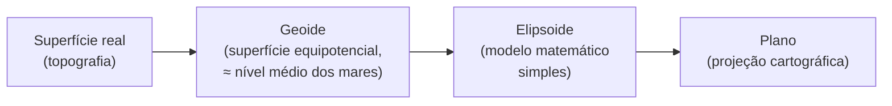

# Geoinformação e Cartografia

Antes de abrir o Google Earth Engine, precisamos de alguns conceitos de **geoinformação** que dão sentido aos dados que ele manipula. Este capítulo responde a três perguntas: o que torna uma informação *geográfica*? Como representamos a superfície curva e irregular da Terra em um plano? E o que são os sistemas que tratam computacionalmente essa informação?

---

## 🌎 A geoinformação e sua relevância

Tudo acontece em algum lugar e em algum momento. Algumas ciências, porém, estudam de modo explícito os fenômenos cuja localização importa: fenômenos naturais, como rios, formações rochosas e áreas de floresta, ou sociais, como segregação urbana, violência e epidemias.

Um dos exemplos mais citados da força do raciocínio espacial é o de **John Snow** durante a epidemia de cólera em Londres, em 1854. Ao marcar num mapa as residências das vítimas, Snow percebeu que os casos se concentravam em torno de uma bomba d'água pública na Broad Street — numa época em que a teoria dominante atribuía a doença ao "ar ruim". O mapa não era apenas uma ilustração: foi o instrumento da descoberta.

Segundo Longley et al. (2013), **geoinformação** (ou informação geográfica) é aquela que possui **tempo e espaço bem definidos**. Os autores ilustram a ligação entre atributo, espaço e tempo com a afirmação:

> *"A temperatura ao meio-dia local na latitude 34 graus e 35 minutos norte, longitude 120 graus e 0 minutos oeste, era 19 graus Celsius."*

Há um atributo (temperatura = 19 °C), uma localização (34°35'N, 120°0'W) e um tempo (meio-dia local). Às vezes, parte dessa informação fica implícita. Em *"A altitude do Monte Everest é de 8.848 metros"*, a localização está subentendida no nome próprio, e o tempo também — a altitude de uma montanha varia muito lentamente. (Curiosidade: uma medição conjunta de China e Nepal, divulgada em 2020, atualizou esse valor para 8.848,86 m.)

### A primeira lei da geografia

Se a localização importa, é porque os fenômenos **não se distribuem aleatoriamente no espaço**. Waldo Tobler sintetizou essa ideia no que ficou conhecido como a *primeira lei da geografia* (1970):

> *"Todas as coisas estão relacionadas com todas as outras, mas coisas próximas estão mais relacionadas do que coisas distantes."*

Essa lei está por trás de boa parte das técnicas que veremos: da interpolação de dados de estações meteorológicas às operações de vizinhança em imagens (Capítulo 8).

---

## 🗺️ Representando a Terra em um plano

Para registrar uma posição (latitude e longitude) e, depois, desenhá-la em um mapa, precisamos resolver um problema nada trivial: a Terra **não é uma esfera perfeita**, como o globo que alguns temos sobre a mesa. Sua superfície é irregular, e sua forma é achatada nos polos.

### Geoide e elipsoide

A primeira aproximação usada pela geodésia é o **geoide**: a superfície de igual potencial gravitacional que coincide, aproximadamente, com o nível médio dos mares prolongado sob os continentes. Ele é influenciado pela distribuição de massa da Terra e pela sua rotação — e **não** é a mesma coisa que a superfície topográfica real.

O geoide se aproxima muito bem da forma da Terra, mas não possui uma descrição matemática simples, o que o torna inadequado para cálculos de posição. Por isso, a Terra é modelada matematicamente por um **elipsoide de revolução**: uma elipse girada em torno do eixo menor, definida por poucos parâmetros (semieixo maior e achatamento).

### Datum

Escolher um elipsoide não basta: é preciso dizer **como ele está posicionado e orientado** em relação ao geoide. O conjunto de parâmetros que define um sistema geodésico de referência — o elipsoide, sua posição e sua orientação em relação à Terra — é chamado de **datum planimétrico**.

Os *data* podem ser classificados de acordo com a forma como o elipsoide é "amarrado" ao geoide:

- **Topocêntricos (locais):** o elipsoide é ajustado para coincidir o melhor possível com o geoide numa região, a partir de um ponto de origem na superfície. Ex.: **SAD 69** e **Córrego Alegre**, usados historicamente no Brasil.
- **Geocêntricos (globais):** o centro do elipsoide coincide com o centro de massa da Terra, o que os torna compatíveis com sistemas de posicionamento por satélite. Ex.: **WGS 84** (usado pelo GPS) e **SIRGAS 2000**.

!!! info "SIRGAS 2000 no Brasil"
    O SIRGAS 2000 é o sistema geodésico oficial do Brasil desde 2005, e o período de transição para abandono do SAD 69 terminou em 2015. Ainda assim, muitos projetos e bases legadas continuam em SAD 69 ou Córrego Alegre: ao combinar dados de fontes diferentes, **verifique sempre o datum**. Na prática, SIRGAS 2000 e WGS 84 são considerados compatíveis: a diferença entre eles é desprezível para a maioria das aplicações de geoprocessamento.

### Projeções cartográficas

O último passo é transferir as feições da superfície curva do elipsoide para uma **superfície desenvolvível** — que pode ser "aberta" sem rasgar nem esticar: o plano, o cilindro ou o cone. Esse método é a **projeção cartográfica**.

Uma boa forma de sentir o problema é tentar achatar a casca de uma laranja sobre a mesa: ela inevitavelmente rasga ou se deforma. Toda projeção introduz **distorções** em pelo menos uma destas propriedades: **área**, **distância** (escala), **direção** e **forma**. Por isso, as projeções são classificadas pela propriedade que preservam:

| Classe | Propriedade preservada | Exemplo típico |
|---|---|---|
| **Conformes** | Ângulos em torno de qualquer ponto; logo, a forma de pequenas regiões | Mercator, UTM |
| **Equivalentes** | Áreas (a proporção entre áreas no mapa e no terreno é constante) | Cônica equivalente de Albers, Mollweide |
| **Equidistantes** | Distâncias (escala uniforme) ao longo de certas linhas | Equidistante cilíndrica |
| **Afiláticas** | Nenhuma das anteriores; buscam um compromisso entre as distorções | Robinson, Policônica |

!!! warning "Não existe projeção perfeita"
    Uma projeção não pode ser, ao mesmo tempo, conforme e equivalente. A escolha depende do uso: para navegação e mapeamento de detalhe, preferem-se projeções conformes (como a UTM); para comparar áreas — por exemplo, o desmatamento de dois estados —, prefira projeções equivalentes. A famosa projeção de Mercator, usada pela maioria dos mapas web, é conforme e por isso **exagera muito as áreas** perto dos polos: a Groenlândia parece do tamanho da África, que é cerca de 14 vezes maior.

### Sistemas de referência de coordenadas e códigos EPSG

Um **Sistema de Referência de Coordenadas (SRC)** reúne tudo o que é necessário para interpretar um par de coordenadas:

- **Datum geodésico** — define a forma, o tamanho e o posicionamento do modelo da Terra (ex.: WGS 84, SIRGAS 2000);
- **Projeção cartográfica** — quando houver, transforma a superfície curva em um plano (ex.: Mercator, UTM);
- **Unidades de medida** — como as coordenadas são expressas (graus, metros).

Um SRC sem projeção é chamado de **geográfico**: as coordenadas são latitude e longitude, em graus. Um SRC com projeção é chamado de **projetado**: as coordenadas são planas (X, Y), normalmente em metros.

Como existem milhares de SRCs, a indústria padronizou identificadores numéricos para eles: os **códigos EPSG**, criados pelo *European Petroleum Survey Group* e hoje mantidos pela IOGP. Cada código identifica um SRC completo, com datum, projeção e parâmetros. Alguns que você encontrará com frequência:

| Código | Descrição | Uso comum |
|---|---|---|
| **EPSG:4326** | WGS 84, coordenadas geográficas (graus) | GPS, GeoJSON, Google Earth Engine |
| **EPSG:3857** | WGS 84 / Pseudo-Mercator (*Web Mercator*) | Mapas web (Google Maps, OpenStreetMap) |
| **EPSG:4674** | SIRGAS 2000, coordenadas geográficas | Dados oficiais brasileiros (IBGE) |
| **EPSG:31983** | SIRGAS 2000 / UTM zona 23S | Medidas em metros na região de São Luís (MA) |

Veremos esses códigos novamente no GEE (Capítulo 4) e no PostGIS, onde eles aparecem como o **SRID** de cada geometria (Capítulo 14).

---

## 💻 Sistemas de informação geográfica

O termo **sistemas de informação geográfica (SIG)** "é aplicado para sistemas que realizam o tratamento computacional de dados geográficos" (CÂMARA, 2005). Longley et al. (2013) detalham: SIGs são ferramentas computacionais para **coletar, armazenar, processar, analisar e visualizar** informação geográfica. Os autores ainda propõem uma visão de **seis componentes**: a rede (que conecta usuários e dados), o *hardware*, o *software*, os dados, os procedimentos e as pessoas.

Geoprocessamento, por sua vez, "denota a disciplina do conhecimento que utiliza técnicas matemáticas e computacionais para o tratamento da informação geográfica" (CÂMARA et al., 2001). Ele abrange desde a **coleta** (cartografia, sensoriamento remoto, fotogrametria, GPS) até o **armazenamento** (bancos de dados geográficos) e o **tratamento e análise** (modelagem, geoestatística, análise espacial).

### A evolução da arquitetura dos SIGs

A arquitetura dos SIGs evoluiu em três gerações, de acordo com o papel dos sistemas gerenciadores de banco de dados (SGBDs):

| Geração | Geometrias e índices | Atributos | Acesso |
|---|---|---|---|
| **1ª** | Arquivos proprietários | Arquivos proprietários | API proprietária do SIG |
| **2ª — arquitetura dual** | Arquivos proprietários | SGBD relacional | API proprietária + SQL |
| **3ª — arquitetura integrada** | SGBD com extensão espacial | SGBD | SQL |

Na terceira geração, o SGBD armazena tudo — atributos **e** geometrias. Os SIGs atuais tendem a usar essa abordagem, e os arquivos ficaram restritos, cada vez mais, ao papel de formato de importação e exportação. Essa arquitetura é o tema central da [Parte 2](../parte2/00_plano_parte2.md).

Exemplos de SIGs incluem os livres **QGIS**, **SPRING** e **TerraView** (os dois últimos desenvolvidos pelo INPE) e o proprietário **ArcGIS**.

### E onde fica o Google Earth Engine?

Goodchild et al. (2012) observam que a oferta de dados de sensores orbitais e terrestres cresceu tão rapidamente que se fala em um novo paradigma científico, "intensivo em dados", que enfatiza colaboração internacional, grandes recursos computacionais e visualização avançada. Diante de volumes de petabytes, vale a observação atribuída a Jim Gray: *"muitas vezes é mais eficiente mover as perguntas do que mover os dados"*.

O Google Earth Engine é exatamente isso: uma plataforma em que os dados e o processamento ficam na nuvem, e o usuário envia apenas as perguntas — na forma de pequenos *scripts*. Ele não substitui um SIG de *desktop* em todas as tarefas (edição vetorial detalhada e cartografia final, por exemplo, são melhores no QGIS), mas é imbatível no processamento de grandes coleções de imagens. É o que começaremos a explorar no [Capítulo 3](03_conhecendo_gee.md), depois de entender, no próximo capítulo, o que essas imagens realmente medem.

---

## 📝 Síntese

- **Geoinformação** é a informação com tempo e espaço bem definidos; a primeira lei da geografia explica por que a localização importa.
- A Terra é modelada pelo **geoide** (físico) e pelo **elipsoide** (matemático); o **datum** posiciona o elipsoide; a **projeção** leva-o ao plano, sempre com alguma distorção.
- Um **SRC** combina datum, projeção e unidades, e é identificado por um **código EPSG**.
- **SIGs** tratam computacionalmente a geoinformação; sua arquitetura evoluiu dos arquivos proprietários para o SGBD espacial integrado.

## ✏️ Exercícios

1. Identifique o atributo, a localização e o tempo em: *"Em 12 de março de 2024, a precipitação acumulada na estação meteorológica do Tirirical, em São Luís, foi de 85 mm."*
2. Por que o elipsoide, e não o geoide, é usado como superfície de referência para o cálculo de coordenadas?
3. Um colega sobrepôs uma camada em SAD 69 a outra em SIRGAS 2000 e notou um deslocamento de dezenas de metros. Explique a causa.
4. Você precisa comparar a área desmatada no Maranhão e no Pará. A projeção Web Mercator (EPSG:3857) é adequada? Justifique e sugira uma alternativa.
5. Qual a diferença entre um SRC geográfico e um SRC projetado? Dê um código EPSG de cada tipo.
6. Descreva a diferença entre as arquiteturas dual e integrada de um SIG.
