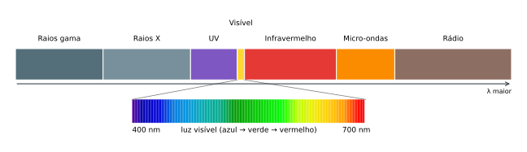
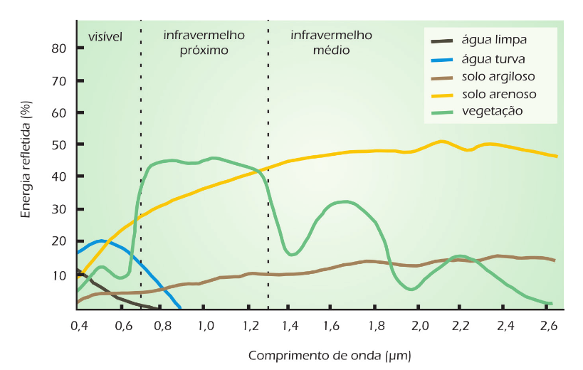
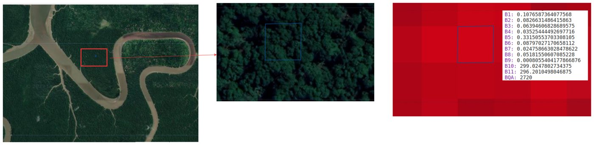
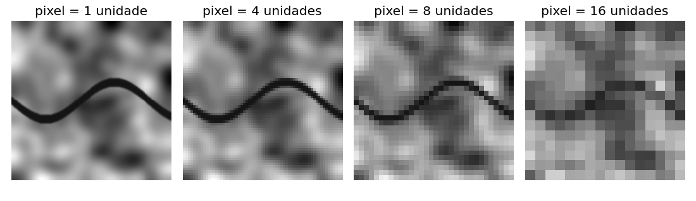
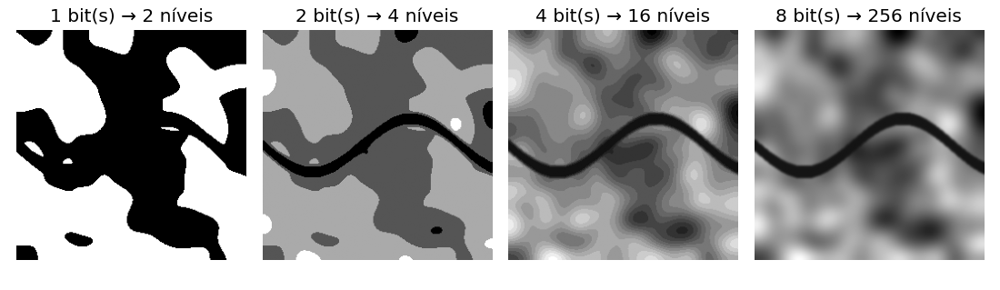
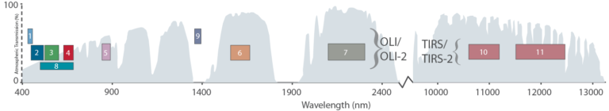

# Fundamentos de Sensoriamento Remoto

A maior parte dos dados que usaremos no Google Earth Engine são **imagens de sensoriamento remoto**. Para interpretá-las — e para escolher a imagem certa para cada problema —, precisamos entender o que um sensor a bordo de um satélite realmente mede. Este capítulo apresenta as definições, um breve histórico, os princípios físicos e as quatro resoluções que caracterizam um sensor.

---

## 🛰️ O que é sensoriamento remoto?

Em uma frase: **adquirir informações a distância, sem contato físico com o objeto**. O termo foi cunhado no início dos anos 1960 por Evelyn L. Pruitt, geógrafa do Escritório de Pesquisa Naval dos EUA, e desde então recebeu muitas definições — algumas curtas e gerais, outras bem detalhadas.

As definições mais abrangentes usam termos generalizantes:

> *"Ciência de derivar informações a respeito de um objeto a partir de medidas feitas a distância, sem entrar em contato com o mesmo."* (SCHOWENGERDT, 1983; SWAIN; DAVIS, 1978)

> *"Ciência e arte de obter informações a respeito de um objeto, área ou fenômeno pela análise de dados adquiridos por um sistema que não se encontra em contato com o objeto."* (LILLESAND; KIEFER, 1994)

Autores brasileiros costumam ser mais específicos, destacando a energia eletromagnética:

> *"Sensoriamento remoto é a tecnologia que permite obter imagens e outros tipos de dados da superfície terrestre, através da captação e do registro da energia refletida ou emitida pela superfície."* (FLORENZANO, 2011)

Fussell et al. (1986) resumem os elementos que caracterizam o sensoriamento remoto:

1. aquisição, coleta ou registro **sem contato** com o objeto;
2. uso de regiões do espectro eletromagnético que **incluem e excedem a região visível**;
3. uso de instrumentos em **plataformas móveis** (aviões, satélites, drones);
4. **transformação simbólica** dos dados por técnicas de interpretação e reconhecimento de padrões com computadores.

---

## 📜 Breve histórico

A origem do sensoriamento remoto está ligada ao desenvolvimento da fotografia e da fotografia aérea. É importante, contudo, diferenciar a **fotogrametria** — a ciência de obter medidas confiáveis a partir de fotografias — do sensoriamento remoto em sentido amplo, que se interessa pela interação da energia com os alvos em diversas faixas do espectro.

| Ano | Marco |
|---|---|
| 1839 | Daguerre e Niépce divulgam o processo fotográfico |
| 1858 | Gaspard-Félix Tournachon (Nadar) tira as primeiras fotografias aéreas, a partir de um balão |
| 1861 | James Clerk Maxwell demonstra a primeira fotografia colorida |
| 1909 | Primeiras fotografias tiradas a partir de um avião |
| 2ª Guerra Mundial | Uso intensivo da fotografia aérea para fins militares; desenvolvimento do filme infravermelho |
| 1957 | Lançamento do Sputnik 1 (URSS), que inaugura a era espacial |
| 1960 | Lançamento do TIROS-1, primeiro satélite meteorológico (NASA) |
| Década de 1960 | Fotografias orbitais dos programas Mercury, Gemini e Apollo; a Apollo 9 (1969) realiza um experimento de fotografia multiespectral |
| 1972 | A NASA lança o ERTS-1 (*Earth Resources Technology Satellite*), depois renomeado **Landsat 1** |
| 1986 | A França lança o SPOT-1 |
| 1999 | Brasil e China lançam o CBERS-1 (*China-Brazil Earth Resources Satellite*) |

A partir das décadas de 1950–60, o avanço da computação provocou uma alavancagem do processamento digital, e a Guerra Fria impulsionou sensores de alta resolução para espionagem. Com o fim da Guerra Fria, muitos desses recursos passaram a ser disponibilizados à sociedade civil. Em 2008, a decisão do Serviço Geológico dos EUA (USGS) de abrir gratuitamente todo o acervo Landsat mudou a escala do que pesquisadores podiam fazer — e está na origem de plataformas como o Google Earth Engine.

---

## ☀️ A energia e os alvos

Por que uma folha é verde e um telhado cerâmico é avermelhado? Porque cada material interage de forma diferente com a energia eletromagnética que incide sobre ele.

A radiação solar (energia incidente, ou **irradiância**) que atinge uma superfície é repartida em três parcelas:

$$
E_I(\lambda) = E_R(\lambda) + E_A(\lambda) + E_T(\lambda)
$$

em que \(E_R\) é a energia **refletida**, \(E_A\) a **absorvida** e \(E_T\) a **transmitida**, todas dependentes do comprimento de onda \(\lambda\). O sensor passivo a bordo de um satélite registra a energia refletida (**radiância**) que chega até ele.

A grandeza de maior interesse é a **reflectância**: a proporção entre o fluxo refletido e o fluxo incidente numa superfície, frequentemente expressa em porcentagem:

$$
\rho(\lambda) = \frac{E_R(\lambda)}{E_I(\lambda)} \times 100
$$

### O espectro eletromagnético

A energia eletromagnética se distribui em um contínuo de comprimentos de onda, o **espectro eletromagnético**. Nossos olhos percebem apenas uma pequena janela, entre aproximadamente 400 e 700 nm (a luz visível); os sensores orbitais, porém, "enxergam" também o infravermelho próximo, o infravermelho de ondas curtas, o termal e as micro-ondas (radar).



### Assinatura espectral

Como cada material reflete, absorve e transmite de forma diferente em cada comprimento de onda, a curva de reflectância ao longo do espectro funciona como uma "impressão digital" do alvo: a **assinatura espectral**. Ela decorre das propriedades físicas, químicas e estruturais do material, e é o que permite distinguir e mapear alvos a partir de imagens.



Observe no gráfico alguns padrões que usaremos o tempo todo:

- A **vegetação sadia** reflete pouco no vermelho (a clorofila absorve essa energia para a fotossíntese) e reflete muito no **infravermelho próximo** (por causa da estrutura interna das folhas). Esse contraste é a base do índice NDVI.
- A **água** reflete pouco em todo o espectro e praticamente nada no infravermelho — por isso aparece escura nessas bandas. A água turva reflete mais no visível que a água limpa.
- Os **solos** têm reflectância que cresce gradualmente com o comprimento de onda; solos arenosos refletem mais que os argilosos.

---

## 📐 As quatro resoluções

Uma imagem de sensoriamento remoto tem estrutura **matricial**: é uma grade de células chamadas **pixels** (*picture elements*). Cada sensor é caracterizado por quatro resoluções.

### Resolução espacial

É o tamanho, no terreno, da área representada por um pixel. A energia de todos os alvos dentro dessa área se funde em um **único valor**. Quanto menor o pixel, maior a resolução espacial e maior a capacidade de registrar objetos pequenos na superfície.



Para um mesmo sensor, cada pixel representa sempre uma área com as mesmas dimensões. Nos satélites Landsat 8 e 9, a maior parte das bandas tem pixels de **30 metros**; no Sentinel-2, de **10 a 60 metros**, conforme a banda. A figura a seguir simula o efeito de aumentar o tamanho do pixel sobre uma mesma cena: o rio, nítido com pixels pequenos, desaparece quando o pixel fica maior que a sua largura.



### Resolução radiométrica

Está associada à **sensibilidade** do sensor em registrar níveis intermediários de energia. O valor registrado em cada pixel é um número inteiro chamado **número digital** (*DN*, *digital number*) ou nível de cinza, que vai do preto (valor mínimo) ao branco (valor máximo). A quantidade de valores possíveis depende do número de *bits* usados:

| Bits | Níveis de cinza | Intervalo |
|:---:|:---:|:---:|
| 1 | 2¹ = 2 | 0 – 1 |
| 2 | 2² = 4 | 0 – 3 |
| 4 | 2⁴ = 16 | 0 – 15 |
| 8 | 2⁸ = 256 | 0 – 255 |
| 11 | 2¹¹ = 2.048 | 0 – 2.047 |
| 12 | 2¹² = 4.096 | 0 – 4.095 |



Sensores como os dos Landsat 5 e 7 e do CBERS trabalham com 8 bits (256 níveis). O IKONOS II registrava 11 bits (2.048 níveis), o que aumenta o poder de contraste, inclusive em áreas de sombra. O OLI do Landsat 8 quantiza em 12 bits, e o OLI-2 do Landsat 9, em 14 bits. Quanto maior a resolução radiométrica, maior o tamanho do arquivo e o tempo de processamento.

### Resolução temporal

É o **intervalo de tempo entre duas aquisições consecutivas** de uma mesma área (o tempo de revisita). Quanto menor o intervalo, maior a resolução temporal. Ela depende da plataforma e do tipo de órbita:

- **Órbitas quase polares e síncronas com o Sol:** o satélite se desloca aproximadamente no sentido norte–sul e passa sobre cada ponto sempre no mesmo horário local, o que garante condições de iluminação semelhantes. É o tipo de órbita da maioria dos satélites de recursos naturais.
- **Órbitas geoestacionárias:** equatoriais, a cerca de 36.000 km de altitude, acompanham a rotação da Terra e ficam sempre sobre o mesmo ponto. Permitem imagens a cada poucos minutos (maior resolução temporal), mas com baixa resolução espacial — é o caso dos satélites meteorológicos, como o GOES.

Órbita, velocidade e altitude estão relacionadas: satélites mais afastados são mais lentos e cobrem áreas maiores (meteorológicos); os mais próximos são mais rápidos e registram mais detalhes (recursos naturais). Alguns satélites podem inclinar o sensor para visadas laterais, aumentando a revisita (como o SPOT); no Landsat, o ângulo do sensor é fixo.

!!! example "A órbita do Landsat"
    Os satélites Landsat 5, 7, 8 e 9 completam uma órbita em aproximadamente **99 minutos**, dando cerca de 14 voltas por dia, a 705 km de altitude. A cobertura completa do planeta leva **16 dias**. A órbita é descendente (de norte para sul) e cruza o Equador por volta das 10h (hora local). Como o Landsat 8 e o Landsat 9 estão defasados em 8 dias, juntos eles revisitam cada ponto a cada 8 dias.

    Veja a [animação do USGS](https://www.usgs.gov/media/images/animation-landsat-satellite-orbiting-earth) e este [vídeo da órbita](https://www.youtube.com/watch?v=xBhorGs8uy8). Para comparar, veja um [satélite geoestacionário](https://www.youtube.com/watch?v=XzhVK09YReA).

### Resolução espectral

É relativa ao **número e à largura das faixas espectrais** (bandas) medidas pelo sensor. Quanto mais bandas e quanto mais estreitas elas forem, maior a resolução espectral e maior a capacidade de registrar diferenças entre os alvos. Uma cena com várias bandas é chamada de **imagem multiespectral**; com centenas de bandas estreitas, **hiperespectral**.



Os sensores OLI/OLI-2 e TIRS/TIRS-2, a bordo dos Landsat 8 e 9, têm as seguintes bandas:

| Banda | Nome | Comprimento de onda (µm) | Resolução (m) |
|:---:|---|:---:|:---:|
| 1 | Costeira/aerossol | 0,43 – 0,45 | 30 |
| 2 | Azul | 0,45 – 0,51 | 30 |
| 3 | Verde | 0,53 – 0,59 | 30 |
| 4 | Vermelho | 0,64 – 0,67 | 30 |
| 5 | Infravermelho próximo (NIR) | 0,85 – 0,88 | 30 |
| 6 | Infravermelho de ondas curtas 1 (SWIR 1) | 1,57 – 1,65 | 30 |
| 7 | Infravermelho de ondas curtas 2 (SWIR 2) | 2,11 – 2,29 | 30 |
| 8 | Pancromática | 0,50 – 0,68 | 15 |
| 9 | Cirrus | 1,36 – 1,38 | 30 |
| 10 | Infravermelho termal 1 (TIRS) | 10,60 – 11,19 | 100 |
| 11 | Infravermelho termal 2 (TIRS) | 11,50 – 12,51 | 100 |

!!! warning "A numeração das bandas muda entre satélites"
    Nos sensores TM e ETM+ dos Landsat 5 e 7, a banda 3 é o **vermelho** e a banda 4 é o **infravermelho próximo**; no Landsat 8 e 9, são as bandas 4 e 5. Antes de escrever qualquer composição ou índice, consulte a tabela de bandas do sensor no catálogo do GEE.

    | Banda TM/ETM+ | Faixa (µm) | Região |
    |:---:|:---:|---|
    | 1 | 0,45 – 0,52 | Azul |
    | 2 | 0,52 – 0,60 | Verde |
    | 3 | 0,63 – 0,69 | Vermelho |
    | 4 | 0,76 – 0,90 | Infravermelho próximo |
    | 5 | 1,55 – 1,75 | Infravermelho de ondas curtas (médio) |
    | 6 | 10,4 – 12,5 | Infravermelho termal |
    | 7 | 2,08 – 2,35 | Infravermelho de ondas curtas (médio) |

    O ETM+ do Landsat 7 tem ainda uma banda 8 pancromática (15 m).

A **banda pancromática** é uma banda larga, que abrange aproximadamente toda a faixa do visível. Por ser larga, recebe mais energia e permite pixels menores (15 m no Landsat 8). Ela é usada na técnica de **fusão** (*pansharpening*), que combina o detalhe espacial da pancromática com a informação de cor das bandas multiespectrais. Você poderá executar o *script* a seguir depois de ler o [Capítulo 3](03_conhecendo_gee.md):

```javascript
// Pansharpening de uma cena Landsat 8 (São Luís e arredores)
var image = ee.Image('LANDSAT/LC08/C02/T1_TOA/LC08_220062_20190504');

// Bandas RGB (30 m) convertidas para o espaço de cores HSV
var rgb = image.select(['B4', 'B3', 'B2']);
var huesat = rgb.rgbToHsv().select(['hue', 'saturation']);

// A banda pancromática (15 m) substitui o "valor" (brilho)
var pan = image.select('B8');
var fusao = ee.Image.cat(huesat, pan).hsvToRgb();

Map.centerObject(image, 13);
Map.addLayer(rgb, {min: 0, max: 0.25}, 'RGB 30 m');
Map.addLayer(fusao, {min: 0, max: 0.25}, 'Fusão 15 m');
```

---

## 🏔️ Nem toda imagem vem de um sensor óptico

As imagens também servem para representar outros **campos contínuos**. Um exemplo importante é o **modelo digital de elevação** da missão SRTM (*Shuttle Radar Topography Mission*), em que o valor de cada pixel é a altitude, em metros. O *script* abaixo exibe a altitude de uma região de Minas Gerais com uma paleta de cores. Os "números mágicos" 800 e 1400 são o intervalo de altitudes que queremos realçar — veremos como escolhê-los no [Capítulo 6](06_selecao_matricial.md).

```javascript
var srtm = ee.Image('USGS/SRTMGL1_003');
var paleta = ['00FFFF', '00FF7F', '7CFC00', '2E8B57',
              'FFD700', 'F4A460', 'A0522D', 'FFFFFF'];
Map.addLayer(srtm, {min: 800, max: 1400, palette: paleta}, 'SRTM');
Map.setCenter(-43.8605, -20.502, 10); // Congonhas, MG
```

---

## 📝 Síntese

- Sensoriamento remoto é a aquisição de informação **sem contato**, por meio da energia eletromagnética **refletida ou emitida** pelos alvos.
- A **reflectância** de cada alvo varia com o comprimento de onda, formando sua **assinatura espectral**.
- Um sensor é caracterizado por quatro resoluções: **espacial** (tamanho do pixel), **radiométrica** (bits por pixel), **temporal** (revisita) e **espectral** (número e largura das bandas).

## ✏️ Exercícios

1. Com suas palavras, explique por que a vegetação sadia aparece clara na banda do infravermelho próximo e escura na banda do vermelho.
2. Um sensor de 10 bits registra quantos níveis de cinza? E um de 16 bits?
3. Para monitorar a expansão de uma queimada ao longo de um único dia, qual resolução é mais importante? Que tipo de órbita você escolheria?
4. Um estudante quer mapear canteiros de 5 m de largura usando Landsat 8. Isso é viável? Por quê?
5. Por que as bandas "vermelho" e "infravermelho próximo" têm números diferentes no Landsat 7 e no Landsat 8? Que cuidado isso exige?
6. Qual a vantagem de uma órbita síncrona com o Sol para comparar imagens de datas diferentes?
