# Conhecendo o Google Earth Engine

Este capítulo apresenta a plataforma que usaremos em toda a Parte 1: por que ela existe, como obter acesso, como é o ambiente de programação e quais conceitos de JavaScript são necessários para acompanhar os exemplos. Não é preciso saber programar — mas é preciso entender alguns poucos conceitos, que serão apresentados aos poucos e sempre ligados a dados geográficos.

---

## ☁️ Por que processar na nuvem?

Imagine que você precisa gerar um gráfico com a **precipitação mensal dos últimos 10 anos** em duas regiões — digamos, São Luís (MA) e Congonhas (MG). Existe um dado diário de precipitação para o mundo todo, o **CHIRPS** (*Climate Hazards Group InfraRed Precipitation with Station data*), com pixels de aproximadamente 5,5 km.

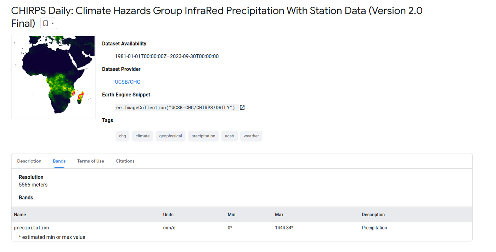

Quais seriam os passos para gerar esse gráfico em um computador local?

1. Baixar as imagens diárias dos últimos 10 anos — aproximadamente **3.650 imagens**;
2. Recortar as 3.650 imagens para a região de estudo (para não processar o globo inteiro);
3. Para cada ano e cada mês, **somar** as imagens diárias (cerca de 30 por mês), gerando 120 imagens mensais;
4. Para cada uma das 120 imagens, calcular a precipitação média na região;
5. Repetir os passos 3 e 4 para a outra região;
6. Salvar as médias em um arquivo;
7. Abrir o arquivo numa planilha e plotar o gráfico.

Mesmo com software livre, o gargalo é evidente: baixar, armazenar e processar milhares de imagens exige tempo, disco e poder computacional.

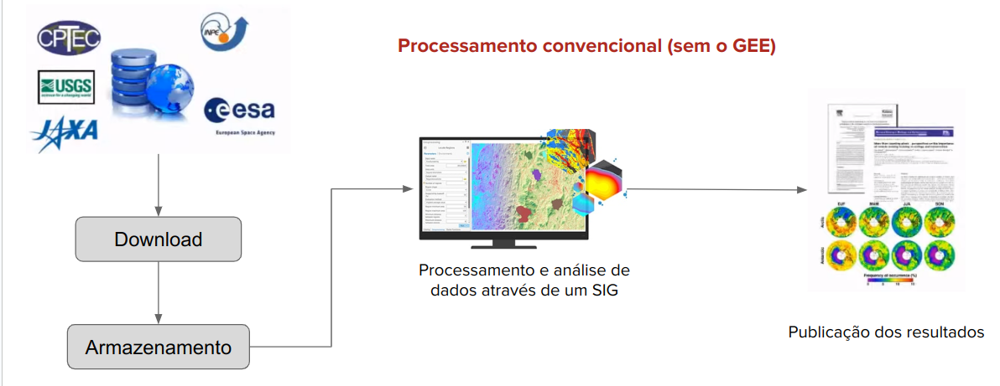

No **Google Earth Engine (GEE)**, os dados já estão armazenados junto à infraestrutura de processamento. Enviamos apenas as instruções — o *script* — e recebemos o resultado: um mapa, um gráfico, uma tabela ou um arquivo exportado para o Google Drive.

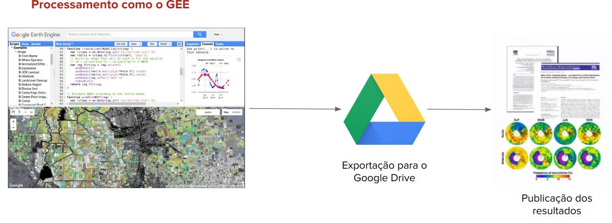

O *script* completo para o problema acima tem pouco mais de 50 linhas. Não se preocupe em entendê-lo agora: ao final da Parte 1 você será capaz de lê-lo linha por linha (ele é explicado em detalhe no [Capítulo 8](08_processamento_matricial.md#serie-temporal-de-precipitacao)).

??? example "O algoritmo completo no Google Earth Engine (clique para expandir)"
    ```javascript
    var congonhas = ee.Geometry.Polygon(
            [[[-43.945697646520735, -20.44294631828056],
              [-43.945697646520735, -20.579286674789692],
              [-43.736957412145735, -20.579286674789692],
              [-43.736957412145735, -20.44294631828056]]], null, false);

    var saoluis = ee.Geometry.Polygon(
            [[[-44.30663017068142, -2.4775511449329626],
              [-44.30663017068142, -2.584563328792773],
              [-44.15556815896267, -2.584563328792773],
              [-44.15556815896267, -2.4775511449329626]]], null, false);

    var areaEstudo = ee.FeatureCollection([
      ee.Feature(congonhas, {nome: 'Congonhas'}),
      ee.Feature(saoluis, {nome: 'Sao Luis'})
    ]);

    var chirps = ee.ImageCollection('UCSB-CHG/CHIRPS/DAILY');

    var anos = ee.List.sequence(2014, 2023);
    var meses = ee.List.sequence(1, 12);

    // Para cada ano e cada mês, soma as imagens diárias
    var mensais = anos.map(function (y) {
      return meses.map(function (m) {
        var filtradas = chirps
          .filter(ee.Filter.calendarRange(y, y, 'year'))
          .filter(ee.Filter.calendarRange(m, m, 'month'));
        var soma = filtradas.reduce(ee.Reducer.sum())
                            .rename('precipitacao_mensal');
        return soma.set({
          'system:time_start': ee.Date.fromYMD(y, m, 1).millis(),
          'year': y,
          'month': m
        });
      });
    }).flatten();

    var colecaoMensal = ee.ImageCollection.fromImages(mensais);
    print('Coleção mensal', colecaoMensal);

    // Série temporal da precipitação média em cada região
    var grafico = ui.Chart.image.seriesByRegion({
      imageCollection: colecaoMensal,
      regions: areaEstudo,
      reducer: ee.Reducer.mean(),
      seriesProperty: 'nome',
      xProperty: 'system:time_start',
      scale: 5566
    }).setOptions({
      title: 'Precipitação mensal (mm)',
      vAxis: {title: 'Precipitação (mm)'},
      hAxis: {title: 'Meses'}
    });

    print(grafico);
    ```

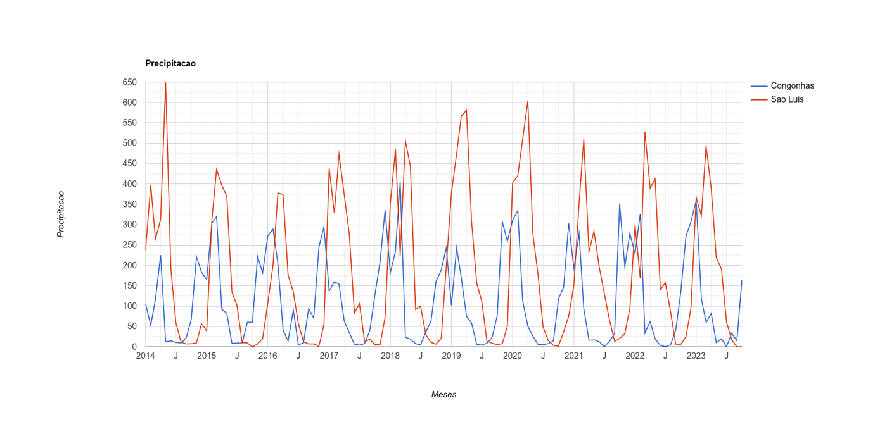

Observe no gráfico o regime de chuvas bem marcado de São Luís, concentrado no primeiro semestre, e o de Congonhas, concentrado no verão austral (de novembro a março). Uma análise que exigiria dias de download ficou pronta em segundos.

---

## 🌐 O que é o Google Earth Engine?

A plataforma Google Earth Engine é uma infraestrutura de processamento e análise de dados geoespaciais, concebida e mantida pelo Google, voltada a investigações científicas e análises geoespaciais em escala planetária (GORELICK et al., 2017). Ela combina três elementos:

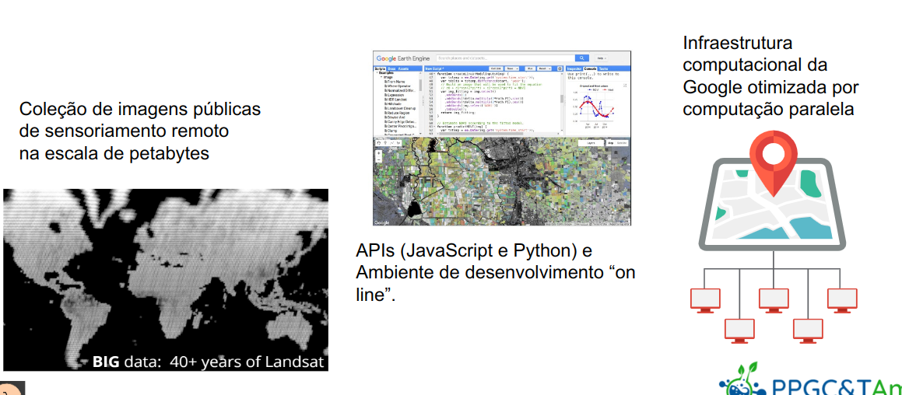

1. **Um catálogo público na escala de petabytes**, com dados atuais e históricos das missões Landsat, Sentinel e MODIS, modelos digitais de elevação (SRTM), dados climáticos (CHIRPS, ERA5), mapas de uso e cobertura da terra e algumas coleções vetoriais. Isso permite monitorar alterações na superfície terrestre ao longo de décadas. O usuário também pode enviar seus próprios dados vetoriais e matriciais — por exemplo, imagens do CBERS, que não estão no catálogo.
2. **Uma infraestrutura computacional** otimizada para processamento paralelo, que executa nos servidores do Google os algoritmos de processamento de dados matriciais e vetoriais — incluindo classificação de imagens —, livrando o usuário da aquisição e gestão de grandes volumes de dados.
3. **APIs em JavaScript e Python** e um ambiente de desenvolvimento *on-line*, o **Code Editor**, com recursos de visualização interativa e de criação de painéis e aplicativos.

Entre as aplicações da plataforma estão o monitoramento ambiental, a gestão de recursos naturais, a agricultura de precisão e a detecção de desastres naturais. No Brasil, o exemplo mais conhecido é o **MapBiomas**, que produz no GEE as séries anuais de mapas de uso e cobertura da terra de todo o país.

Neste livro usaremos a API **JavaScript**, porque ela está disponível diretamente no navegador, pelo Code Editor, sem instalar nada. Quem preferir Python pode usar a biblioteca [geemap](https://geemap.org/) em um *notebook* Jupyter ou no Google Colab; os conceitos são os mesmos.

---

## 🔑 Acessando o GEE pela primeira vez

Para usar o GEE é preciso uma conta Google e um **projeto do Google Cloud** registrado para uso **não comercial** (ensino e pesquisa). O processo é gratuito para esses usos.

!!! info "Cotas de uso não comercial"
    Desde abril de 2026, todo projeto não comercial recebe uma cota mensal gratuita de processamento, medida em *EECU-hours* (unidades de computação do Earth Engine). O nível padrão, **Community**, é mais do que suficiente para todos os exercícios deste livro. Detalhes em [Earth Engine Noncommercial Tiers](https://developers.google.com/earth-engine/guides/noncommercial_tiers). A verificação do uso não comercial precisa ser renovada anualmente.

!!! tip "Use o e-mail institucional"
    Usar a conta Google vinculada ao e-mail da universidade costuma agilizar a verificação de uso acadêmico.

**Passo 1.** Acesse [code.earthengine.google.com](https://code.earthengine.google.com/). Na primeira vez, clique em **"I want to register a new project"**.

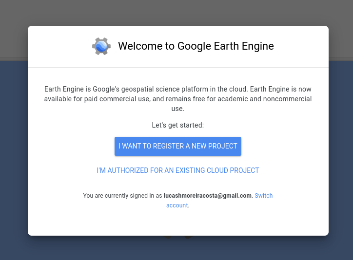

**Passo 2.** Escolha **"Register a Noncommercial or Commercial Cloud project"** e depois a opção de uso não comercial.

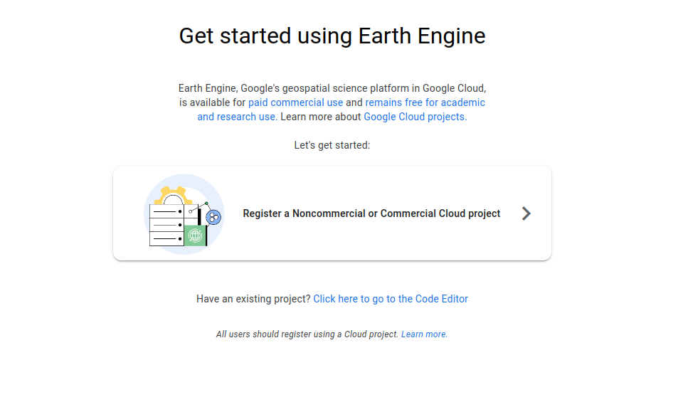

**Passo 3.** Indique **"Unpaid usage"** e o tipo de organização **"Academia & research"**.

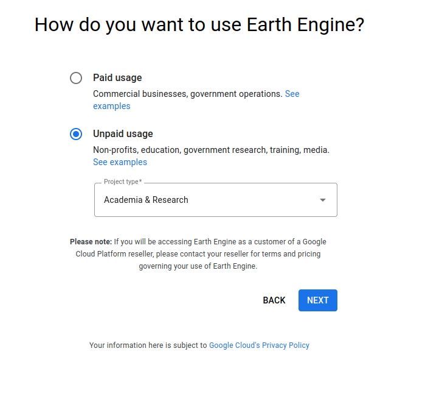

**Passo 4.** Escolha **"Create a new Google Cloud project"** e dê um identificador ao projeto (por exemplo, `ee-seunome`).

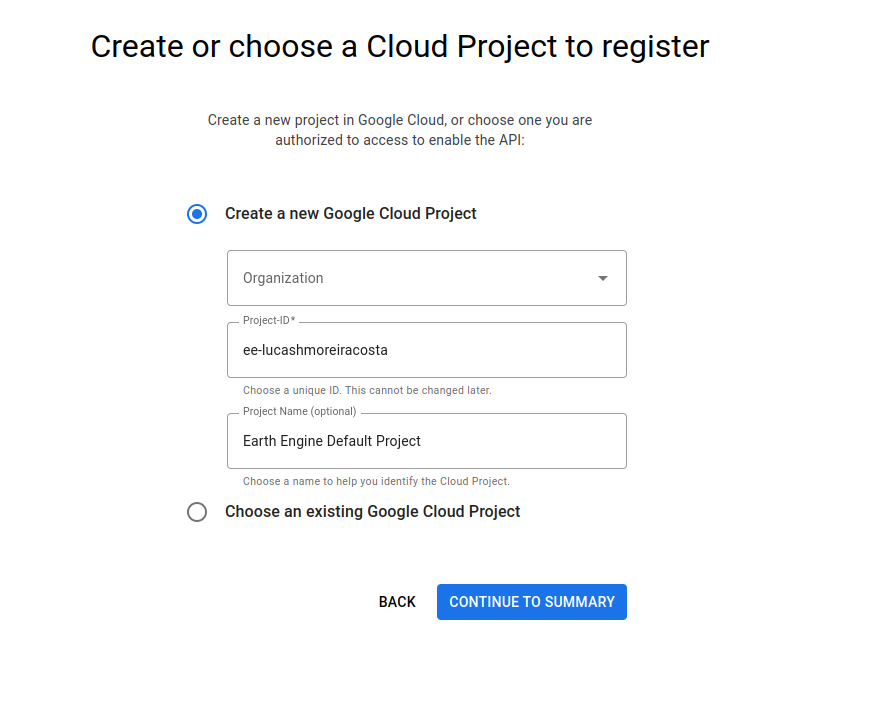

**Passo 5.** É provável que apareça uma mensagem pedindo que você aceite os termos do Google Cloud. Clique no *link*, aceite os termos e volte à página anterior.

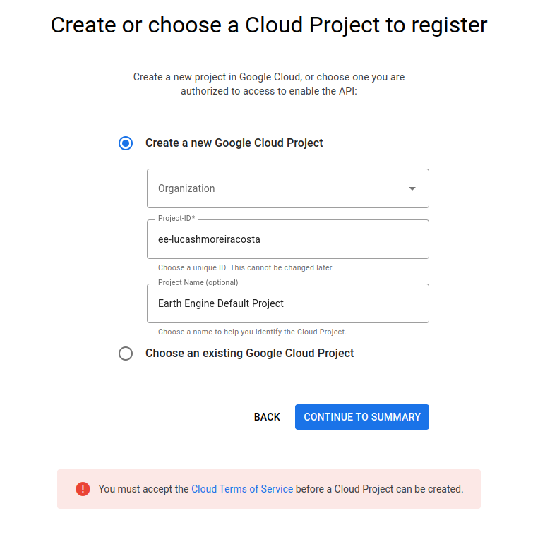


**Passo 6.** De volta à tela de criação, conclua o cadastro do projeto e confirme as informações.


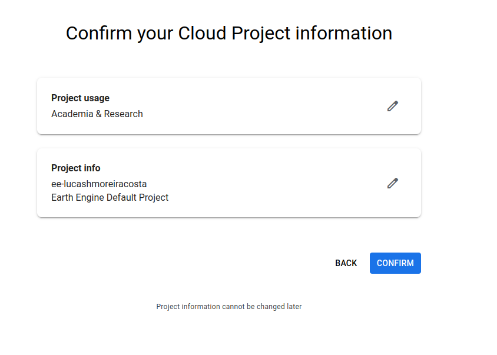

**Passo 7.** Ao final, você será direcionado ao Code Editor.

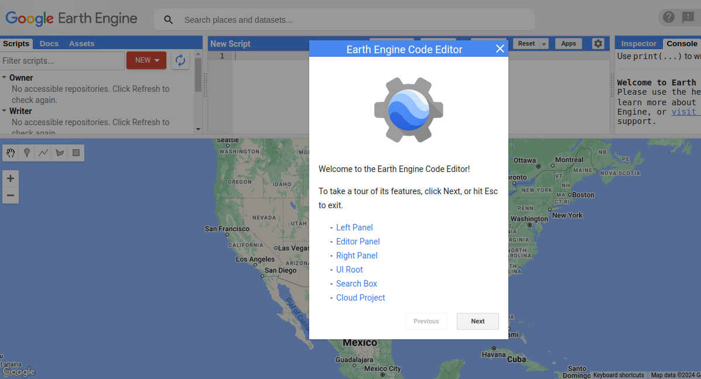

!!! note "As telas mudam"
    O Google altera com frequência o fluxo de cadastro. Se alguma tela estiver diferente, a lógica continua a mesma: criar (ou escolher) um projeto do Google Cloud e registrá-lo para uso não comercial. Em caso de dúvida, consulte [Earth Engine access](https://developers.google.com/earth-engine/guides/access).

Por fim, adicione ao seu Code Editor o repositório com os *scripts* de exemplo deste livro, clicando no *link*: [users/sergiocosta/ercemapi2023](https://code.earthengine.google.com/?accept_repo=users/sergiocosta/ercemapi2023).

---

## 🖥️ O Code Editor

O Code Editor, acessível em [code.earthengine.google.com](https://code.earthengine.google.com/), é dividido em quatro áreas:

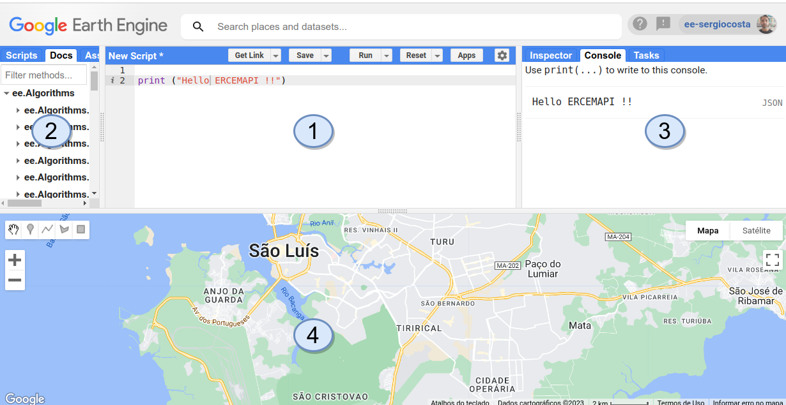

1. **Área de código** (centro): onde os *scripts* são escritos para carregar, processar e visualizar dados. O editor realça a sintaxe e aponta erros. Os botões **Run**, **Save** e **Get Link** ficam no topo.
2. **Abas à esquerda**: **Scripts** (seus arquivos, organizados em repositórios e pastas), **Docs** (documentação de todos os comandos) e **Assets** (seus dados vetoriais e matriciais enviados à plataforma).
3. **Abas à direita**: **Inspector** (clique no mapa para ver os valores dos pixels e feições), **Console** (resultados de `print` e gráficos) e **Tasks** (andamento das exportações e importações).
4. **Área do mapa** (abaixo): mapa interativo com o gerenciador de camadas (*Layers*), a alternância entre mapa e satélite e as ferramentas de desenho de geometrias.

!!! warning "Salve explicitamente os seus *scripts*"
    Diferente de outros ambientes *on-line*, o Code Editor **não salva automaticamente**. Clique em **Save** (ou `Ctrl+S`). Antes do primeiro *script*, crie um repositório em *Scripts → NEW → Repository*; dentro dele você pode criar pastas e arquivos. Para compartilhar um *script* com alguém (ou entregá-lo ao professor), use **Get Link**.

---

## 🧩 JavaScript no Google Earth Engine

A linguagem JavaScript foi criada por Brendan Eich em 1995, na Netscape, para tornar as páginas *web* mais interativas (WIRFS-BROCK; EICH, 2020). Desde então, deixou de estar restrita aos navegadores. Antes de ser escolhida para o Earth Engine, ela já era a linguagem de *script* do Google Docs e do Google Planilhas (o Google Apps Script).

Um ***script*** é uma sequência de comandos que o computador segue para realizar um processo — como uma receita culinária. Para escrevê-lo, é preciso conhecer as instruções individuais e saber combiná-las.

### Instruções que causam efeitos

Algumas instruções apenas **causam um efeito**: imprimir algo no Console ou mover o mapa. Crie um *script*, copie o código a seguir e clique em **Run**:

```javascript
// Duas instruções que apenas causam efeitos
print('Olá, Google Earth Engine!');
Map.setCenter(-37.77028535227355, -4.567792298842188, 13); // Aracati, CE
```

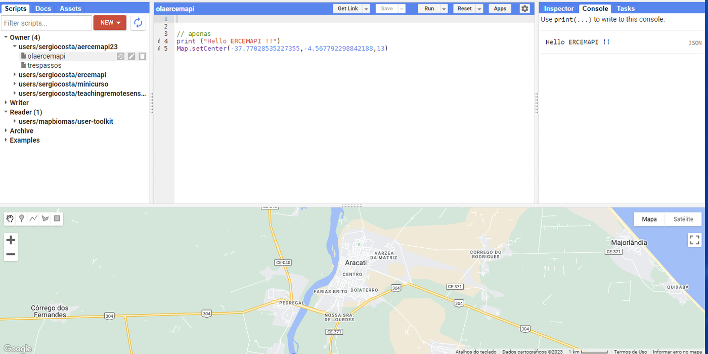

`print` escreve no Console; `Map.setCenter(longitude, latitude, zoom)` centraliza o mapa. **Atenção à ordem: no GEE, as coordenadas são sempre longitude, latitude** — o inverso do que muitas pessoas estão acostumadas.

### Instruções que produzem valores: variáveis

Outras instruções **produzem novos valores**, seja buscando um dado no catálogo, seja processando valores criados antes. Por exemplo, `ee.Image` busca uma imagem a partir de seu identificador. Para usar esse valor depois, damos um nome a ele — ou seja, armazenamos o resultado em uma **variável**, com a palavra `var`:

```javascript
var saoluis = ee.Image('LANDSAT/LC08/C02/T1_TOA/LC08_220062_20190504');
```

### Entrada, processamento e saída

Praticamente todo *script* no GEE segue três passos: **seleção/entrada** dos dados, **processamento** e **apresentação/saída**. As variáveis são o que liga um passo ao outro.

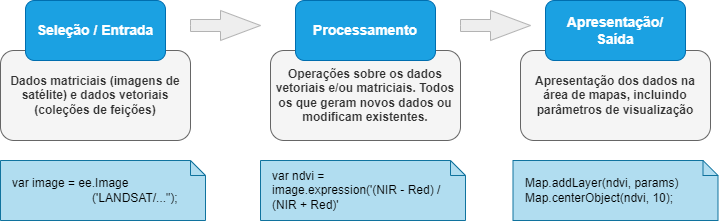

```javascript
// SELEÇÃO/ENTRADA
// Esta operação produz um novo valor: um objeto do tipo imagem.
// Veremos o que são as imagens no próximo capítulo.
var image = ee.Image('LANDSAT/LC08/C02/T1_TOA/LC08_220062_20190504');

// PROCESSAMENTO
// Um índice de vegetação (NDVI), calculado a partir de duas bandas.
// Veremos índices em detalhe no Capítulo 8.
var ndvi = image.expression('(NIR - Red) / (NIR + Red)', {
  'NIR': image.select('B5'), // banda do infravermelho próximo
  'Red': image.select('B4')  // banda do vermelho
});

// APRESENTAÇÃO/SAÍDA
Map.addLayer(ndvi, {min: -1, max: 1, palette: ['blue', 'white', 'green']}, 'NDVI');
Map.centerObject(image, 8);
```

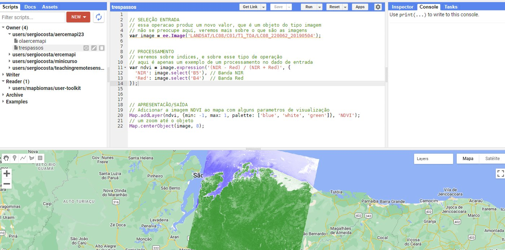

### Agrupando valores com dicionários

Às vezes é útil agrupar vários valores sob um mesmo nome. Os metadados de uma imagem, por exemplo, poderiam ser representados assim:

```javascript
var metadados = {
  dataAquisicao: '2019-09-15',
  resolucaoEspacial: 30,
  sistemaCoordenadas: 'EPSG:32623'  // UTM zona 23N, a projeção das cenas Landsat de São Luís
};

print('Data de aquisição:', metadados.dataAquisicao);
print('Resolução espacial:', metadados.resolucaoEspacial);
```

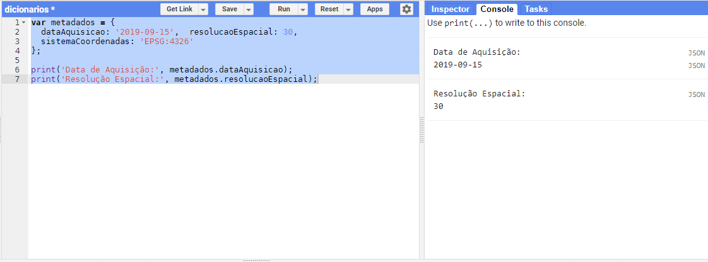

A variável `metadados` é um **dicionário** (ou objeto): um conjunto de pares **chave: valor**. Os dicionários são fundamentais no GEE: eles definem os **atributos das feições** (Capítulo 4) e os **parâmetros** de muitas instruções — como o `{min: -1, max: 1, palette: [...]}` que passamos a `Map.addLayer` no exemplo anterior.

### Agrupando operações com funções

No exemplo do NDVI, o processamento coube em uma única instrução. Frequentemente, porém, ele exige várias instruções, que podem ser organizadas e encapsuladas em **funções**: dada uma entrada, a função a processa e retorna uma saída.

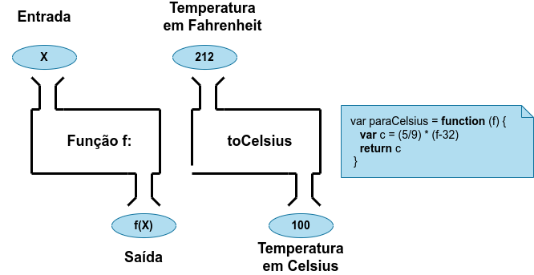

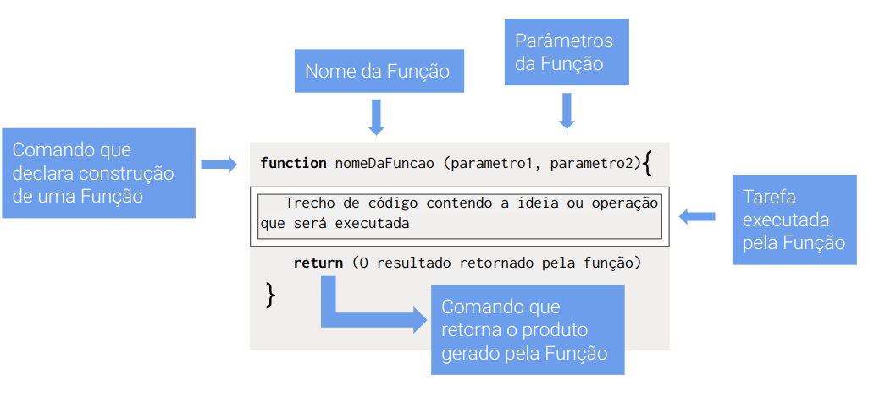

Uma função para converter graus Fahrenheit em Celsius:

```javascript
// Definição da função
var paraCelsius = function (f) {  // ENTRADA: f
  var c = (5 / 9) * (f - 32);     // PROCESSAMENTO
  return c;                       // SAÍDA
};

// Uso da função, no mesmo script
var tempFahr = 212;                     // ENTRADA
var tempCelsius = paraCelsius(tempFahr); // PROCESSAMENTO
print(tempCelsius);                     // APRESENTAÇÃO: 100
```

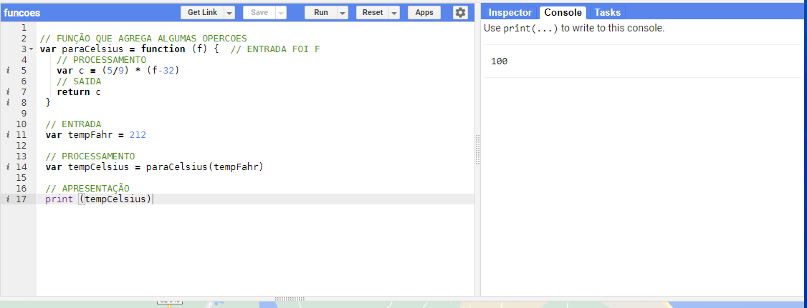

Funções serão essenciais a partir do Capítulo 7, quando aplicaremos uma mesma operação a todos os elementos de uma coleção.

---

## ⚖️ Cliente × servidor

Este é o conceito mais importante — e mais confuso — do GEE. No Code Editor convivem **dois mundos**:

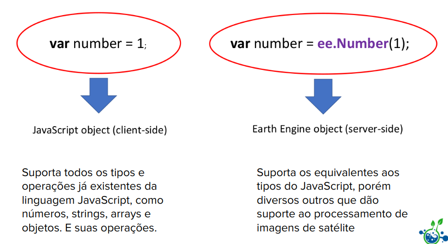

- **O lado do cliente** é o seu navegador. Ele entende o JavaScript "puro": números, textos (*strings*), *arrays* e objetos, com suas operações usuais (`+`, `*`, `>`...).
- **O lado do servidor** é a infraestrutura do Google. Tudo que começa com `ee.` — `ee.Number`, `ee.List`, `ee.Image`, `ee.FeatureCollection` — é um **objeto do servidor**. Para usar a infraestrutura do Google, precisamos usar esses tipos e as operações (métodos) deles.

```javascript
// Lado do cliente: JavaScript puro, calculado no navegador
var n1 = 10;
var n2 = 20;
var n3 = n1 * n2;
print(n3);  // 200

// Lado do servidor: calculado na infraestrutura do Google
var num1 = ee.Number(10);
var num2 = ee.Number(20);
var num3 = num1.multiply(num2);
print(num3);  // 200
```

Observe que, no servidor, não usamos o operador `*`, e sim o método `.multiply()`. A forma geral é `objeto.metodo(argumentos)`. Os tipos do servidor têm equivalentes aos tipos do JavaScript e muitos outros voltados ao processamento de imagens de satélite. A aba **Docs** lista todos os métodos disponíveis para cada tipo — clique em um método para ver sua descrição.

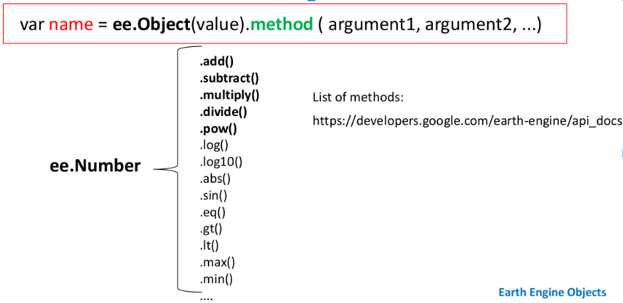

!!! warning "Não misture os dois mundos"
    Um objeto do servidor (`ee.Number(10)`) não é um número do JavaScript: ele é uma *descrição* de um cálculo que será feito no servidor. Por isso `ee.Number(10) * 2` não funciona como esperado — use `ee.Number(10).multiply(2)`. Da mesma forma, um `if` ou `for` do JavaScript não enxerga o valor de um objeto do servidor. Quando precisarmos repetir uma operação, usaremos o `.map()`, apresentado a seguir.

---

## 🔁 O padrão *filter–map–reduce*

O padrão *filter–map–reduce* é amplamente usado em aplicações que lidam com grandes volumes de dados — e é a forma natural de pensar no GEE (CARDILLE, 2024):

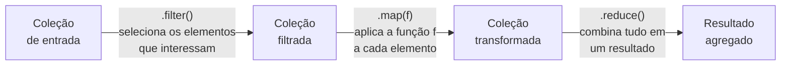

1. **Filtrar** (`.filter()`): escolher um subconjunto de imagens ou feições com base em critérios espaciais, temporais, de atributos ou de metadados (Capítulos 5 e 6).
2. **Mapear** (`.map()`): aplicar uma função a **cada** elemento da coleção filtrada, calculando ou transformando algo (Capítulos 7 e 8).
3. **Reduzir** (`.reduce()`): combinar os elementos transformados em um resultado — uma média, uma soma, um desvio-padrão, uma imagem-síntese de uma série temporal.

Vamos entender o padrão primeiro com JavaScript puro, sem tipos do GEE.

**`filter`** cria uma nova coleção apenas com os elementos que passam em um teste:

```javascript
var temperaturasF = [80, 86, 95, 56, 104, 50, 60];

var maior80 = function (x) {
  return x > 80;
};

var filtrados = temperaturasF.filter(maior80);
print(filtrados);  // [86, 95, 104]
```

**`map`** cria uma nova coleção aplicando uma função a cada elemento:

```javascript
var paraCelsius = function (f) {
  return (5 / 9) * (f - 32);
};

var temperaturasC = filtrados.map(paraCelsius);
print(temperaturasC);  // [30, 35, 40]
```

**`reduce`** reduz a coleção a um único valor, acumulando o resultado de uma função:

```javascript
var soma = function (acumulador, valorAtual) {
  return acumulador + valorAtual;
};

var total = temperaturasC.reduce(soma, 0);
print(total);  // 105
```

Quando os valores intermediários não interessam, encadeamos as operações:

```javascript
var resultado = temperaturasF
    .filter(maior80)
    .map(paraCelsius)
    .reduce(soma, 0);

print(resultado);  // 105
```

### O mesmo padrão, no cliente e no servidor

A seguir, o mesmo cálculo — filtrar os valores menores que 8, dobrá-los e somá-los — escrito nos dois mundos. Primeiro, apenas com JavaScript, **do lado do cliente**:

```javascript
var valores = [10, 2, 3, 5];  // array do JavaScript

var resultado = valores
    .filter(function (x) { return x < 8; })
    .map(function (x) { return x * 2; })
    .reduce(function (acc, x) { return acc + x; }, 0);

print(resultado);  // 20
```

Agora com tipos e operações do GEE, **do lado do servidor**:

```javascript
var valores = ee.List([10, 2, 3, 5]);  // lista do servidor

var resultado = valores
    .filter(ee.Filter.lt('item', 8))
    .map(function (x) {
      return ee.Number(x).multiply(2);
    })
    .reduce(ee.Reducer.sum());

print(resultado);  // 20
```

Execute cada versão com o **Profiler** ligado (menu do botão **Run → Run with profiler**, ou `Ctrl+Alt+Enter`). Na versão do servidor, o Profiler lista as operações executadas na infraestrutura do Google:

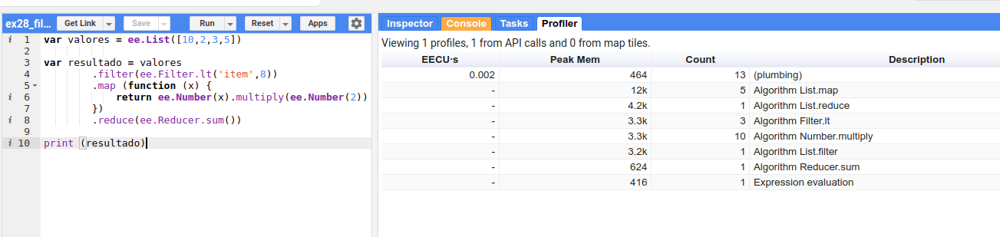

Na versão do cliente, nenhuma chamada ao servidor é registrada:

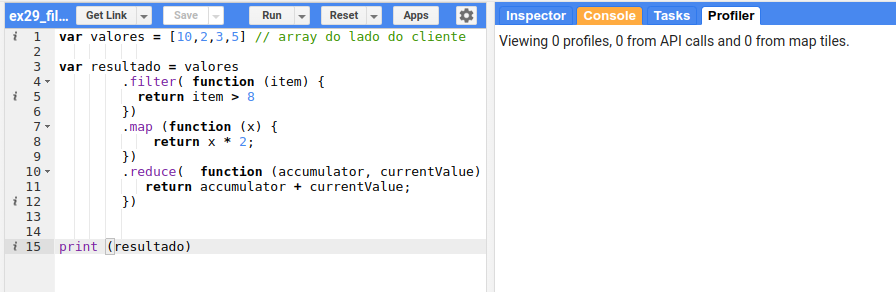

!!! info "Por que isso importa?"
    As operações do servidor consomem a **cota** do seu projeto. Para cálculos pequenos, como estes, a diferença é irrelevante — mas entender onde cada operação roda ajuda a escrever *scripts* eficientes e a interpretar as mensagens de erro.

!!! abstract "Resumo"
    O padrão *filter–map–reduce* permite **selecionar** os dados relevantes, **aplicar** operações específicas a cada um deles e, em seguida, **reduzir** os resultados para obter informações agregadas. Ele reaparecerá em quase todos os capítulos seguintes.

---

## 📝 Síntese

- O GEE une um **catálogo de petabytes**, uma **infraestrutura de processamento paralelo** e **APIs** (JavaScript e Python); os dados não precisam ser baixados.
- O acesso exige um **projeto do Google Cloud** registrado para uso não comercial.
- *Scripts* seguem a estrutura **entrada → processamento → saída**; variáveis, dicionários e funções organizam o código.
- Objetos `ee.*` vivem no **servidor** e são manipulados por **métodos**; o padrão ***filter–map–reduce*** organiza o processamento de coleções.

## ✏️ Exercícios

1. Crie um repositório no seu Code Editor e salve nele um *script* que centralize o mapa na sua cidade com zoom 12. Gere o *link* com **Get Link**.
2. Escreva uma função `paraFahrenheit` que faça a conversão inversa da `paraCelsius`. Teste-a com 0 e 100.
3. Crie um dicionário com os metadados de uma imagem fictícia (satélite, data, cobertura de nuvens) e imprima cada valor.
4. Reescreva o exemplo das temperaturas **do lado do servidor**, usando `ee.List`, `ee.Filter.gt`, `.map` com `ee.Number` e `ee.Reducer.sum()`. Compare os resultados no Profiler.
5. Explique, com suas palavras, por que `ee.Number(5) + 3` não produz 8.
