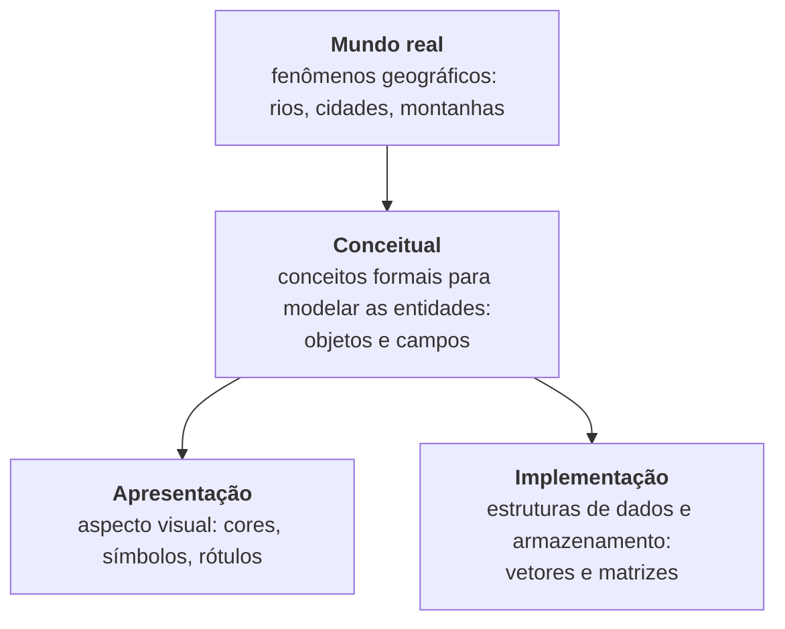
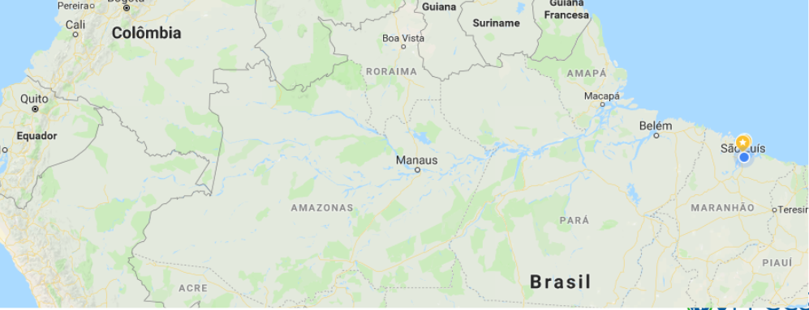
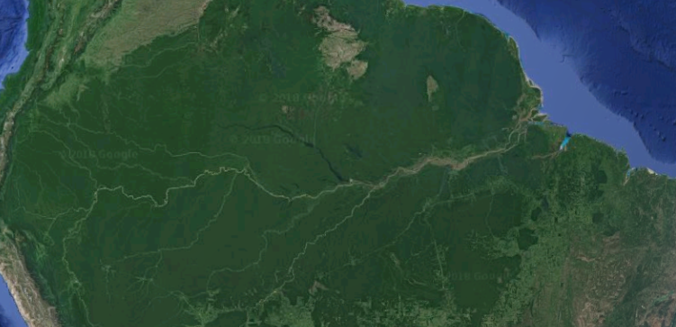
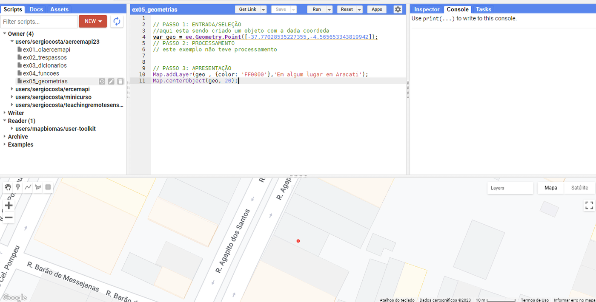
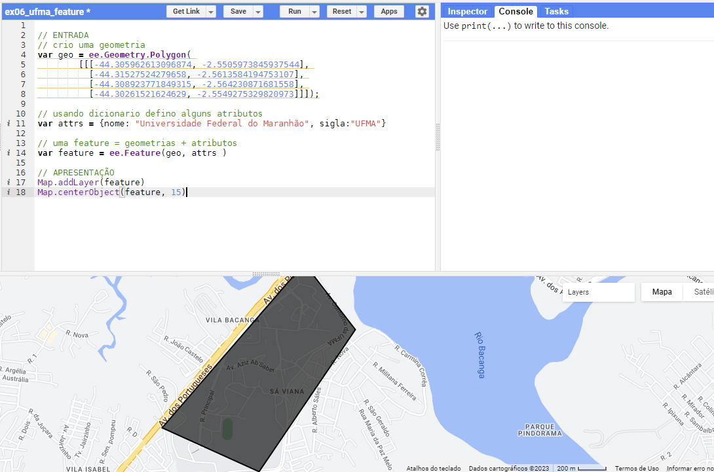
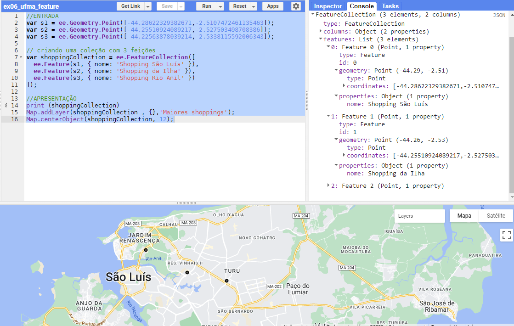
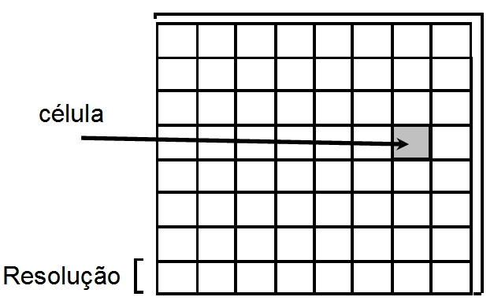
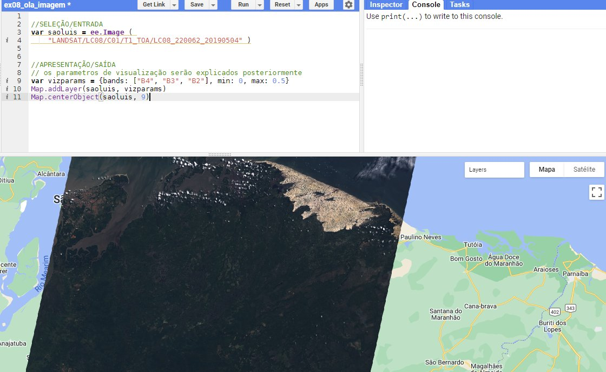
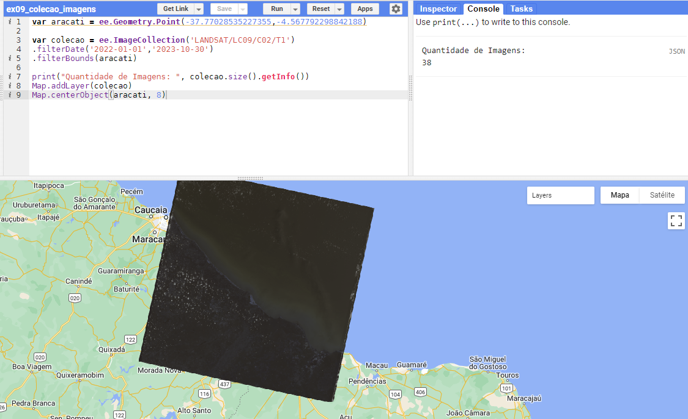

# Tipos de Dados Geográficos

Como representar a informação geográfica em um sistema computacional? O mundo real é extremamente complexo, e só conseguimos capturar partes dele por meio de **modelos e abstrações**. Este capítulo apresenta as duas grandes visões conceituais do espaço geográfico — objetos e campos —, suas representações computacionais — vetores e matrizes — e como elas aparecem no Google Earth Engine.

---

## 🧠 Abstração e níveis de modelagem

Até a nossa linguagem é um modelo: embora existam infinitas árvores diferentes, reconhecemos uma árvore quando a vemos. *"Abstração é o processo mental que consiste em escolher ou isolar um aspecto determinado de um estado de coisas relativamente complexo, a fim de simplificar a sua avaliação, classificação ou para permitir a comunicação do mesmo"* (HOUAISS, 2006). Para resolver um problema, é necessário escolher uma abstração da realidade. A observação e a medição desempenham papel central nessa escolha.

Nos sistemas de informação geográfica, a modelagem costuma ser entendida em quatro níveis de abstração (CÂMARA, 2005):



- **Mundo real:** os fenômenos geográficos — aqueles que, como vimos no Capítulo 1, possuem tempo e espaço bem definidos.
- **Conceitual:** os conceitos formais com os quais as entidades geográficas podem ser modeladas.
- **Apresentação:** o aspecto visual ou gráfico — cor, tipo e espessura de linha, padrão de hachura, simbologia e rotulação.
- **Implementação:** as estruturas de dados e os modos de armazenamento.

### Nível conceitual: objetos e campos

Na literatura são aceitas duas visões de dados geográficos (LONGLEY et al., 2013):

- **Objetos discretos** (*objects*, geo-objetos): representam o mundo como **entidades com limites bem definidos** sobre um espaço vazio. Um exemplo comum são os mapas geopolíticos, cujos limites são definidos e aceitos por acordos (inter)nacionais — ou as montanhas com nome, como o Monte Everest.
- **Campos contínuos** (*fields*, geo-campos): representam o mundo real como um número finito de variáveis, **cada qual definida em cada posição do espaço**. Um exemplo comum são as imagens de satélite, já que o sensor registra um valor para cada posição imageada — ou a topografia, a altitude que varia continuamente sobre a paisagem.

| Objetos discretos | Campos contínuos |
|:---:|:---:|
|  |  |

Diferentes sistemas usam nomes diferentes para esses conceitos:

| Sistema / padrão | Objetos | Campos |
|---|---|---|
| **SPRING** (CÂMARA et al., 1996) | coleção de geo-objetos (mapa cadastral) | geo-campo numérico e geo-campo temático (imagens são um caso particular de geo-campo numérico) |
| **ArcGIS** (ESRI) | *features* (feições) | *surfaces* (superfícies) |
| **OpenGIS** (OGC) | *feature collection* | *coverage* |
| **Google Earth Engine** | `ee.Feature`, `ee.FeatureCollection` | `ee.Image`, `ee.ImageCollection` |

O Google Earth Engine trabalha com ambas as representações, mas seu maior potencial está no processamento de **campos contínuos** — as imagens.

### Nível de implementação: vetores e matrizes

Vetores e matrizes são as estruturas de dados usadas, respectivamente, para representar objetos discretos e campos contínuos (SMITH et al., 2007):

- A **estrutura matricial** (*raster*) divide o mundo em uma grade de células e especifica atributos para cada célula (LONGLEY et al., 2013). Formatos de arquivo comuns: **GeoTIFF**, GXF, GeoPackage (*raster tiles*).
- A **estrutura vetorial** representa o mundo como coleções de feições geométricas — pontos, linhas e polígonos — com um ou mais atributos associados. Formatos comuns: **Shapefile**, **KML**, **GeoJSON**, **GeoPackage**, GPX, DWG e DGN.

Ambas podem ser armazenadas em **bancos de dados espaciais**, tema da Parte 2.

---

## 📍 Dados vetoriais

Nos dados vetoriais, a localização e a forma de cada objeto são representadas por um ou mais pares de coordenadas (a **geometria**), podendo incluir atributos não espaciais que o descrevem e identificam (DAVIS; FONSECA, 2001). Os pares de coordenadas formam três geometrias primitivas: **ponto**, **linha** e **polígono** (área).


### O formato WKT

Essas primitivas podem ser escritas em diferentes formatos. Aqui usaremos o **WKT** (*Well-Known Text*), definido pelo OGC, por ser legível e ajudar a compreender a estrutura interna das geometrias. O WKT é o nome do tipo seguido dos pares de coordenadas (**longitude latitude**):

```text
POINT (-44.29777178028425 -2.5313470294034044)

LINESTRING (-44.300075363904284 -2.543551794770009,
            -44.315009903699206 -2.5610438856080293,
            -44.3201597450078 -2.5655883603806258,
            -44.33234770277147 -2.5655883603806258,
            -44.338527512341784 -2.564387934650711)

POLYGON ((-44.29622682789167 -2.5235440348039972,
          -44.30652651050886 -2.526973928317386,
          -44.30300745228132 -2.5364918353169004,
          -44.29777178028425 -2.54360878308611,
          -44.28627046802839 -2.5348626489898383,
          -44.29622682789167 -2.5235440348039972))
```

Observe que o polígono termina no mesmo ponto em que começa: o anel é **fechado**. Voltaremos ao WKT no [Capítulo 14](../parte2/14_tipos_espaciais.md), no contexto dos bancos de dados.

### Geometrias no GEE: `ee.Geometry`

O GEE representa as primitivas com os tipos `ee.Geometry.Point`, `ee.Geometry.LineString` e `ee.Geometry.Polygon`. As coordenadas são escritas entre colchetes, separadas por vírgula:

| WKT | Google Earth Engine |
|---|---|
| `POINT (-44.2977 -2.5313)` | `ee.Geometry.Point([-44.2977, -2.5313])` |
| `LINESTRING (-44.30 -2.54, -44.31 -2.56)` | `ee.Geometry.LineString([[-44.30, -2.54], [-44.31, -2.56]])` |
| `POLYGON ((x1 y1, x2 y2, x3 y3, x1 y1))` | `ee.Geometry.Polygon([[[x1, y1], [x2, y2], [x3, y3]]])` |

Para visualizar uma geometria, adicionamos-a ao mapa e aproximamos o zoom:

```javascript
// PASSO 1: ENTRADA/SELEÇÃO
// cria um objeto ponto com as coordenadas dadas (longitude, latitude)
var geo = ee.Geometry.Point([-37.77028535227355, -4.565653343819942]);

// PASSO 2: PROCESSAMENTO
// este exemplo não tem processamento

// PASSO 3: APRESENTAÇÃO
Map.addLayer(geo, {color: 'FF0000'}, 'Em algum lugar em Aracati');
Map.centerObject(geo, 20);
```



!!! tip "Desenhando geometrias no mapa"
    Em vez de digitar coordenadas, você pode **desenhar** pontos, linhas e polígonos com as ferramentas no canto superior esquerdo do mapa — de modo parecido ao Google Maps e ao Google Earth. Ao concluir o desenho, a geometria aparece como um *import* no topo do *script* (com o nome `geometry`, que pode ser renomeado). Clicando no ícone ao lado dos *imports*, é possível copiar o código gerado, útil para reutilizar a geometria em outros *scripts*.

### Feições: `ee.Feature`

As entidades geográficas codificadas no modelo vetorial são chamadas de **feições** (*features*): objetos do tipo ponto, linha ou polígono (LONGLEY, 2005). Além da geometria, elas têm **atributos**. Uma feição poligonal que representa um município, por exemplo, pode ter como atributos o nome, a população e o índice de desenvolvimento humano.

No GEE, uma `ee.Feature` é uma **geometria + um dicionário de atributos**. Cada chave do dicionário nomeia um atributo, e o valor pode ser de qualquer tipo. O código a seguir cria um polígono com os limites aproximados da Universidade Federal do Maranhão e dois atributos, `nome` e `sigla`:

```javascript
// ENTRADA
// cria uma geometria
var geo = ee.Geometry.Polygon(
    [[[-44.305962613096874, -2.5505973845937544],
      [-44.31527524279658, -2.5613584194753107],
      [-44.308923771849315, -2.564230871681558],
      [-44.30261521624629, -2.5549275329820973]]]);

// um dicionário define os atributos
var attrs = {nome: 'Universidade Federal do Maranhão', sigla: 'UFMA'};

// uma feature = geometria + atributos
var feature = ee.Feature(geo, attrs);

// APRESENTAÇÃO
print(feature);
Map.addLayer(feature, {}, 'UFMA');
Map.centerObject(feature, 15);
```



### Coleções de feições: `ee.FeatureCollection`

Usuários de SIG estão habituados a trabalhar com **coleções de feições**: o mapa do Maranhão, por exemplo, é uma coleção em que cada município é uma feição. No GEE, esse conceito é o tipo `ee.FeatureCollection`, basicamente um conjunto de `ee.Feature`. Uma coleção pode ser criada a partir de uma lista de feições, carregada do catálogo da plataforma ou importada de outras fontes.

```javascript
// ENTRADA
var s1 = ee.Geometry.Point([-44.28622329382671, -2.5107472461135463]);
var s2 = ee.Geometry.Point([-44.25510924089217, -2.527503498708386]);
var s3 = ee.Geometry.Point([-44.22563878039214, -2.5338115592006343]);

// criando uma coleção com 3 feições
var shoppings = ee.FeatureCollection([
  ee.Feature(s1, {nome: 'Shopping São Luís'}),
  ee.Feature(s2, {nome: 'Shopping da Ilha'}),
  ee.Feature(s3, {nome: 'Shopping Rio Anil'})
]);

// APRESENTAÇÃO
print(shoppings);
Map.addLayer(shoppings, {}, 'Maiores shoppings');
Map.centerObject(shoppings, 12);
```



No Console, expanda o objeto impresso: a coleção tem uma lista `features`, e cada feição tem `geometry` e `properties`. Neste exemplo a coleção foi criada explicitamente, mas o mais comum é que ela venha do catálogo ou de um arquivo enviado pelo usuário — é o que veremos no [Capítulo 5](05_selecao_vetorial.md).

---

## 🟩 Dados matriciais

Em uma representação matricial, o espaço é dividido em uma **malha retangular de células**, geralmente quadradas. O espaço é concebido como uma matriz \(P(m, n)\), com \(m\) colunas e \(n\) linhas, em que cada célula tem um número de linha, um número de coluna e um valor correspondente ao atributo estudado (CÂMARA, 2005). O exemplo mais comum são as imagens produzidas por sensores a bordo de satélites ou aeronaves. A **resolução espacial** depende da relação entre o tamanho da célula e a área que ela representa no terreno.



As quatro resoluções — espacial, espectral, radiométrica e temporal — foram apresentadas no [Capítulo 2](02_sensoriamento_remoto.md#as-quatro-resolucoes).

### Imagens: `ee.Image`

O tipo `ee.Image` representa uma única imagem, que pode ser composta por **várias bandas**, cada uma com informações de uma faixa do espectro eletromagnético (vermelho, verde, infravermelho próximo...). Cada pixel tem um valor para cada banda, e a imagem está associada a um sistema de projeção. Assim como uma coleção de feições, uma imagem pode ser carregada a partir de seu identificador:

```javascript
// SELEÇÃO/ENTRADA
var saoluis = ee.Image('LANDSAT/LC08/C02/T1_TOA/LC08_220062_20190504');

// APRESENTAÇÃO/SAÍDA
// os parâmetros de visualização serão explicados no Capítulo 6
var vizParams = {bands: ['B4', 'B3', 'B2'], min: 0, max: 0.5};
Map.addLayer(saoluis, vizParams, 'Landsat 8');
Map.centerObject(saoluis, 9);
```



O identificador conta a história da imagem: `LANDSAT/LC08/C02/T1_TOA` é a coleção (Landsat 8, *Collection 2*, *Tier 1*, reflectância no topo da atmosfera) e `LC08_220062_20190504` é a cena — capturada em **4 de maio de 2019**, na órbita/ponto (*path/row*) **220/062** do sistema de referência mundial do Landsat. Imprima a imagem com `print(saoluis)` e explore no Console suas bandas e propriedades (metadados). Com base nas respostas espectrais registradas nessas bandas, é possível discernir alvos na superfície, estimar temperaturas e muito mais.

### Coleções de imagens: `ee.ImageCollection`

Uma `ee.ImageCollection` é um conjunto de imagens, que podem ser organizadas por data de aquisição, localização ou outros critérios. Ela permite representar dados em diferentes momentos, o que é crucial para análises temporais — e é com coleções, muito mais do que com imagens isoladas, que trabalhamos no GEE.

```javascript
var aracati = ee.Geometry.Point(-37.77028535227355, -4.567792298842188);

var colecao = ee.ImageCollection('LANDSAT/LC09/C02/T1')
    .filterDate('2022-01-01', '2023-10-30')
    .filterBounds(aracati);

print('Quantidade de imagens:', colecao.size());
Map.addLayer(colecao, {bands: ['B4', 'B3', 'B2'], min: 5000, max: 15000}, 'Landsat 9');
Map.centerObject(aracati, 8);
```



Sem filtros, a coleção `LANDSAT/LC09/C02/T1` contém **centenas de milhares** de cenas, cobrindo o mundo inteiro desde o lançamento do Landsat 9, em 2021. Os métodos `.filterDate` e `.filterBounds` já são um primeiro exemplo do *filter* do padrão *filter–map–reduce*; veremos a seleção de imagens em detalhe no [Capítulo 6](06_selecao_matricial.md).

!!! note "Ao adicionar uma coleção ao mapa"
    `Map.addLayer` aplicado a uma coleção exibe um **mosaico**: as imagens são sobrepostas e, em cada pixel, aparece o valor da última imagem da coleção que cobre aquele pixel. Para estatísticas sobre toda a coleção (média, mediana), usaremos redutores, no Capítulo 8.

---

## 📝 Síntese

| Visão conceitual | Estrutura | Tipos no GEE | Formatos de arquivo |
|---|---|---|---|
| Objetos discretos | Vetorial (ponto, linha, polígono) | `ee.Geometry`, `ee.Feature`, `ee.FeatureCollection` | Shapefile, KML, GeoJSON, GeoPackage |
| Campos contínuos | Matricial (grade de células) | `ee.Image`, `ee.ImageCollection` | GeoTIFF, GeoPackage |

## ✏️ Exercícios

1. Classifique como objeto ou campo, justificando: (a) limites dos bairros de São Luís; (b) temperatura da superfície do mar; (c) rede de rodovias federais; (d) altitude do terreno; (e) localização das escolas públicas.
2. Escreva em WKT e em código do GEE uma linha com três vértices que represente um trecho de uma avenida da sua cidade.
3. Crie uma `ee.FeatureCollection` com três pontos de interesse da sua cidade, cada um com os atributos `nome` e `tipo`. Imprima a coleção e adicione-a ao mapa.
4. Use a ferramenta de desenho para criar o polígono do seu *campus*. Transforme-o em uma `ee.Feature` com os atributos `nome` e `area_aprox_ha`.
5. Carregue a imagem `LANDSAT/LC08/C02/T1_TOA/LC08_220062_20190504`, imprima-a e responda: quantas bandas ela tem? Qual o valor da propriedade `CLOUD_COVER`?
