# Seleção e Visualização de Dados Vetoriais

Nos capítulos anteriores vimos os conceitos básicos da plataforma e os tipos de dados geográficos. A partir de agora, vamos trabalhar com dados reais: neste capítulo, veremos como **acessar**, **visualizar** e **selecionar** dados vetoriais — seja do catálogo do GEE, seja de arquivos enviados por você.

---

## 📥 Acessando dados vetoriais

### Do catálogo do GEE

O catálogo do Google Earth Engine é composto predominantemente por dados matriciais, mas inclui algumas coleções vetoriais, como limites de países e conjuntos de dados fornecidos principalmente por agências dos Estados Unidos. Para encontrá-los, digite um termo na caixa de busca do Code Editor — por exemplo, *countries*:

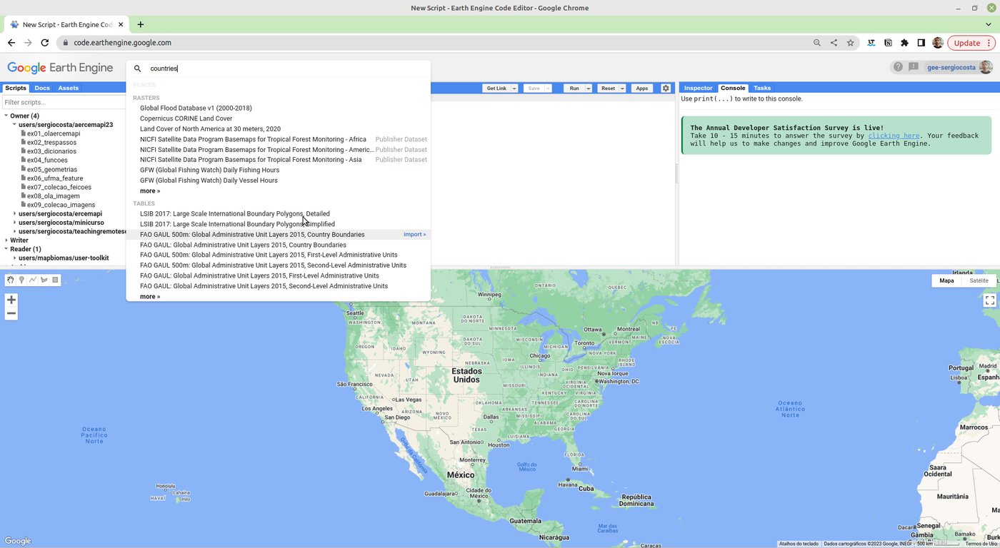

Clique em um dos resultados, como o **LSIB 2017: Large Scale International Boundary Polygons**:

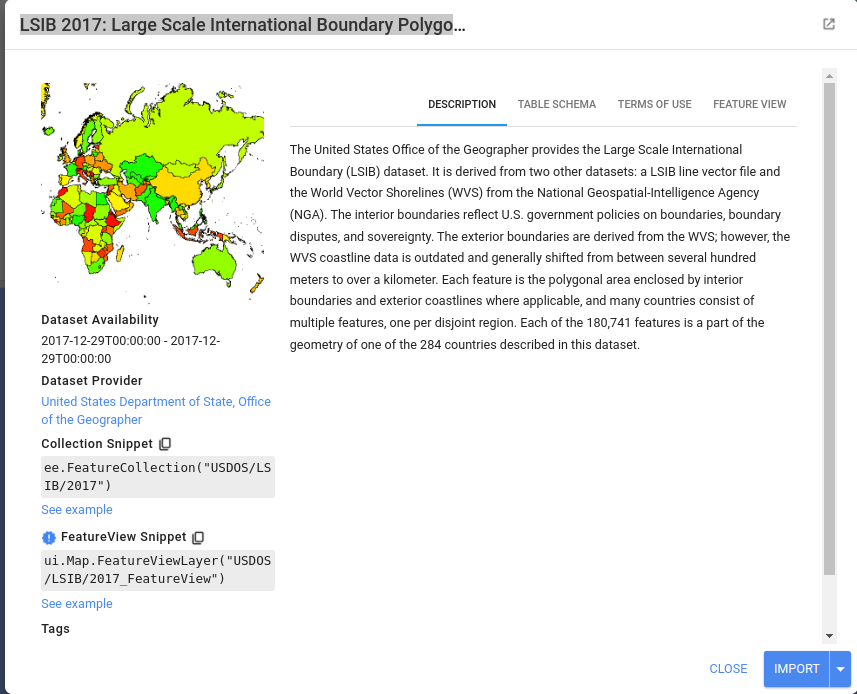

A partir dessa tela, há duas formas de carregar os dados. A primeira é clicar em **Import**: o conjunto aparece como uma variável (`table`) na seção de *imports* do *script*.

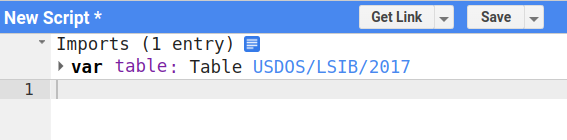

```javascript
Map.addLayer(table);
Map.setCenter(-37.77028535227355, -4.567792298842188, 1); // zoom 1: o mundo todo
```

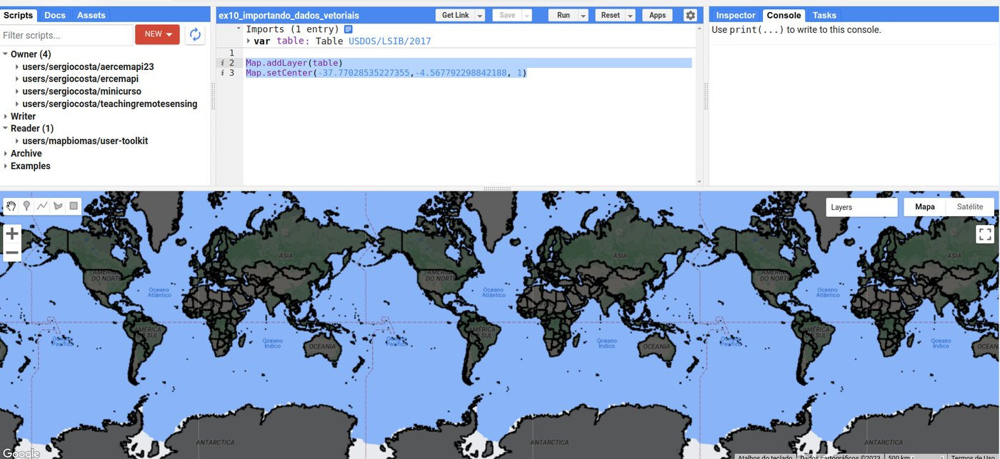

A segunda forma é copiar o trecho de código indicado em **Collection Snippet**, que contém o identificador (ID) do conjunto:

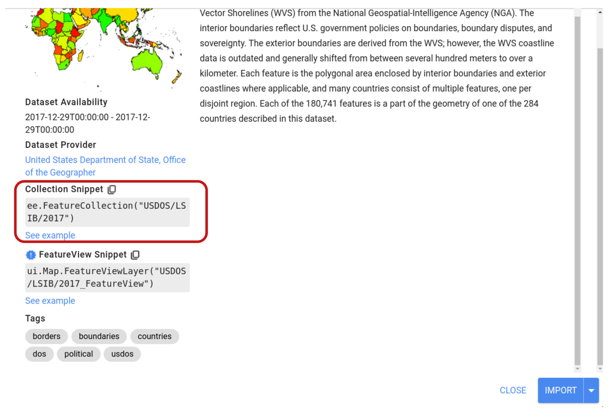

```javascript
var paises = ee.FeatureCollection('USDOS/LSIB_SIMPLE/2017');

Map.addLayer(paises, {}, 'Países');
Map.setCenter(-47.92, -15.80, 3); // centralizando em Brasília
```

Essa segunda forma é mais fácil de copiar e colar em outros *scripts*, e é a que usaremos no restante do livro.

### Enviando seus próprios dados (*assets*)

Como o catálogo tem poucas coleções vetoriais, é comum importar dados de outras fontes, no formato **Shapefile** (também aceitos: CSV com coordenadas e, via Google Cloud, outros formatos). No Brasil, o portal do **IBGE** disponibiliza as malhas territoriais de todo o país — veja outras fontes em [Fontes de Dados Geográficos](../anexos/fontes_dados.md).

!!! info "O formato Shapefile"
    O Shapefile (ou ESRI Shapefile) é um padrão amplamente usado para armazenar dados vetoriais e se tornou um formato comum para compartilhar dados geoespaciais. Apesar do nome no singular, um *shapefile* é um **conjunto de arquivos** com o mesmo nome e extensões diferentes: `.shp` (geometrias), `.shx` (índice), `.dbf` (atributos) e `.prj` (sistema de referência). Os quatro são necessários — envie-os juntos ou compactados em um `.zip`.

**1. Baixe a malha de municípios do Maranhão** no portal [Malha Municipal — IBGE](https://www.ibge.gov.br/geociencias/organizacao-do-territorio/malhas-territoriais/15774-malhas.html).

**2. Envie o arquivo ao GEE.** Na aba **Assets**, clique em **NEW** e escolha **Shape files**. Na janela que se abre, clique em **SELECT** para escolher os arquivos (ou o `.zip`), dê um nome ao *asset* e clique em **UPLOAD**. O andamento do envio aparece na aba **Tasks**.

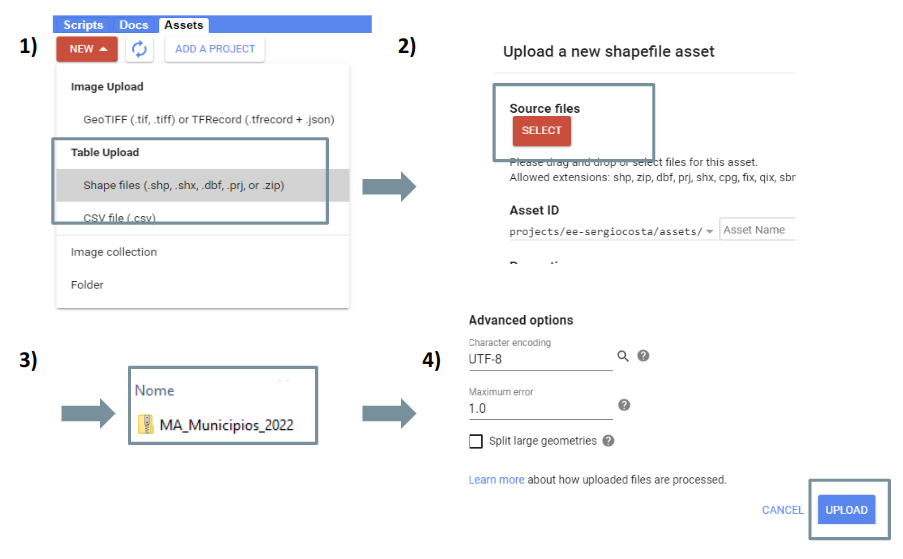

**3. Copie o identificador.** Após o envio, o dado aparece na aba **Assets**. Clique nele para ver seus detalhes e copiar o identificador (*Table ID*):

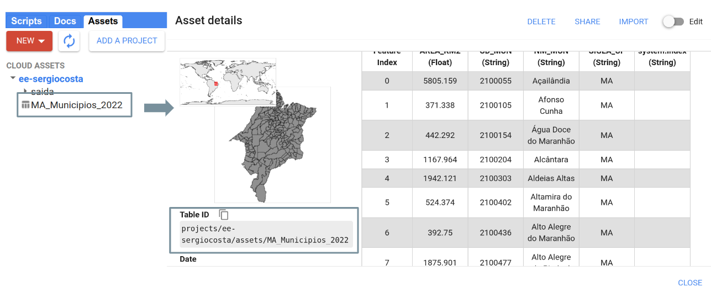

Com o identificador, os dados são carregados como qualquer outro conjunto do catálogo:

```javascript
var municipios = ee.FeatureCollection(
    'projects/ee-sergiocosta/assets/MA_Municipios_2022'
);

Map.addLayer(municipios, {}, 'Municípios do MA');
Map.centerObject(municipios, 6);
```

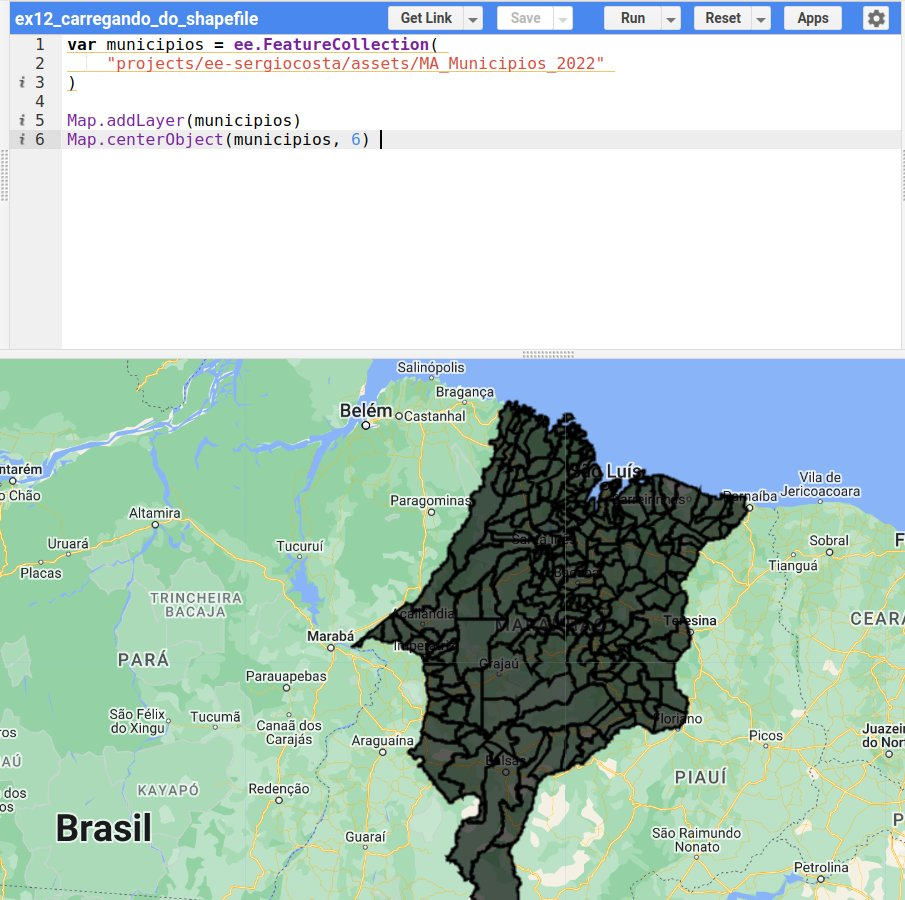

!!! warning "Use o identificador do **seu** *asset*"
    Os exemplos deste livro usam os *assets* do projeto do autor (`projects/ee-sergiocosta/assets/...`). Ao reproduzi-los, envie os dados para o seu projeto e **substitua o identificador** pelo seu — algo como `projects/ee-seunome/assets/MA_Municipios_2022`. Os dados usados nos exemplos estão disponíveis para download:

    - Municípios do Maranhão: [Malha Municipal — IBGE](https://www.ibge.gov.br/geociencias/organizacao-do-territorio/malhas-territoriais/15774-malhas.html) (arquivo `MA_Municipios_2022`);
    - Unidades federativas com o código numérico da região: [BR_UF.zip](../dados/BR_UF.zip) (versão simplificada, preparada para este livro);
    - Limites da Amazônia Legal: [Amazônia Legal — IBGE](https://www.ibge.gov.br/geociencias/organizacao-do-territorio/estrutura-territorial/15819-amazonia-legal.html);
    - Polos madeireiros e terras indígenas (Capítulo 7): [polos_madeireiros_mma.zip](../dados/polos_madeireiros_mma.zip) e [terras_indigenas.zip](../dados/terras_indigenas.zip).

---

## 🎨 Visualização dos dados vetoriais

Ao adicionar dados vetoriais com `Map.addLayer(municipios)`, eles aparecem em preto. O segundo parâmetro de `Map.addLayer` é um dicionário de **parâmetros de visualização**, e o terceiro é o **nome** da camada no gerenciador de camadas (*Layers*):

```javascript
var municipios = ee.FeatureCollection(
    'projects/ee-sergiocosta/assets/MA_Municipios_2022'
);

Map.addLayer(municipios, {color: 'FF0000'}, 'Municípios em vermelho');
Map.centerObject(municipios, 6);
```

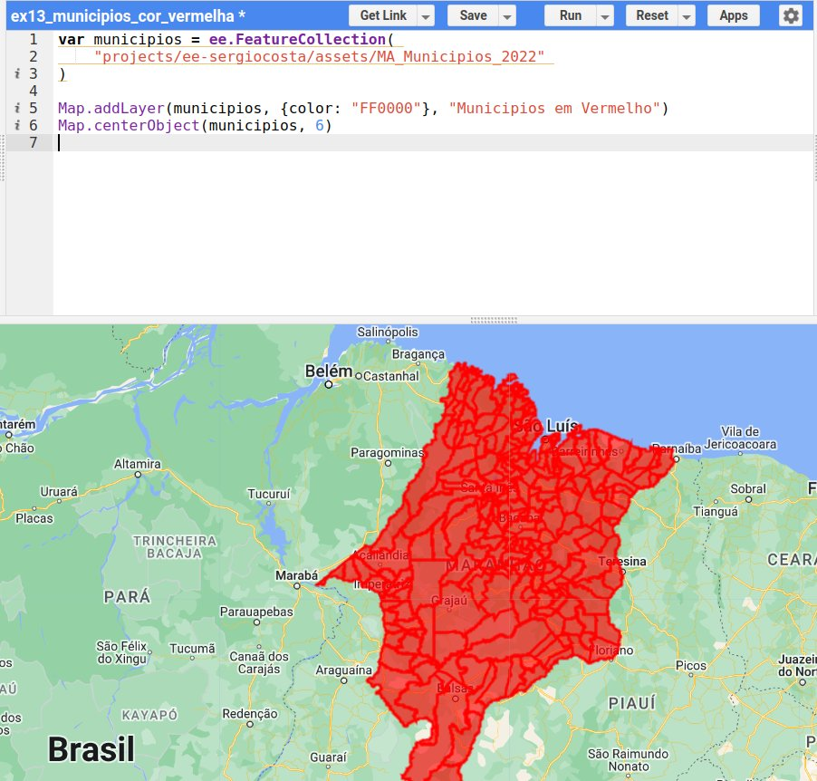

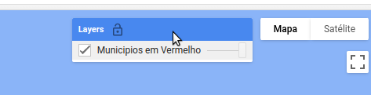

??? tip "Encontrando o código de uma cor"
    As cores são indicadas por códigos hexadecimais RGB (`RRGGBB`). Há vários *sites* que retornam o código de uma cor, e a própria busca do Google oferece um seletor — pesquise por *seletor de cores* ou *color picker*:

    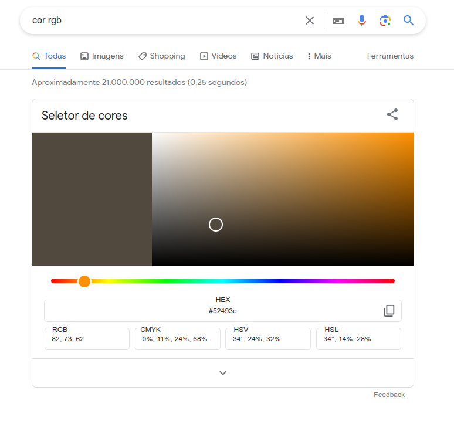

Com o parâmetro `color`, a borda e o preenchimento ficam na mesma cor. Para um controle mais detalhado, use o método **`.style()`** da coleção, que permite definir a cor e a largura da borda, a cor do preenchimento, o tipo de linha, entre outros:

```javascript
var municipios = ee.FeatureCollection(
    'projects/ee-sergiocosta/assets/MA_Municipios_2022'
);

Map.addLayer(municipios.style({
  fillColor: 'FF0000',  // cor de preenchimento
  color: '000000',      // cor da borda
  width: 1              // largura da borda
}), {}, 'Municípios');

Map.centerObject(municipios, 6);
```

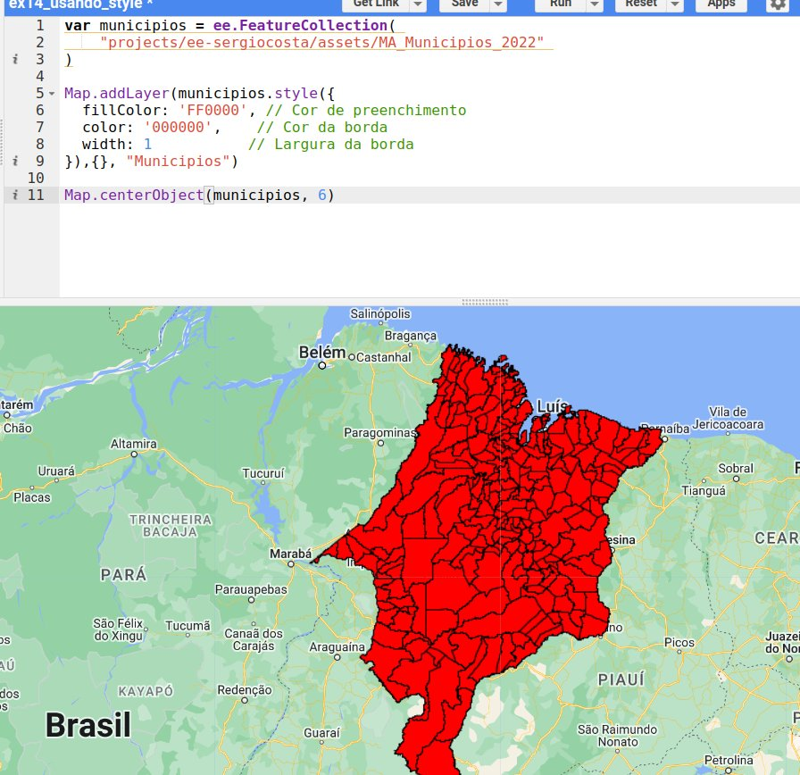

Veja todos os parâmetros em [ee.FeatureCollection.style](https://developers.google.com/earth-engine/apidocs/ee-featurecollection-style).

### Transparência

É possível acrescentar um canal **alfa** (transparência) à cor, passando do formato `RRGGBB` para `RRGGBBAA`. Cada par de dígitos hexadecimais vai de `00` (0) a `FF` (255). No canal alfa, `00` é totalmente transparente e `FF` totalmente opaco. Para obter o código de uma opacidade \(p\) (em %), calcule \(\text{round}(255 \times p / 100)\) e converta para hexadecimal:

| Opacidade | 100% | 90% | 80% | 75% | 60% | 50% | 40% | 25% | 20% | 10% | 0% |
|---|---|---|---|---|---|---|---|---|---|---|---|
| **Código** | `FF` | `E6` | `CC` | `BF` | `99` | `80` | `66` | `40` | `33` | `1A` | `00` |

Assim, `abffd180` é a cor `abffd1` (um verde-claro) com opacidade de 50% (`80` em hexadecimal = 128 em decimal).

### Mapas categóricos

Nos exemplos anteriores, todas as feições têm a mesma cor — uma **simbologia simples**. Muitas vezes, porém, precisamos de **mapas categóricos**, em que cada categoria recebe uma cor: tipos de uso da terra, classes de solo, divisões administrativas...

Considere a coleção de unidades federativas [BR_UF.zip](../dados/BR_UF.zip), em que cada UF tem um atributo numérico `CD_REGIAO` com o código de uma das cinco regiões do país (1 = Norte, 2 = Nordeste, 3 = Sudeste, 4 = Sul, 5 = Centro-Oeste). Para colorir por região, o truque é **transformar as feições em uma imagem**. Primeiro, criamos uma imagem vazia:

```javascript
var vazia = ee.Image().byte();
```

Em seguida, usamos o método `.paint()`, que recebe a coleção de feições e o atributo que definirá o valor dos pixels — neste caso, de 1 a 5:

```javascript
var regioes = vazia.paint(ufs, 'CD_REGIAO');
```

!!! info "Rasterização"
    O método `.paint()` realiza uma **rasterização**: converte dados vetoriais em uma matriz de pixels. O atributo usado precisa ser **numérico**.

Por fim, associamos uma paleta de cores aos valores: o valor 1 recebe a primeira cor da paleta, o valor 2 a segunda, e assim por diante.

```javascript
var paleta = ['408F70', 'FF0000', 'E7EB1B', 'FF8C4D', '9091C8'];
Map.addLayer(regioes, {palette: paleta, min: 1, max: 5}, 'Regiões');
```

O código completo:

```javascript
var ufs = ee.FeatureCollection('projects/ee-sergiocosta/assets/BR_UF');

Map.addLayer(ufs, {}, 'UFs');

// cores diferentes por região: é necessário trabalhar com imagens
var vazia = ee.Image().byte();

// rasterização pelo atributo numérico CD_REGIAO (1 a 5)
var regioes = vazia.paint(ufs, 'CD_REGIAO');

// os valores de 1 a 5 são associados às cores da paleta
var paleta = ['408F70', 'FF0000', 'E7EB1B', 'FF8C4D', '9091C8'];
Map.addLayer(regioes, {palette: paleta, min: 1, max: 5}, 'Regiões');

Map.centerObject(ufs, 4);
```

| Camada "UFs" | Camada "Regiões" |
|:---:|:---:|
| 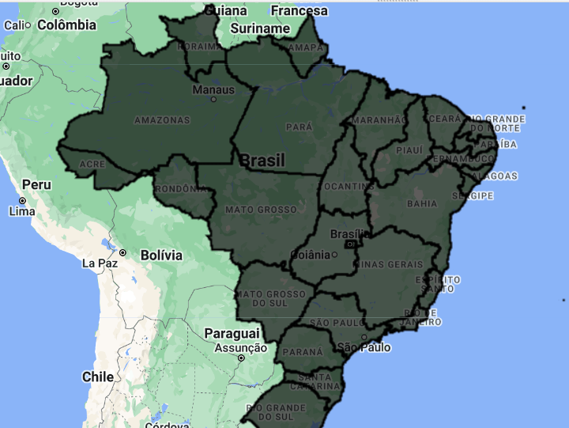 | 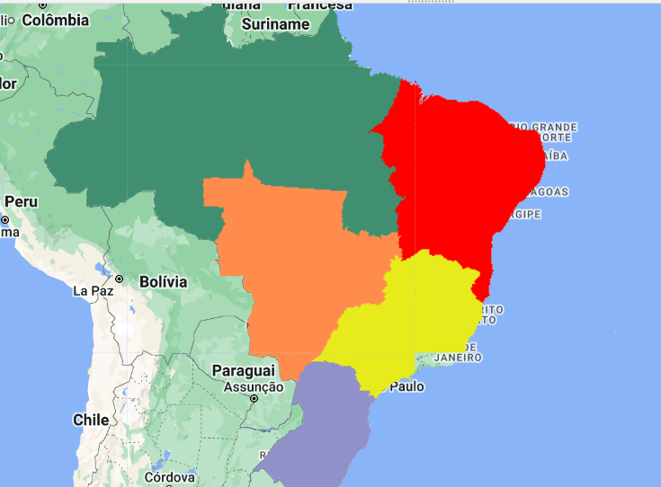 |

---

## 🔎 Seleção de dados vetoriais

As operações de seleção são cruciais para extrair informações relevantes de conjuntos de dados geográficos. Nos SIGs, elas permitem filtrar e consultar elementos por **atributos não espaciais**, por **relações espaciais** ou por interação direta (como clicar em um objeto). O GEE oferece grande parte dessas seleções por meio do método `.filter()`, que recebe um **filtro** (`ee.Filter`).

### Seleção por atributos

A seleção por atributos filtra os elementos de uma coleção com base nos valores de seus atributos. Suponha que queremos apenas os municípios do Maranhão com mais de 8.000 km². Como a área de cada município está no atributo `AREA_KM2`:

```javascript
var filtroArea = ee.Filter.gt('AREA_KM2', 8000);  // gt = greater than (maior que)
var municipiosAcima8000 = municipios.filter(filtroArea);
```

Código completo:

```javascript
var municipios = ee.FeatureCollection(
    'projects/ee-sergiocosta/assets/MA_Municipios_2022'
);

var filtroArea = ee.Filter.gt('AREA_KM2', 8000);
var municipiosAcima8000 = municipios.filter(filtroArea);

print('Quantidade:', municipiosAcima8000.size());
Map.addLayer(municipiosAcima8000, {color: 'FF0000'}, 'Área maior que 8000 km²');
Map.centerObject(municipiosAcima8000, 6);
```

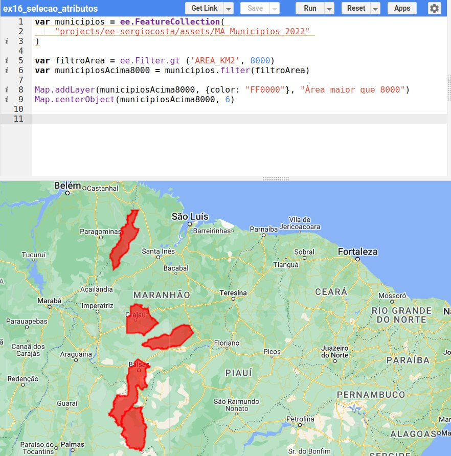

Os filtros de comparação mais comuns são:

| Filtro | Significado | Exemplo |
|---|---|---|
| `ee.Filter.eq(nome, valor)` | igual a | `ee.Filter.eq('SIGLA_UF', 'MA')` |
| `ee.Filter.neq(nome, valor)` | diferente de | `ee.Filter.neq('NM_MUN', 'São Luís')` |
| `ee.Filter.gt` / `ee.Filter.gte` | maior que / maior ou igual | `ee.Filter.gte('AREA_KM2', 1000)` |
| `ee.Filter.lt` / `ee.Filter.lte` | menor que / menor ou igual | `ee.Filter.lt('CLOUD_COVER', 20)` |
| `ee.Filter.inList(nome, lista)` | valor pertence à lista | `ee.Filter.inList('NM_MUN', ['Caxias', 'Codó'])` |
| `ee.Filter.and(f1, f2)` / `ee.Filter.or(f1, f2)` | combinação de filtros | ver Capítulo 7 |
| `filtro.not()` | negação | `ee.Filter.gt('AREA_KM2', 8000).not()` |

### Seleção espacial

A seleção espacial filtra os elementos com base em sua **localização**: os que estão contidos em uma área de interesse, próximos a um ponto ou ao longo de uma linha. Considere uma coleção com os municípios do Maranhão e outra com a delimitação da **Amazônia Legal**:

```javascript
var amazoniaLegal = ee.FeatureCollection(
    'projects/ee-sergiocosta/assets/brazilian_legal_amazon'
);

var municipiosMA = ee.FeatureCollection(
    'projects/ee-sergiocosta/assets/MA_Municipios_2022'
);
```

Queremos os municípios que tenham **alguma parte** do seu território dentro da Amazônia Legal (não necessariamente todo o município). O filtro `ee.Filter.bounds` implementa a operação de **intersecção** entre geometrias:

```javascript
var interceptaAmazoniaLegal = ee.Filter.bounds(amazoniaLegal);
var dentroAmazonia = municipiosMA.filter(interceptaAmazoniaLegal);
```

Com a negação do filtro, obtemos o resultado inverso — os municípios totalmente fora da Amazônia Legal:

```javascript
var foraAmazonia = municipiosMA.filter(interceptaAmazoniaLegal.not());
```

O código completo, apresentando cada grupo com uma cor:

```javascript
// ENTRADA
var amazoniaLegal = ee.FeatureCollection(
    'projects/ee-sergiocosta/assets/brazilian_legal_amazon'
);
var municipiosMA = ee.FeatureCollection(
    'projects/ee-sergiocosta/assets/MA_Municipios_2022'
);

// PROCESSAMENTO
var interceptaAmazoniaLegal = ee.Filter.bounds(amazoniaLegal);
var dentroAmazonia = municipiosMA.filter(interceptaAmazoniaLegal);
var foraAmazonia = municipiosMA.filter(interceptaAmazoniaLegal.not());

// APRESENTAÇÃO/SAÍDA
Map.addLayer(dentroAmazonia.style({
  fillColor: '50824e', color: '000000', width: 1
}), {}, 'Municípios na Amazônia Legal');

Map.addLayer(foraAmazonia.style({
  fillColor: 'ed5d28', color: '000000', width: 1
}), {}, 'Municípios fora da Amazônia Legal');

Map.addLayer(amazoniaLegal.style({
  fillColor: 'abffd180',  // verde-claro com 50% de opacidade
  color: '000000', width: 1
}), {}, 'Amazônia Legal');

Map.centerObject(amazoniaLegal, 6);
```

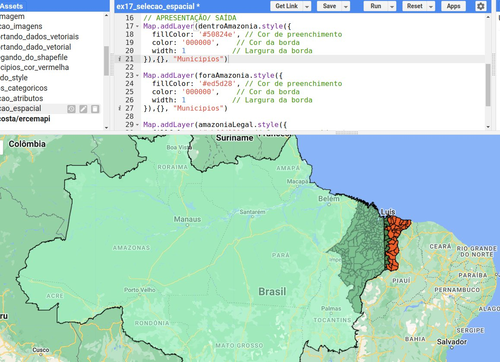

### Seleção combinada

Filtros espaciais e de atributos podem ser **encadeados**. Para selecionar os municípios que estão fora da Amazônia Legal **e** têm mais de 3.000 km²:

```javascript
// ENTRADA
var amazoniaLegal = ee.FeatureCollection(
    'projects/ee-sergiocosta/assets/brazilian_legal_amazon'
);
var municipiosMA = ee.FeatureCollection(
    'projects/ee-sergiocosta/assets/MA_Municipios_2022'
);

// PROCESSAMENTO
var interceptaAmazoniaLegal = ee.Filter.bounds(amazoniaLegal);
var filtroArea = ee.Filter.gt('AREA_KM2', 3000);

var selecionados = municipiosMA
    .filter(interceptaAmazoniaLegal.not())
    .filter(filtroArea);

// APRESENTAÇÃO/SAÍDA
Map.addLayer(selecionados.style({
  fillColor: 'ed5d28', color: '000000', width: 1
}), {}, 'Fora da Amazônia Legal e > 3000 km²');

Map.addLayer(amazoniaLegal.style({
  fillColor: 'abffd180', color: '000000', width: 1
}), {}, 'Amazônia Legal');

Map.centerObject(amazoniaLegal, 6);
```

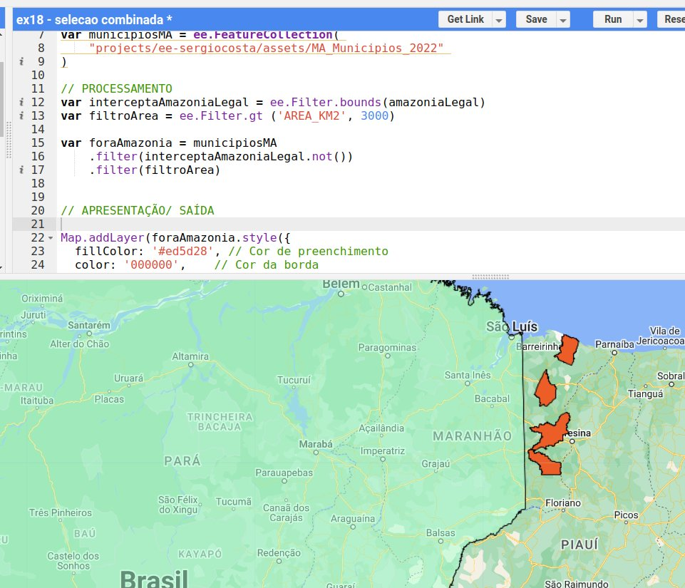

!!! tip "Encadear ou combinar?"
    Encadear dois `.filter()` equivale a combiná-los com **E** lógico. O mesmo resultado poderia ser obtido com um único filtro: `ee.Filter.and(interceptaAmazoniaLegal.not(), filtroArea)`. Para o **OU** lógico, é obrigatório usar `ee.Filter.or(...)`.

---

## 📝 Síntese

- Dados vetoriais vêm do **catálogo** (poucos) ou de ***assets*** enviados pelo usuário (Shapefile, CSV).
- A visualização é controlada pelos parâmetros de `Map.addLayer` (`color`) ou, com mais detalhe, por `.style()`; mapas categóricos exigem **rasterizar** as feições com `.paint()`.
- A seleção usa `.filter()` com filtros de **atributo** (`ee.Filter.eq`, `gt`, `lt`...), **espaciais** (`ee.Filter.bounds`) e suas combinações (`.not()`, `and`, `or`).

## ✏️ Exercícios

Estes exercícios fazem parte da [Atividade 1](09_exercicios.md#atividade-1-selecao-e-visualizacao).

1. Carregue a coleção `USDOS/LSIB_SIMPLE/2017` e selecione apenas os países da América do Sul (dica: explore os atributos no Console e use `ee.Filter.eq` com o atributo de região, `wld_rgn`).
2. Envie ao GEE a malha municipal do seu estado e exiba-a com borda azul de largura 2 e preenchimento transparente.
3. Selecione os municípios do seu estado com área menor que 500 km² e mostre quantos são com `print(...size())`.
4. Com a coleção BR_UF, faça um mapa categórico com uma cor diferente para cada região, usando uma paleta escolhida por você.
5. Selecione os municípios maranhenses **dentro** da Amazônia Legal com área maior que 5.000 km², usando um único `ee.Filter.and`.
