# Seleção e Visualização de Dados Matriciais

A principal fonte de dados matriciais é o próprio catálogo do Google Earth Engine, que abriga coleções dos principais programas internacionais de sensoriamento remoto:

- **Landsat** — uma das fontes mais antigas e confiáveis de imagens da Terra (desde 1972), ideal para monitorar mudanças no uso da terra, desmatamento e agricultura;
- **Sentinel** — do programa Copernicus da União Europeia, com imagens ópticas (Sentinel-2) e de radar (Sentinel-1), usadas no monitoramento ambiental, na detecção de incêndios e no acompanhamento de eventos extremos;
- **MODIS** — imagens diárias de resolução moderada;
- **SRTM** — o modelo digital de elevação que vimos no Capítulo 2;
- além de dados climáticos, mapas de cobertura da terra e muitos outros.

Imagens de programas que não estão no catálogo, como as do **CBERS**, podem ser enviadas como *assets*, de modo semelhante ao que fizemos com os *shapefiles*.

No caso das imagens de satélite, é mais comum trabalhar com **coleções** do que com imagens individuais. Ainda assim, como nos dados vetoriais, podemos acessar uma imagem pelo seu identificador:

```javascript
var image = ee.Image('LANDSAT/LC08/C02/T1_TOA/LC08_220062_20190504');

Map.addLayer(image, {}, 'Landsat 8');
Map.centerObject(image, 8);
```

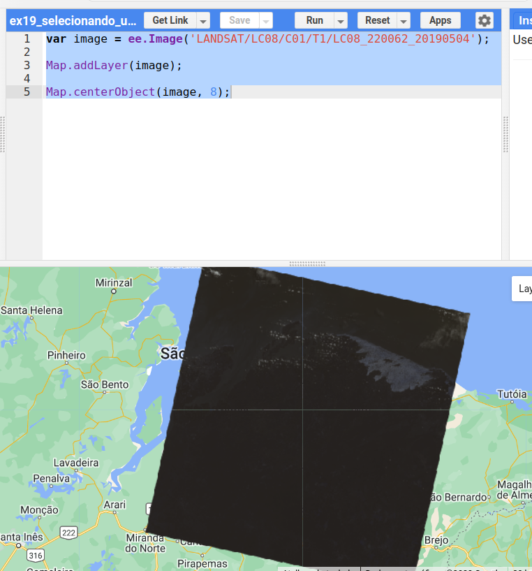

A imagem aparece quase preta e pouco informativa: faltam os **parâmetros de visualização**.

---

## 🎨 Visualização de dados matriciais

A escolha dos parâmetros de visualização é crucial para a interpretação de imagens. Vamos usar como exemplo uma imagem de **NDVI** (*Normalized Difference Vegetation Index*), cujos valores variam de −1 a 1 (o índice será explicado no [Capítulo 8](08_processamento_matricial.md)):

```javascript
var image = ee.Image('LANDSAT/LC08/C02/T1_TOA/LC08_220062_20190504');
var ndvi = image.normalizedDifference(['B5', 'B4']);
```

### Mínimo e máximo

Por padrão, uma imagem de uma banda é representada em **tons de cinza**: o valor mínimo é mapeado para o preto e o máximo para o branco. No caso do NDVI, os valores de −1 a 1 seriam distribuídos pelos 256 tons de cinza da tela:

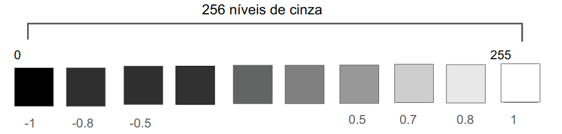

Mas os valores de uma cena real raramente ocupam todo o intervalo teórico. Para saber quais são os valores mais frequentes, recorremos ao **histograma**:

```javascript
var roi = ee.Geometry.Polygon(
    [[[-44.40094120999187, -2.2314841101817464],
      [-44.40094120999187, -2.8900019126297876],
      [-43.43963749905437, -2.8900019126297876],
      [-43.43963749905437, -2.2314841101817464]]]);

var image = ee.Image('LANDSAT/LC08/C02/T1_TOA/LC08_220062_20190504');
var ndvi = image.normalizedDifference(['B5', 'B4']);

var histograma = ui.Chart.image.histogram({image: ndvi, region: roi, scale: 30});

print(histograma);
Map.addLayer(roi, {}, 'Região do histograma');
Map.centerObject(roi, 9);
```

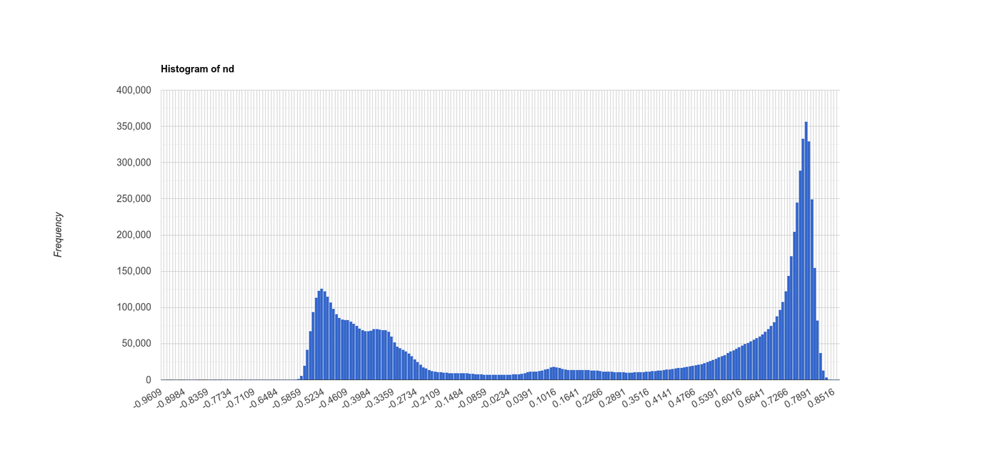

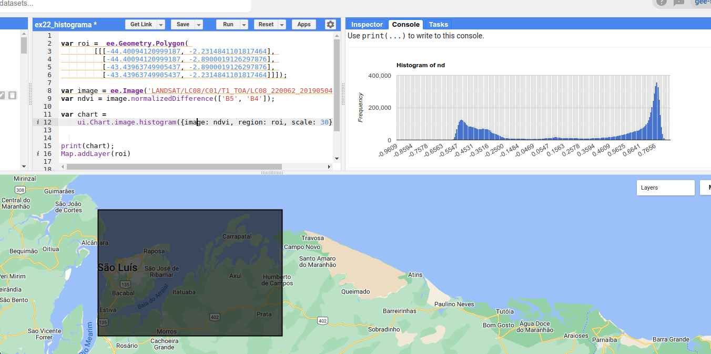

Pelo histograma, os valores se concentram entre **−0,5 e 0,8**. Podemos então definir esses limites como mínimo e máximo: todos os valores abaixo de −0,5 serão mapeados para o preto, e todos acima de 0,8 para o branco. Os 256 tons de cinza passam a ser usados apenas onde há dados — e o contraste melhora.

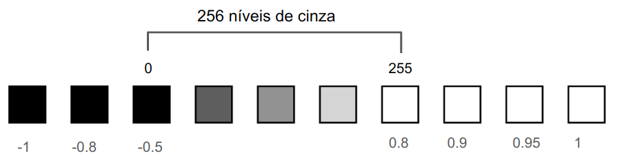

| Mínimo −1 e máximo 1 | Mínimo −0,5 e máximo 0,8 |
|:---:|:---:|
| 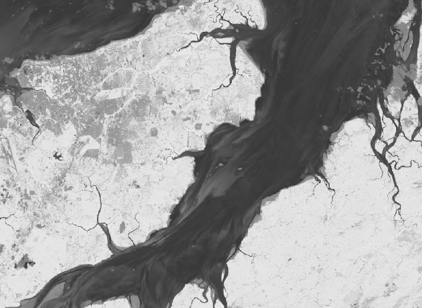 |  |

### Paletas de cores

Em vez de tons de cinza, podemos definir uma **paleta de cores**:

```javascript
var paleta = ['red', 'yellow', 'green'];
```

Com essa paleta, o valor mínimo é mapeado para o vermelho, o máximo para o verde, e os valores intermediários são interpolados linearmente, passando pelo amarelo. Os parâmetros de mínimo e máximo continuam tendo grande impacto, como mostra a figura: em (a), sem paleta; em (b), com a paleta e os limites padrão; em (c), com a paleta e os limites ajustados.

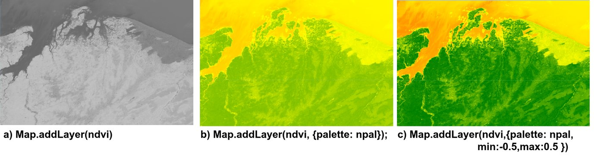

```javascript
var image = ee.Image('LANDSAT/LC08/C02/T1_TOA/LC08_220062_20190504');
var ndvi = image.normalizedDifference(['B5', 'B4']);

var paleta = ['red', 'yellow', 'green'];

Map.addLayer(ndvi, {}, 'Tons de cinza');
Map.addLayer(ndvi, {min: -0.5, max: 0.8}, 'Tons de cinza, -0.5 a 0.8');
Map.addLayer(ndvi, {palette: paleta}, 'Paleta sem min e max');
Map.addLayer(ndvi, {palette: paleta, min: -0.5, max: 0.8}, 'Paleta, -0.5 a 0.8');

Map.centerObject(ndvi, 8);
```

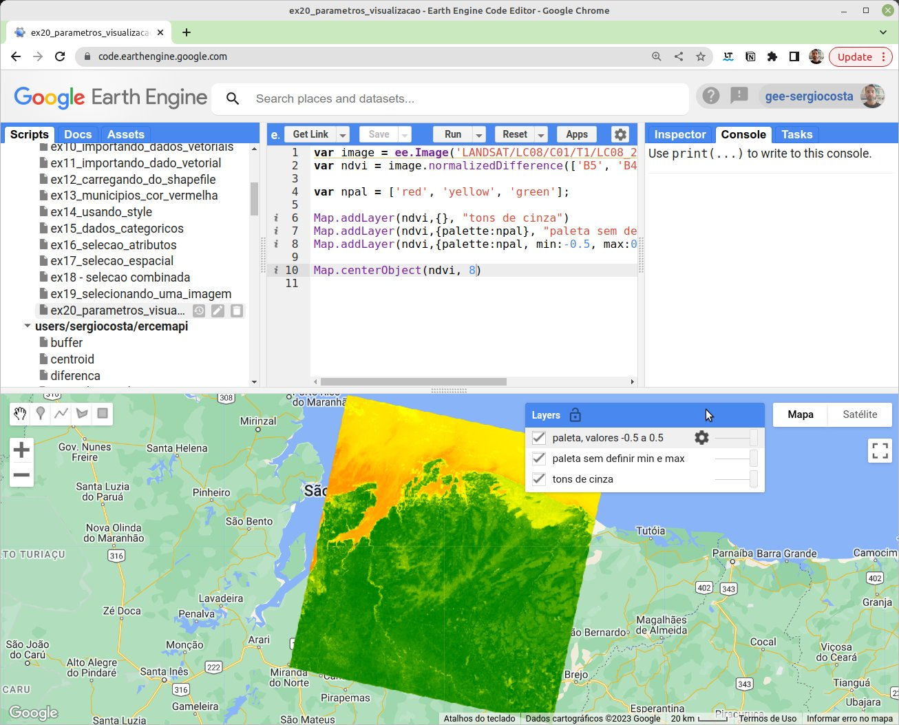

!!! tip "Ajustando pelo gerenciador de camadas"
    No gerenciador de camadas (*Layers*), clique na engrenagem ao lado de uma camada para ajustar interativamente o mínimo, o máximo, a paleta e a opacidade. A opção *Stretch* calcula automaticamente limites a partir do histograma da área visível. Depois de encontrar bons valores, clique em **Import** para levá-los ao seu código.

!!! info "Paletas prontas"
    Criar boas paletas é difícil. O pacote comunitário [ee-palettes](https://github.com/gee-community/ee-palettes) oferece dezenas delas:

    ```javascript
    var palettes = require('users/gena/packages:palettes');
    var paleta = palettes.colorbrewer.RdYlGn[9];
    Map.addLayer(ndvi, {min: -0.5, max: 0.8, palette: paleta}, 'NDVI');
    ```

### Composições coloridas

Na interpretação de imagens multiespectrais, é prática comum criar **composições coloridas**: associar três bandas aos três canais de cor da tela — vermelho (R), verde (G) e azul (B). Nas composições em **cor verdadeira**, cada banda vai para o canal correspondente: a banda do vermelho no canal vermelho, a do verde no verde e a do azul no azul. Nas composições em **falsa cor**, usam-se outras combinações. A composição B5 (infravermelho próximo), B4 (vermelho) e B3 (verde) do Landsat 8, por exemplo, realça a vegetação, que aparece em tons de vermelho — lembre-se da assinatura espectral da vegetação, com alta reflectância no infravermelho próximo.

```javascript
var image = ee.Image('LANDSAT/LC08/C02/T1_TOA/LC08_220062_20190504');

var corVerdadeira = ['B4', 'B3', 'B2'];
var falsaCor = ['B5', 'B4', 'B3'];

Map.addLayer(image, {bands: falsaCor, min: 0.03, max: 0.4}, 'Falsa cor 5-4-3');
Map.addLayer(image, {bands: corVerdadeira, min: 0.03, max: 0.4}, 'Cor verdadeira 4-3-2');

Map.centerObject(image, 8);
```

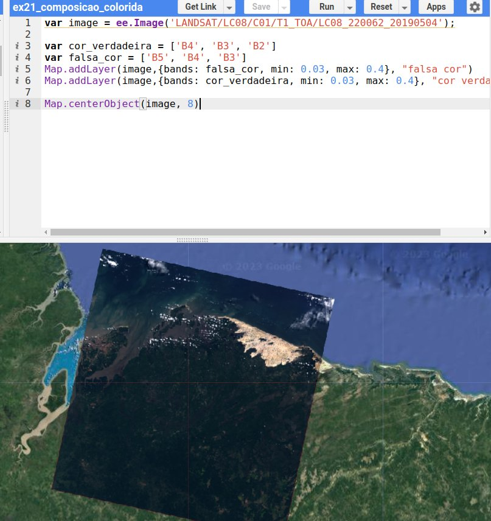

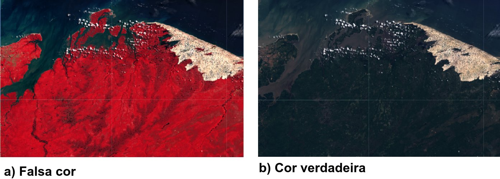

!!! note "Reflectância no topo da atmosfera"
    Os limites de 0,03 a 0,4 fazem sentido porque a coleção `T1_TOA` já está em unidades de **reflectância no topo da atmosfera** (*Top of Atmosphere*), entre 0 e 1. Coleções em números digitais ou em reflectância de superfície exigem outros limites (Capítulo 8).

!!! abstract "Antes de montar uma composição"
    É importante saber em que faixa do espectro está cada banda (tabela do [Capítulo 2](02_sensoriamento_remoto.md#resolucao-espectral)) e qual a **assinatura espectral** do alvo que se deseja realçar. Algumas composições clássicas para Landsat 8/9:

    | Composição (R-G-B) | Uso típico |
    |---|---|
    | 4-3-2 | Cor verdadeira, próxima do que o olho humano vê |
    | 5-4-3 | Falsa cor: vegetação em vermelho |
    | 6-5-4 | Distinção entre vegetação, solo exposto e áreas urbanas |
    | 7-6-4 | Áreas urbanas, solos e geologia; atravessa melhor a fumaça |
    | 5-6-2 | Agricultura: culturas saudáveis em verde vivo |

---

## 🔎 Seleção de dados matriciais

Com coleções que somam centenas de milhares de imagens, a **seleção** é o primeiro passo de qualquer análise. As imagens de satélite são selecionadas por critérios **espaciais**, **temporais** e de **metadados** — os mesmos disponíveis nos formulários dos catálogos tradicionais, como o do INPE:

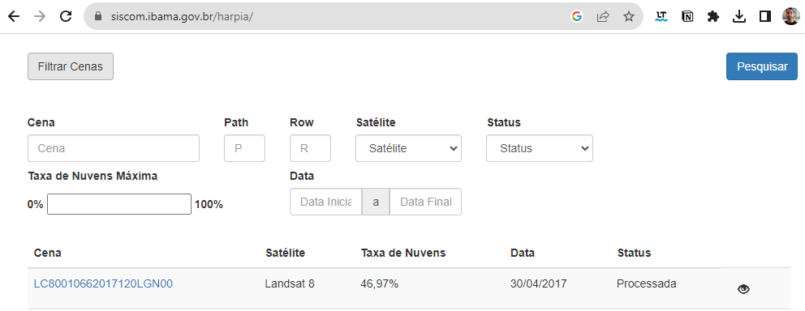

A diferença é que, no GEE, esses critérios são escritos em um *script*: um processo que, de outra forma, exigiria preencher cada campo e clicar em "pesquisar", torna-se **automatizado e reprodutível**, e permite combinações que nenhum formulário oferece.

### Seleção espacial

Queremos apenas as imagens que cobrem o município de São Luís. Primeiro, selecionamos o município pela seleção por atributo que vimos no capítulo anterior (o código IBGE de São Luís é 2111300); depois, filtramos a coleção de imagens com `.filterBounds()`:

```javascript
var municipios = ee.FeatureCollection(
    'projects/ee-sergiocosta/assets/MA_Municipios_2022'
);

// código IBGE de São Luís
var saoluis = municipios.filter(ee.Filter.eq('CD_MUN', '2111300'));

var imagens = ee.ImageCollection('LANDSAT/LC09/C02/T1')
    .filterBounds(saoluis);

print('Quantidade de imagens:', imagens.size());
```

### Seleção temporal

Em aplicações de sensoriamento remoto, quase sempre precisamos de uma **seleção temporal**. O código a seguir seleciona apenas as imagens de 1º de janeiro a 30 de outubro de 2022:

```javascript
var imagens = ee.ImageCollection('LANDSAT/LC09/C02/T1')
    .filterBounds(saoluis)
    .filterDate('2022-01-01', '2022-10-30');

print('Quantidade de imagens:', imagens.size());  // 49, quando este texto foi escrito
```

Adicione a primeira imagem da coleção ao mapa e observe:

```javascript
var primeiraImagem = imagens.first();
Map.addLayer(primeiraImagem, {bands: ['B4', 'B3', 'B2'], min: 5000, max: 15000}, 'Primeira imagem');
Map.centerObject(saoluis, 9);
```

É bem provável que ela esteja coberta de nuvens — algo muito comum no litoral maranhense durante a estação chuvosa.

### Seleção por metadados

Em vez de atributos, as imagens têm **metadados**: informações registradas para cada cena, como data, sensor, ângulo solar e o **percentual de cobertura de nuvens**. Clique em uma imagem com a aba **Inspector** aberta para vê-los, ou imprima a lista completa:

```javascript
print(primeiraImagem.propertyNames());
```

Os mesmos filtros que usamos para atributos servem para metadados. O código a seguir seleciona apenas as imagens com **menos de 20% de nuvens** e as ordena, de forma crescente, pela cobertura de nuvens:

```javascript
var municipios = ee.FeatureCollection(
    'projects/ee-sergiocosta/assets/MA_Municipios_2022'
);
var saoluis = municipios.filter(ee.Filter.eq('CD_MUN', '2111300'));

var imagens = ee.ImageCollection('LANDSAT/LC09/C02/T1')
    .filterBounds(saoluis)
    .filterDate('2022-01-01', '2022-10-30')
    .filter(ee.Filter.lt('CLOUD_COVER', 20))
    .sort('CLOUD_COVER');

print('Quantidade de imagens:', imagens.size());  // 8, quando este texto foi escrito

var melhor = imagens.first();  // a de menor cobertura de nuvens
Map.addLayer(melhor, {bands: ['B4', 'B3', 'B2'], min: 5000, max: 15000}, 'Menos nuvens');
Map.centerObject(saoluis, 9);
```

!!! warning "`filterMetadata` está obsoleto"
    Materiais mais antigos (inclusive versões anteriores deste curso) usam `.filterMetadata('CLOUD_COVER', 'less_than', 20)`. Esse método foi **descontinuado** pelo GEE; use `.filter(ee.Filter.lt('CLOUD_COVER', 20))`.

### *Path* e *row*

Talvez a imagem com menos nuvens nem seja da área que você esperava: o município de São Luís é coberto por mais de uma cena Landsat. As cenas são indexadas pelo par **path/row** do sistema de referência mundial (WRS-2): o *path* corresponde às órbitas, que se sucedem de leste para oeste, e o *row* à posição ao longo da órbita, de norte para sul. A cena que cobre a Ilha do Maranhão é a **220/062**. Filtrando por esses metadados, não é mais necessário usar `.filterBounds()`, pois o par já define a localização:

```javascript
var imagens = ee.ImageCollection('LANDSAT/LC09/C02/T1')
    .filterDate('2022-01-01', '2022-10-30')
    .filter(ee.Filter.lt('CLOUD_COVER', 20))
    .filter(ee.Filter.eq('WRS_PATH', 220))
    .filter(ee.Filter.eq('WRS_ROW', 62))
    .sort('CLOUD_COVER');

print('Quantidade de imagens:', imagens.size());
```

!!! tip "Principais parâmetros para seleção de imagens"
    | Critério | Método | Exemplo |
    |---|---|---|
    | Espacial | `.filterBounds(geometria)` | `.filterBounds(saoluis)` |
    | Temporal | `.filterDate(início, fim)` | `.filterDate('2022-01-01', '2023-01-01')` |
    | Sazonal | `ee.Filter.calendarRange` | `.filter(ee.Filter.calendarRange(6, 9, 'month'))` |
    | Metadados | `ee.Filter.lt/eq/...` | `.filter(ee.Filter.lt('CLOUD_COVER', 20))` |
    | Ordenação | `.sort(propriedade)` | `.sort('CLOUD_COVER')` |

---

## 📝 Síntese

- A visualização de imagens depende do **mínimo**, do **máximo** (escolhidos com apoio do histograma) e da **paleta**; imagens multiespectrais são exibidas por **composições coloridas**.
- A seleção de imagens combina filtros **espaciais** (`filterBounds`), **temporais** (`filterDate`, `calendarRange`) e de **metadados** (`CLOUD_COVER`, `WRS_PATH`, `WRS_ROW`).

## ✏️ Exercícios

Estes exercícios fazem parte da [Atividade 1](09_exercicios.md#atividade-1-selecao-e-visualizacao).

1. Gere o histograma do NDVI de uma região da sua escolha e escolha, a partir dele, os limites de visualização. Justifique a escolha.
2. Exiba a cena `LC08_220062_20190504` nas composições 4-3-2, 5-4-3 e 6-5-4. Descreva o que cada uma realça nos Lençóis Maranhenses.
3. Selecione as imagens Landsat 8 (`LANDSAT/LC08/C02/T1_TOA`) que cobrem a sua cidade em 2023 com menos de 10% de nuvens. Quantas são? Exiba a de menor cobertura.
4. Repita o exercício anterior apenas para os meses de julho a novembro, com `ee.Filter.calendarRange`. O número de imagens aumentou ou diminuiu em relação a uma seleção de janeiro a maio? Por quê?
5. Descubra o *path/row* da cena Landsat que cobre a sua cidade (dica: use o *Inspector* sobre uma imagem) e refaça a seleção usando esses metadados.
