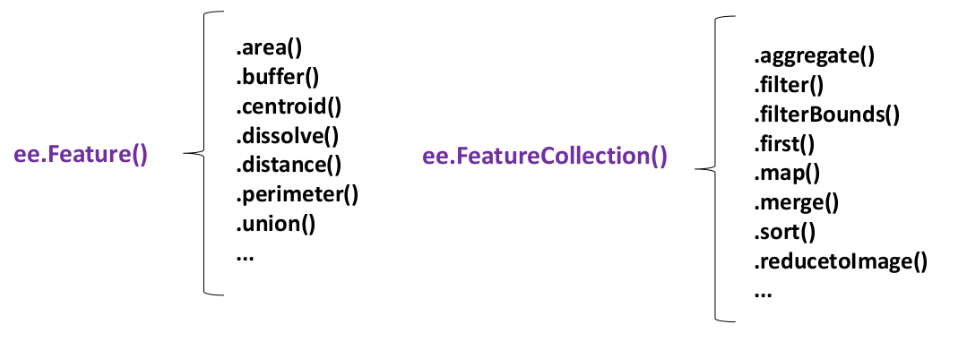
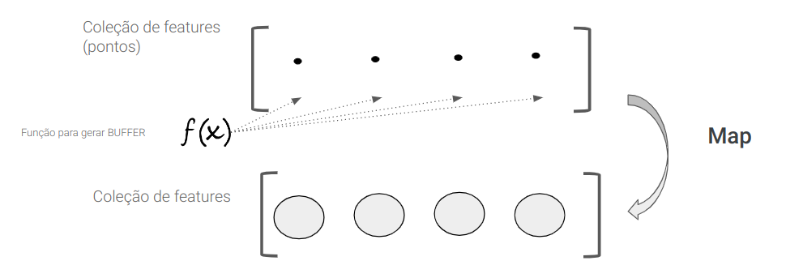
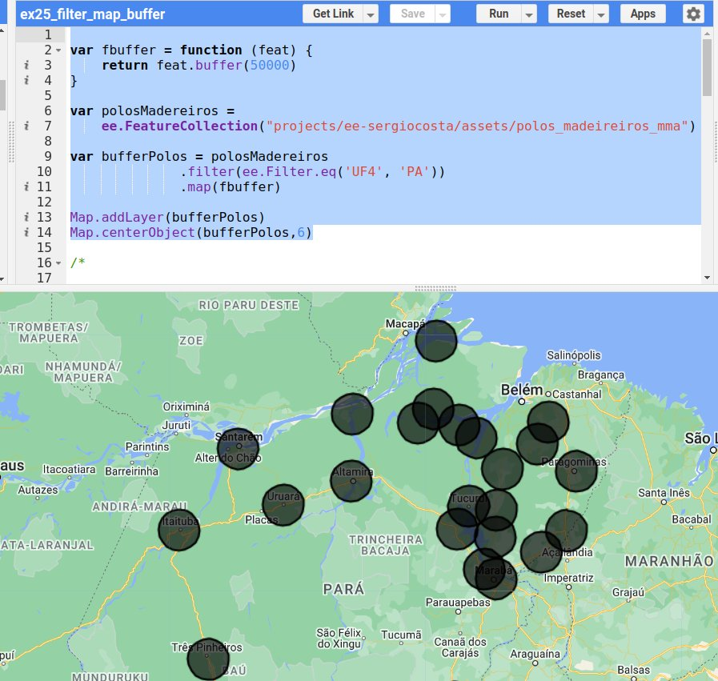
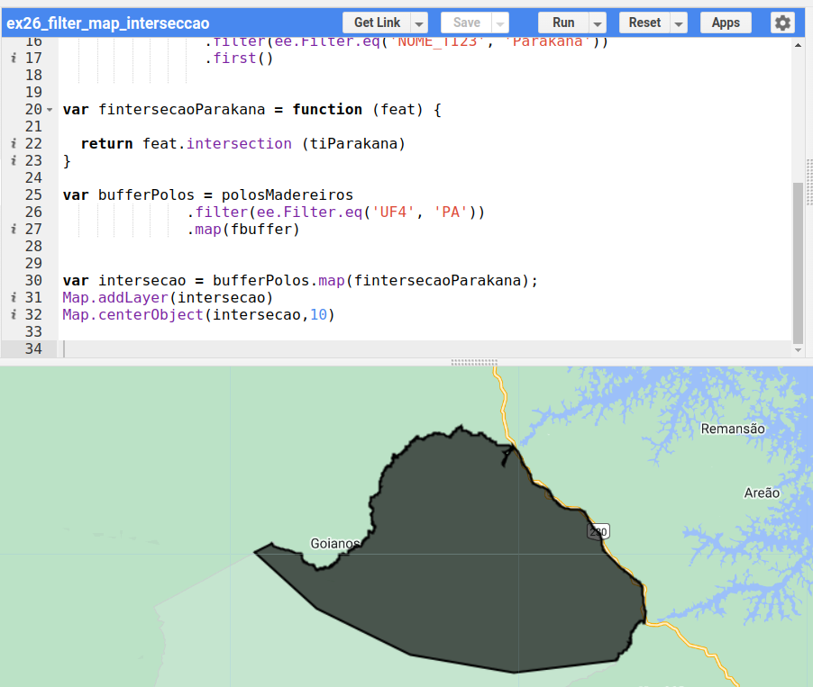
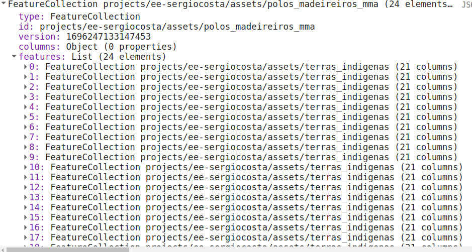
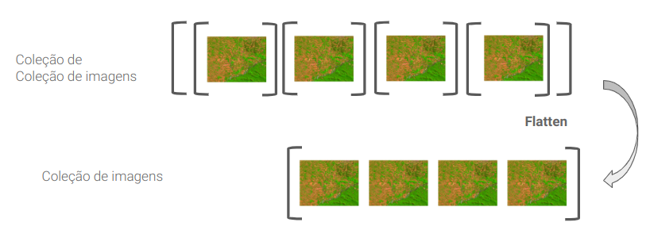
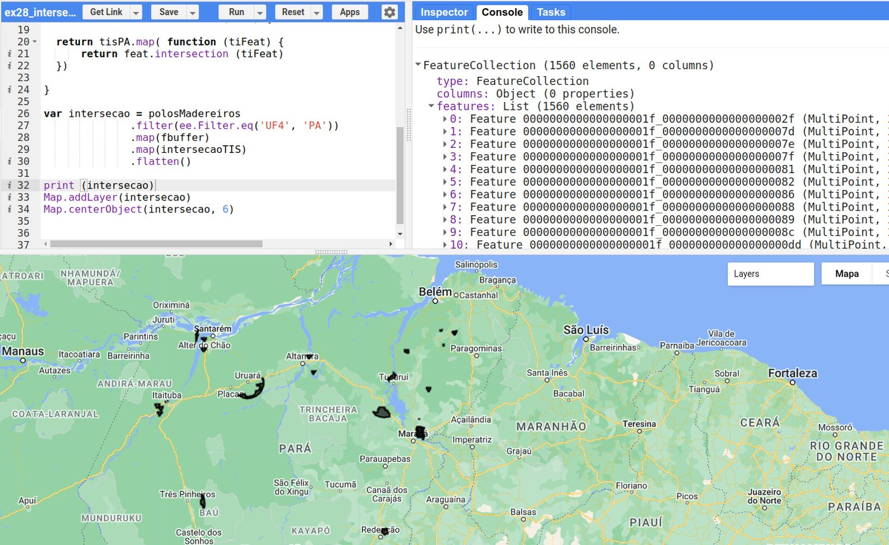
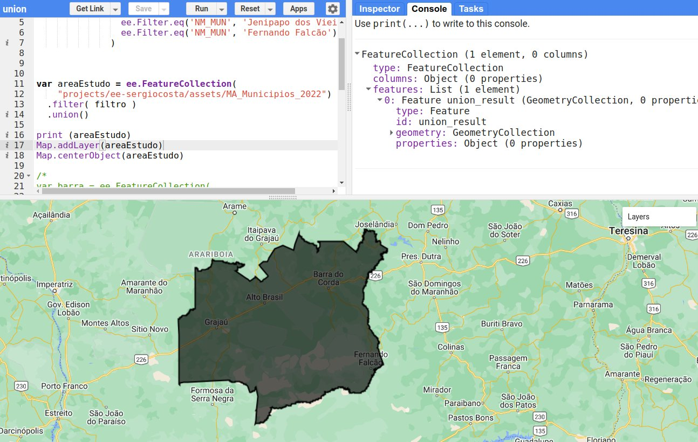
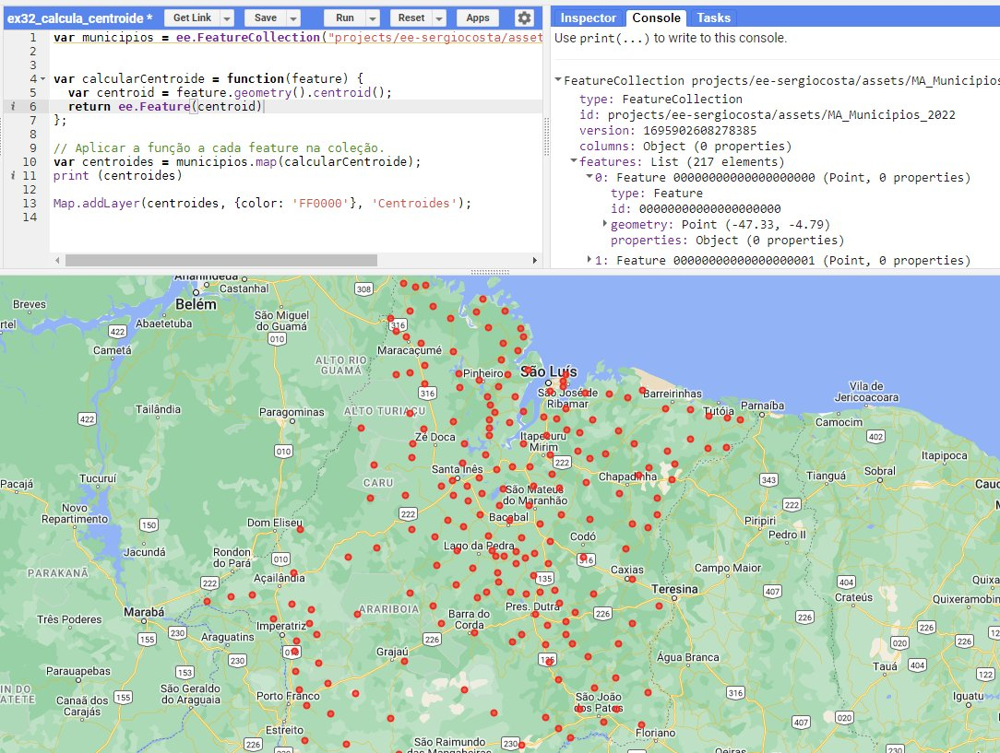
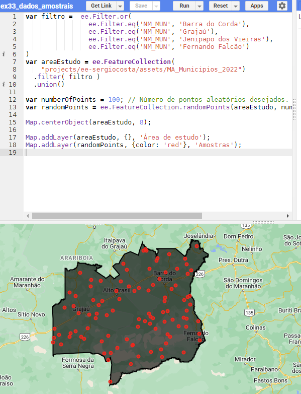

# Processamento de Dados Vetoriais

As operações sobre dados vetoriais são comumente conhecidas como **operações de geoprocessamento**. Neste capítulo veremos as mais comuns: geração de faixas de distância (*buffer*), sobreposição de polígonos (intersecção, união e diferença), cálculo de áreas e centroides e geração de amostras aleatórias.

Antes de começar, é importante perceber que algumas operações são aplicadas a **uma feição** (`ee.Feature`) e outras a **uma coleção** (`ee.FeatureCollection`):



Operações como `.buffer()`, `.centroid()`, `.area()` e `.intersection()` são definidas para uma feição. Para aplicá-las a todas as feições de uma coleção, usamos o **`.map()`** — o segundo passo do padrão *filter–map–reduce* que vimos no [Capítulo 3](03_conhecendo_gee.md#o-padrao-filtermapreduce).

!!! info "Dados usados neste capítulo"
    Baixe e envie aos seus *assets* (ver [Capítulo 5](05_selecao_vetorial.md#enviando-seus-proprios-dados-assets)):

    - [polos_madeireiros_mma.zip](../dados/polos_madeireiros_mma.zip) — polos madeireiros da Amazônia (Ministério do Meio Ambiente), 74 pontos, atributo `UF4` com a sigla da UF;
    - [terras_indigenas.zip](../dados/terras_indigenas.zip) — terras indígenas (FUNAI, 2010), atributos `NOME_TI23` (nome) e `UF10` (UF). Versão com geometria simplificada, preparada para fins didáticos.

    Lembre-se de substituir `projects/ee-sergiocosta/assets/...` pelo identificador dos seus *assets*.

---

## ⭕ Geração de faixas de distância (*buffer*)

A operação de *buffer* identifica **zonas de proximidade** ao redor de entidades geográficas — pontos, linhas ou polígonos (LONGLEY et al., 2013). Autoridades municipais podem usá-la para definir zonas de restrição em torno de rios, reservatórios ou áreas de preservação; no planejamento de transportes, para identificar as áreas a uma certa distância de estações de metrô ou paradas de ônibus.

Para realizá-la, escolhemos a entidade de interesse e a distância desejada, geralmente em metros. Suponha que queremos investigar a relação entre o desmatamento e a proximidade de **polos madeireiros**. O método `.buffer()` é aplicado a uma feição e retorna uma nova feição. Para aplicá-lo a toda a coleção, encapsulamos a operação em uma função e usamos o `.map()`:



```javascript
var fbuffer = function (feat) {
  return feat.buffer(50000);  // 50 km
};

var bufferPolos = polosMadeireiros.map(fbuffer);
```

O código completo, restrito aos polos do Pará:

```javascript
var fbuffer = function (feat) {
  return feat.buffer(50000);
};

var polosMadeireiros =
    ee.FeatureCollection('projects/ee-sergiocosta/assets/polos_madeireiros_mma');

var bufferPolos = polosMadeireiros
    .filter(ee.Filter.eq('UF4', 'PA'))   // filter
    .map(fbuffer);                       // map

Map.addLayer(bufferPolos, {}, 'Buffer de 50 km');
Map.centerObject(bufferPolos, 6);
```



---

## 🔀 Sobreposição de polígonos

A sobreposição de polígonos é uma operação fundamental nos SIGs, essencial para o planejamento urbano, a gestão de recursos naturais, a análise de riscos e muitas outras aplicações. As três operações principais são a **intersecção**, a **união** e a **diferença**.

| Operação | Notação | Resultado |
|---|:---:|---|
| **Intersecção** | A ∩ B | apenas a área comum a A e B |
| **União** | A ∪ B | toda a área de A e de B |
| **Diferença** | A − B | a área de A que não está em B |

### Intersecção

A intersecção identifica as **regiões de sobreposição** entre duas ou mais geometrias — as áreas em que diferentes conjuntos de dados têm algo em comum. Na pesquisa sobre conflitos territoriais, por exemplo, ela identifica onde as jurisdições de várias entidades se sobrepõem. Continuando o exemplo anterior, vamos identificar as áreas de **terras indígenas** que estão dentro das faixas de 50 km dos polos madeireiros — algo essencial para avaliar o impacto potencial dessas atividades.

**Exemplo 1 — intersecção com uma única terra indígena.** Selecionamos a TI Parakanã (uma feição, obtida com `.first()`) e aplicamos a cada *buffer* uma função que retorna a intersecção com ela:

```javascript
var polosMadeireiros =
    ee.FeatureCollection('projects/ee-sergiocosta/assets/polos_madeireiros_mma');

var tis = ee.FeatureCollection('projects/ee-sergiocosta/assets/terras_indigenas');

var tiParakana = tis
    .filter(ee.Filter.eq('NOME_TI23', 'Parakana'))
    .first();

var fbuffer = function (feat) {
  return feat.buffer(50000);
};

var fintersecaoParakana = function (feat) {
  return feat.intersection(tiParakana);
};

var intersecao = polosMadeireiros
    .filter(ee.Filter.eq('UF4', 'PA'))
    .map(fbuffer)
    .map(fintersecaoParakana);

Map.addLayer(intersecao, {}, 'Intersecção com a TI Parakanã');
Map.centerObject(intersecao, 9);
```



Observe que não foi preciso guardar o resultado do *buffer* em uma variável: os dois `.map()` foram encadeados.

**Exemplo 2 — intersecção com todas as terras indígenas do Pará.** Agora a função aplicada a cada *buffer* precisa calcular a intersecção com **cada** terra indígena — ou seja, precisamos de um `.map()` dentro de outro:

```javascript
var intersecaoTIs = function (feat) {
  return tisPA.map(function (tiFeat) {
    return feat.intersection(tiFeat);
  });
};
```

Executando esse código e imprimindo o resultado, nada aparece no mapa. No Console, descobrimos o motivo: o resultado é uma **coleção de coleções** — para cada *buffer*, uma coleção de intersecções.



A operação **`.flatten()`** transforma uma coleção de coleções em uma única coleção:



O código completo:

```javascript
var polosMadeireiros =
    ee.FeatureCollection('projects/ee-sergiocosta/assets/polos_madeireiros_mma');

var tisPA = ee.FeatureCollection('projects/ee-sergiocosta/assets/terras_indigenas')
    .filter(ee.Filter.stringContains('UF10', 'PA'));

var fbuffer = function (feat) {
  return feat.buffer(50000);
};

var intersecaoTIs = function (feat) {
  return tisPA.map(function (tiFeat) {
    return feat.intersection(tiFeat);
  });
};

var intersecao = polosMadeireiros
    .filter(ee.Filter.eq('UF4', 'PA'))
    .map(fbuffer)
    .map(intersecaoTIs)
    .flatten();

print(intersecao);
Map.addLayer(intersecao, {color: 'FF0000'}, 'TIs a menos de 50 km de polos');
Map.centerObject(intersecao, 6);
```



Agora o Console mostra uma coleção de feições, e não mais uma coleção de coleções.

!!! warning "Terras indígenas em mais de uma UF"
    No atributo `UF10`, as terras que se estendem por mais de um estado aparecem com as siglas separadas por vírgula (`'MT, PA'`, `'AM, PA'`, `'PA, TO'`...). Um filtro `ee.Filter.eq('UF10', 'PA')` deixaria de fora essas terras; por isso usamos `ee.Filter.stringContains`, que testa se o texto contém `PA`. Antes de filtrar por um atributo de texto, confira os valores que ele assume.

!!! tip "Intersecções vazias"
    Quando um *buffer* não toca uma terra indígena, a intersecção resulta em uma geometria vazia — que também entra na coleção. Para descartá-las, filtre pela área: acrescente ao final da cadeia `.map(function (f) { return f.set('area', f.area(1)); }).filter(ee.Filter.gt('area', 0))`.

### União

A união **combina polígonos**, gerando um novo polígono que abrange toda a área dos polígonos originais. Ela é usada para consolidar informações de diversas fontes ou para criar um polígono contínuo a partir de várias unidades menores — na gestão de recursos naturais, várias áreas de vegetação podem resultar em um único polígono de *habitat*. Um uso muito comum é **delimitar uma área de estudo** a partir de vários municípios. O código a seguir une quatro municípios do centro do Maranhão:

```javascript
var filtro = ee.Filter.or(
    ee.Filter.eq('NM_MUN', 'Barra do Corda'),
    ee.Filter.eq('NM_MUN', 'Grajaú'),
    ee.Filter.eq('NM_MUN', 'Jenipapo dos Vieiras'),
    ee.Filter.eq('NM_MUN', 'Fernando Falcão')
);

var areaEstudo = ee.FeatureCollection(
    'projects/ee-sergiocosta/assets/MA_Municipios_2022')
  .filter(filtro)
  .union();

print(areaEstudo);
Map.addLayer(areaEstudo, {}, 'Área de estudo');
Map.centerObject(areaEstudo, 8);
```



O filtro `ee.Filter.or` seleciona os municípios que satisfazem **qualquer** das condições. O mesmo resultado seria obtido com `ee.Filter.inList('NM_MUN', ['Barra do Corda', 'Grajaú', 'Jenipapo dos Vieiras', 'Fernando Falcão'])`. O método `.union()` da coleção retorna uma nova coleção com **uma única feição**, cuja geometria é a união de todas.

### Diferença

A diferença **subtrai** um polígono de outro, eliminando uma área específica de um polígono maior — por exemplo, remover uma área construída de uma zona de conservação ambiental. Suponha que, durante a análise, decidimos excluir o município de Grajaú da área de estudo:

```javascript
var municipios = ee.FeatureCollection('projects/ee-sergiocosta/assets/MA_Municipios_2022');

var areaEstudo = municipios
    .filter(ee.Filter.inList('NM_MUN',
        ['Barra do Corda', 'Grajaú', 'Jenipapo dos Vieiras', 'Fernando Falcão']))
    .union();

var grajau = municipios
    .filter(ee.Filter.eq('NM_MUN', 'Grajaú'))
    .first();

var calcularDiferenca = function (feature) {
  return feature.difference(grajau);
};

var resultadoDiferenca = areaEstudo.map(calcularDiferenca);

Map.addLayer(areaEstudo, {color: '999999'}, 'Área de estudo inicial');
Map.addLayer(resultadoDiferenca, {color: 'FF0000'}, 'Diferença');
Map.centerObject(resultadoDiferenca, 8);
```

Como `areaEstudo` é uma coleção (com uma feição), usamos novamente o `.map()` para aplicar a operação.

---

## 📏 Área e centroides

### Cálculo de área

O método `.area()` retorna a área de uma geometria em **metros quadrados**, calculada sobre o elipsoide — ou seja, sem as distorções de uma projeção. Para calcular a área de todos os municípios e guardá-la como um novo atributo, usamos `.map()` e `.set()`:

```javascript
var municipios = ee.FeatureCollection('projects/ee-sergiocosta/assets/MA_Municipios_2022');

var comArea = municipios.map(function (feature) {
  var areaKm2 = feature.geometry().area(1).divide(1e6);  // m² → km²
  return feature.set('area_calc_km2', areaKm2);
});

print(comArea.limit(5));  // compare area_calc_km2 com o atributo AREA_KM2 do IBGE
```

O argumento `1` é o erro máximo tolerado (em metros) no cálculo.

### Cálculo de centroides

Outra operação muito comum é o cálculo do ponto central — o **centro de massa** — de uma geometria, o **centroide**. Ele é usado para posicionar rótulos em mapas temáticos, em análises de redes, de densidade e muitas outras. Aplicado a uma feição, o método `.centroid()` retorna uma nova feição, com o centroide como geometria e **os mesmos atributos** da original:

```javascript
var municipios = ee.FeatureCollection('projects/ee-sergiocosta/assets/MA_Municipios_2022');

var calcularCentroide = function (feature) {
  return feature.centroid(1);
};

// aplica a função a cada feição da coleção
var centroides = municipios.map(calcularCentroide);

print(centroides.limit(5));
Map.addLayer(municipios, {}, 'Municípios');
Map.addLayer(centroides, {color: 'FF0000'}, 'Centroides');
Map.centerObject(municipios, 6);
```



!!! question "E se eu calcular o centroide da *geometria*?"
    `feature.geometry().centroid()` retorna apenas uma **geometria**, sem atributos. Para manter os atributos nesse caso, crie uma nova feição: `ee.Feature(feature.geometry().centroid(1), feature.toDictionary())`. Usar diretamente `feature.centroid()` é mais simples.

---

## 🎲 Geração de dados amostrais

A geração de amostras aleatórias é uma etapa fundamental em muitas aplicações de sensoriamento remoto e análise espacial: avaliar a qualidade de uma classificação de imagem, treinar algoritmos de aprendizado de máquina ou conduzir análises estatísticas. O método `ee.FeatureCollection.randomPoints` recebe a região de interesse e o número de pontos desejado e retorna uma coleção de pontos. No exemplo a seguir, criamos 100 pontos na área de estudo:

```javascript
var areaEstudo = ee.FeatureCollection(
    'projects/ee-sergiocosta/assets/MA_Municipios_2022')
  .filter(ee.Filter.inList('NM_MUN',
      ['Barra do Corda', 'Grajaú', 'Jenipapo dos Vieiras', 'Fernando Falcão']))
  .union();

var numeroDePontos = 100;
var amostras = ee.FeatureCollection.randomPoints({
  region: areaEstudo.geometry(),
  points: numeroDePontos,
  seed: 42  // semente: garante que os mesmos pontos sejam gerados a cada execução
});

Map.centerObject(areaEstudo, 8);
Map.addLayer(areaEstudo, {}, 'Área de estudo');
Map.addLayer(amostras, {color: 'red'}, 'Amostras');
```



!!! tip "Reprodutibilidade"
    O parâmetro `seed` torna o sorteio **reprodutível**: com a mesma semente, os mesmos pontos são gerados. Isso é importante em trabalhos científicos, para que outras pessoas possam repetir a análise.

---

## 📝 Síntese

| Operação | Aplicada a | Método no GEE |
|---|---|---|
| Faixa de distância | feição | `feature.buffer(distância)` |
| Intersecção | feição | `feature.intersection(outra)` |
| União | coleção | `colecao.union()` |
| Diferença | feição | `feature.difference(outra)` |
| Área | geometria | `geometry.area(erroMax)` |
| Centroide | feição | `feature.centroid(erroMax)` |
| Amostras aleatórias | região | `ee.FeatureCollection.randomPoints(...)` |
| Achatar coleções | coleção de coleções | `colecao.flatten()` |

Para aplicar uma operação de feição a toda uma coleção, use **`.map()`**.

## ✏️ Exercícios

1. Gere *buffers* de 10 km em torno das sedes dos polos madeireiros do Maranhão (`UF4 = 'MA'`). Quantos polos existem no estado?
2. Calcule a área (em km²) de cada terra indígena do Maranhão e liste as três maiores (dica: `.sort('area', false).limit(3)`).
3. Construa a área de estudo formada pelos municípios da Ilha do Maranhão (São Luís, São José de Ribamar, Paço do Lumiar e Raposa) e gere 50 amostras aleatórias com semente 2024.
4. Modifique o Exemplo 2 da intersecção para calcular, em cada feição resultante, a área em km², e remova as intersecções vazias.
5. Explique por que o resultado do Exemplo 2 era uma coleção de coleções e o que o `.flatten()` faz.
