# Processamento de Dados Matriciais

Assim como nos dados vetoriais, algumas operações são aplicadas a **uma imagem** (`ee.Image`) e outras a **uma coleção de imagens** (`ee.ImageCollection`):

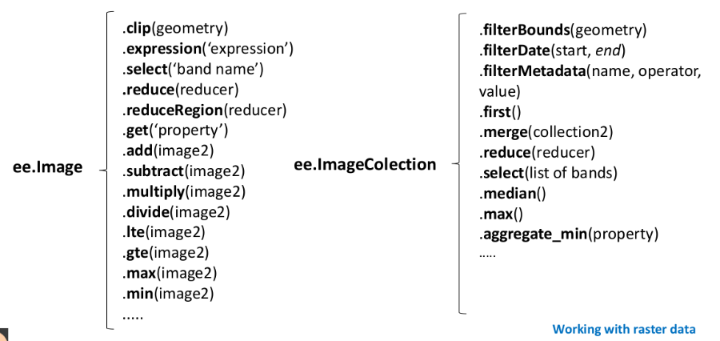

Muitas das operações sobre dados matriciais são melhor entendidas dentro do conceito de **álgebra de mapas** (TOMLIN, 1990). Neste capítulo, usamos esse conceito para organizar as operações do GEE, calculamos índices espectrais, pré-processamos imagens, construímos séries temporais e damos um primeiro passo na classificação de imagens.

---

## 🧮 Álgebra de mapas

Tomlin (1990) classifica as operações sobre mapas matriciais pela **origem dos valores** usados para calcular cada célula do mapa de saída:

- **Operações locais:** o valor de uma localização no mapa de saída é calculado a partir dos valores **da mesma localização** em um ou mais mapas de entrada. Incluem expressões aritméticas e lógicas, como *"classificar como alto risco todas as áreas sem vegetação com declividade superior a 15%"*.
- **Operações focais:** o valor de uma localização no mapa de saída é calculado a partir dos valores **da vizinhança** dessa localização no mapa de entrada. Incluem expressões como *"calcular a média local dos valores do mapa"*.
- **Operações zonais:** o valor é calculado a partir de **todas as células de uma zona**, sendo as zonas definidas por um segundo mapa. Incluem expressões como *"dado um mapa de municípios e um modelo digital de terreno, calcular a altitude média de cada município"*.

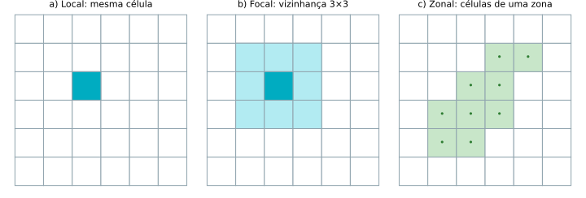

A essas três pode-se acrescentar uma quarta, as **operações globais**, que usam o conjunto de dados inteiro.

---

## 📍 Operações locais

Operadores locais atuam sobre células individuais, sem considerar as vizinhas. Incluem as operações aritméticas básicas (adição, subtração, multiplicação, divisão) e funções como logaritmo, exponenciação, raiz quadrada e operações trigonométricas e lógicas. No GEE, são métodos das imagens:

```javascript
var soma = imagem1.add(imagem2);          // imagem1 + imagem2, pixel a pixel
var raiz = imagem.sqrt();                 // raiz quadrada de cada pixel
var mascara = imagem.gt(0.3);             // 1 onde o pixel > 0,3; 0 caso contrário
```

### Índices espectrais: o NDVI

O exemplo mais clássico de operação local é o **NDVI** (*Normalized Difference Vegetation Index*), amplamente usado para avaliar a presença e o vigor da vegetação:

$$
NDVI = \frac{NIR - Red}{NIR + Red}
$$

em que **NIR** é o valor do pixel na banda do infravermelho próximo e **Red** o valor na banda do vermelho. O resultado varia de −1 a 1: valores próximos de 1 indicam vegetação densa e sadia; próximos de 0, áreas com pouca ou nenhuma vegetação (solo exposto, áreas construídas); e valores negativos estão associados a corpos d'água. A explicação está na assinatura espectral ([Capítulo 2](02_sensoriamento_remoto.md#assinatura-espectral)): a vegetação reflete muito o infravermelho próximo e absorve o vermelho.

No Landsat 8, **a banda 5 é o infravermelho próximo (NIR) e a banda 4 é o vermelho (Red)**. O código a seguir mostra explicitamente a aritmética de bandas com `.expression()`:

```javascript
// Uma imagem Landsat 8 em reflectância no topo da atmosfera
var image = ee.Image('LANDSAT/LC08/C02/T1_TOA/LC08_220062_20190504');

// NDVI como operação local
var ndvi = image.expression('(NIR - Red) / (NIR + Red)', {
  'NIR': image.select('B5'),  // infravermelho próximo
  'Red': image.select('B4')   // vermelho
}).rename('NDVI');

Map.addLayer(ndvi, {min: -0.5, max: 0.8, palette: ['blue', 'white', 'green']}, 'NDVI');
Map.centerObject(image, 10);
```

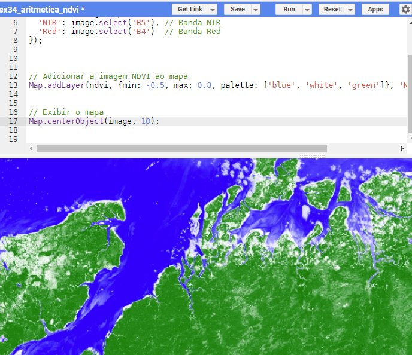

Como a diferença normalizada é muito usada, o GEE oferece um atalho: `image.normalizedDifference(['B5', 'B4'])` produz o mesmo resultado.

!!! question "Desafio: NDVI de uma coleção inteira"
    E se precisássemos calcular o NDVI de **todas** as imagens de uma coleção? Tente antes de abrir a resposta.

??? success "Resposta: usando o padrão *map*"
    Encapsulamos o cálculo em uma função e a aplicamos a cada imagem com `.map()`:

    ```javascript
    var roi = ee.Geometry.Point([-43.85686250192464, -20.499542712390806]);  // Congonhas, MG

    var l8 = ee.ImageCollection('LANDSAT/LC08/C02/T1_TOA')
        .filterBounds(roi)
        .filterDate('2015-01-01', '2023-01-01')
        .filter(ee.Filter.lt('CLOUD_COVER', 1));

    print(l8);

    // a função recebe uma imagem e retorna o seu NDVI
    var calcNDVI = function (image) {
      return image.normalizedDifference(['B5', 'B4']).rename('NDVI');
    };

    var ndvis = l8.map(calcNDVI);
    print(ndvis);  // uma coleção com o mesmo número de imagens

    Map.addLayer(ndvis, {min: -0.5, max: 0.8, palette: ['blue', 'white', 'green']}, 'NDVI');
    Map.centerObject(roi, 12);
    ```

    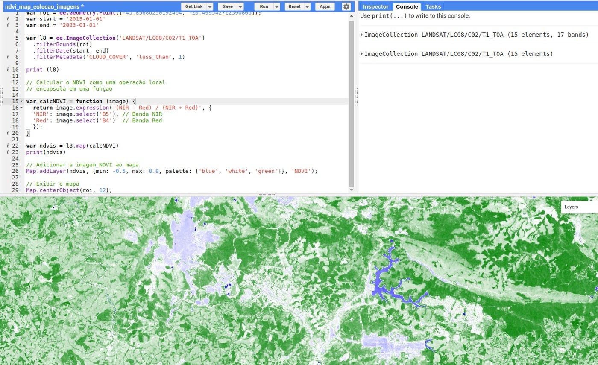

    E, completando o padrão *filter–map–reduce*, podemos **reduzir** a coleção a uma única imagem com o NDVI médio do período:

    ```javascript
    var ndviMedio = ndvis.mean();
    Map.addLayer(ndviMedio, {min: -0.5, max: 0.8, palette: ['blue', 'white', 'green']}, 'NDVI médio');
    ```

    Outros redutores úteis: `.median()`, `.max()`, `.min()` e `.reduce(ee.Reducer.stdDev())`.

### Pré-processamento: reflectância de superfície e fator de escala

Os dados `T1_TOA` usados até aqui estão em reflectância **no topo da atmosfera**. Mas a atmosfera — vapor d'água, aerossóis — interfere no sinal e, portanto, no NDVI. Para análises mais rigorosas, usa-se a reflectância **de superfície** (*Surface Reflectance*, ou BOA — *Bottom of Atmosphere*), já corrigida dos efeitos atmosféricos. No catálogo, é a coleção [LANDSAT/LC08/C02/T1_L2](https://developers.google.com/earth-engine/datasets/catalog/LANDSAT_LC08_C02_T1_L2):

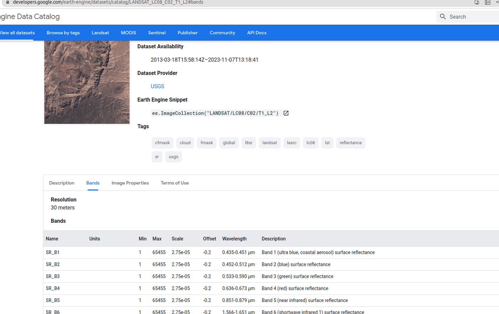

Esses dados, porém, **não estão em reflectância**: são inteiros que precisam ser convertidos com um **fator de escala** e um ***offset*** (deslocamento), informados na aba *Bands* do catálogo. Para as bandas ópticas do Landsat Collection 2, nível 2: \(\rho = DN \times 0{,}0000275 - 0{,}2\). É outra operação local:

```javascript
var image = ee.Image('LANDSAT/LC08/C02/T1_L2/LC08_220062_20190504')
    .select(['SR_B2', 'SR_B3', 'SR_B4', 'SR_B5']);

// aplica o fator de escala e o offset
var reflectancia = image.multiply(0.0000275).add(-0.2);

Map.addLayer(image, {}, 'Número digital');
Map.addLayer(reflectancia, {}, 'Reflectância');
Map.centerObject(image, 8);
```

Clique em um pixel com o *Inspector* aberto e compare os valores das duas camadas:

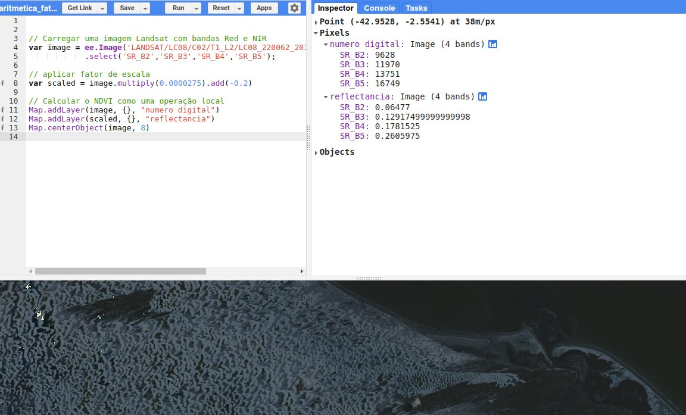

??? success "Juntando tudo: reflectância de superfície + NDVI de uma coleção"
    ```javascript
    var roi = ee.Geometry.Point([-43.85686250192464, -20.499542712390806]);

    var l8 = ee.ImageCollection('LANDSAT/LC08/C02/T1_L2')
        .filterBounds(roi)
        .filterDate('2015-01-01', '2023-01-01')
        .filter(ee.Filter.lt('CLOUD_COVER', 5));

    // fator de escala das bandas ópticas (SR_B*) e termais (ST_B*, em °C)
    var aplicarEscala = function (image) {
      var opticas = image.select('SR_B.').multiply(0.0000275).add(-0.2);
      var termicas = image.select('ST_B.*').multiply(0.00341802).add(149.0).subtract(273.15);
      return image.addBands(opticas, null, true)
                  .addBands(termicas, null, true);
    };

    var adicionarNDVI = function (image) {
      var ndvi = image.normalizedDifference(['SR_B5', 'SR_B4']).rename('NDVI');
      return image.addBands(ndvi);
    };

    var ndvis = l8
        .map(aplicarEscala)
        .map(adicionarNDVI)
        .select('NDVI');

    var ndviMedio = ndvis.mean();
    Map.addLayer(ndviMedio, {min: -0.5, max: 0.8, palette: ['blue', 'white', 'green']}, 'NDVI médio');
    Map.centerObject(roi, 12);
    ```

    Observe o padrão: cada etapa de pré-processamento vira uma **função**, e as funções são encadeadas com `.map()`.

### Outro índice e máscaras: o NDWI

O **NDWI** (*Normalized Difference Water Index*, na versão de McFeeters, 1996) realça corpos d'água usando as bandas do verde e do infravermelho próximo:

$$
NDWI = \frac{Green - NIR}{Green + NIR}
$$

Valores positivos indicam, em geral, água. Com uma operação lógica (também local!), criamos uma **máscara** e a aplicamos à imagem com `.updateMask()`, que torna transparentes os pixels em que a máscara vale 0:

```javascript
var image = ee.Image('LANDSAT/LC08/C02/T1_L2/LC08_220062_20190504')
    .select(['SR_B2', 'SR_B3', 'SR_B4', 'SR_B5']);
var sr = image.multiply(0.0000275).add(-0.2);

var ndwi = sr.normalizedDifference(['SR_B3', 'SR_B5']).rename('NDWI');

var agua = ndwi.gte(0);  // 1 = água, 0 = não água

Map.addLayer(ndwi, {min: -0.8, max: 0.8, palette: ['brown', 'white', 'blue']}, 'NDWI');
Map.addLayer(sr.updateMask(agua.not()),
    {bands: ['SR_B4', 'SR_B3', 'SR_B2'], min: 0, max: 0.2}, 'Terra (água mascarada)');
Map.centerObject(image, 9);
```

!!! info "Centenas de índices prontos"
    O projeto [Awesome Spectral Indices](https://github.com/awesome-spectral-indices/awesome-spectral-indices) cataloga centenas de índices espectrais, com fórmulas padronizadas. O módulo [spectral](https://github.com/awesome-spectral-indices/spectral) permite usá-los no GEE:

    ```javascript
    var spectral = require('users/dmlmont/spectral:spectral');
    print(spectral.indices.NDVI.formula);
    ```

---

## 🔲 Operações focais

Operadores focais, também conhecidos como **operadores de vizinhança**, consideram uma vizinhança de células ao redor de cada célula. São usados para filtragem, suavização ou realce de características. Um exemplo comum é o **filtro de média**, que substitui o valor de cada célula pela média dos valores da vizinhança. No GEE, a vizinhança é definida por um ***kernel*** (núcleo), e o método `.reduceNeighborhood()` aplica um redutor a ela:

```javascript
var ndviSuavizado = ndvi.reduceNeighborhood({
  reducer: ee.Reducer.mean(),
  kernel: ee.Kernel.square(1)  // raio de 1 pixel = janela 3×3
});
```

!!! warning "O parâmetro de `ee.Kernel.square` é o **raio**"
    `ee.Kernel.square(r)` cria uma janela de \((2r + 1) \times (2r + 1)\) pixels: `square(1)` é uma janela **3×3**; `square(3)` já é uma janela **7×7**. Por padrão, o raio é medido em pixels.

Código completo:

```javascript
var image = ee.Image('LANDSAT/LC08/C02/T1_TOA/LC08_220062_20190504');

var ndvi = image.normalizedDifference(['B5', 'B4']).rename('NDVI');

var ndviSuavizado = ndvi.reduceNeighborhood({
  reducer: ee.Reducer.mean(),
  kernel: ee.Kernel.square(1)
});

var vis = {min: -0.5, max: 0.8, palette: ['blue', 'white', 'green']};
Map.addLayer(ndvi, vis, 'NDVI');
Map.addLayer(ndviSuavizado, vis, 'NDVI suavizado (média 3×3)');
Map.centerObject(image, 10);
```

| NDVI original | NDVI suavizado |
|:---:|:---:|
| 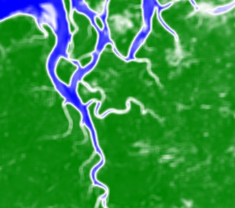 | 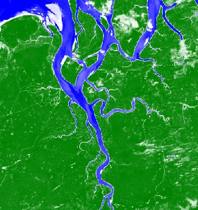 |

!!! info "Convolução"
    A média em uma vizinhança é um caso particular de **convolução**, que também pode ser executada diretamente: `ndvi.convolve(ee.Kernel.square(1))`. Com outros *kernels* — como `ee.Kernel.laplacian8()` ou `ee.Kernel.sobel()` —, a convolução realça bordas em vez de suavizar.

---

## 🗺️ Operações zonais

Operadores zonais atuam sobre **grupos de células dentro de zonas** — municípios, estados, bacias hidrográficas, áreas de estudo. Eles calculam estatísticas como soma, média, máximo e mínimo das células de cada zona. No GEE, a operação zonal para **uma** região é o `.reduceRegion()`. Por exemplo, o NDVI médio do município de São Luís:

```javascript
var saoluis = ee.FeatureCollection('projects/ee-sergiocosta/assets/MA_Municipios_2022')
    .filter(ee.Filter.eq('CD_MUN', '2111300'));

var image = ee.Image('LANDSAT/LC08/C02/T1_TOA/LC08_220062_20190504');
var ndvi = image.normalizedDifference(['B5', 'B4']).rename('NDVI');

var ndviMedio = ndvi.reduceRegion({
  reducer: ee.Reducer.mean(),
  geometry: saoluis.geometry(),
  scale: 30,
  maxPixels: 1e9
});

print('NDVI médio de São Luís:', ndviMedio);
```

O resultado de um operador zonal é um **dicionário**, com um valor para cada banda da imagem: `{NDVI: 0.27...}`.

!!! tip "O parâmetro `scale`"
    `scale` é o tamanho do pixel (em metros) em que o cálculo será feito — em geral, a resolução nativa do dado (30 m no Landsat). Sem ele, o GEE usa a escala da projeção padrão, o que pode gerar resultados inesperados. O `maxPixels` aumenta o limite de pixels processados; se ele for excedido, o GEE avisa com um erro.

A média é apenas um entre vários redutores. O redutor `max`, por exemplo, retorna o maior valor de uma região — como a **altitude máxima de Minas Gerais**, segundo o SRTM:

```javascript
var ufs = ee.FeatureCollection('projects/ee-sergiocosta/assets/BR_UF');
var mg = ufs.filter(ee.Filter.eq('SIGLA_UF', 'MG'));

var srtm = ee.Image('CGIAR/SRTM90_V4');

var altitudeMaxima = srtm.reduceRegion({
  reducer: ee.Reducer.max(),
  geometry: mg.geometry(),
  scale: 90,
  maxPixels: 1e9
});

print('Altitude máxima de MG (m):', altitudeMaxima);
```

Para **várias zonas** de uma vez, usa-se `.reduceRegions()`, que recebe uma coleção de feições e devolve a mesma coleção com um novo atributo em cada feição — por exemplo, o NDVI médio de cada município:

```javascript
var municipios = ee.FeatureCollection('projects/ee-sergiocosta/assets/MA_Municipios_2022');

var ndviPorMunicipio = ndvi.reduceRegions({
  collection: municipios.filterBounds(image.geometry()),
  reducer: ee.Reducer.mean(),
  scale: 30
});

print(ndviPorMunicipio.select(['NM_MUN', 'mean']));
```

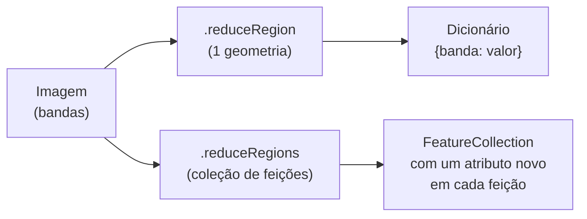

## 🌐 Operações globais

As operações globais consideram **todo o conjunto de dados** — por exemplo, para equalização de histograma, estiramento de contraste ou normalização. No GEE, podemos usar `.reduceRegion` sobre toda a extensão da imagem:

```javascript
var image = ee.Image('LANDSAT/LC08/C02/T1_TOA/LC08_220062_20190504');
var ndvi = image.normalizedDifference(['B5', 'B4']).rename('NDVI');

var estatisticas = ndvi.reduceRegion({
  reducer: ee.Reducer.mean().combine(ee.Reducer.minMax(), '', true),
  geometry: image.geometry(),
  scale: 30,
  bestEffort: true  // ajusta a escala automaticamente se houver pixels demais
});

print('NDVI da cena inteira:', estatisticas);
```

---

## 📈 Série temporal de precipitação

Agora temos todos os ingredientes para entender o exemplo motivacional do [Capítulo 3](03_conhecendo_gee.md#por-que-processar-na-nuvem): a precipitação mensal em São Luís e Congonhas. Vamos por partes.

**1. Entrada.** As duas regiões — os polígonos `congonhas` e `saoluis`, definidos no início do *script* do Capítulo 3 — formam uma coleção de feições com o atributo `nome`, e a coleção CHIRPS diária é carregada:

```javascript
var areaEstudo = ee.FeatureCollection([
  ee.Feature(congonhas, {nome: 'Congonhas'}),
  ee.Feature(saoluis, {nome: 'Sao Luis'})
]);

var chirps = ee.ImageCollection('UCSB-CHG/CHIRPS/DAILY');
```

**2. Processamento: de diário para mensal.** Para cada ano e cada mês, filtramos as imagens diárias daquele mês (*filter*) e as somamos (*reduce*). Como são dois laços — anos e meses —, usamos um `.map()` dentro de outro, sobre listas do servidor criadas com `ee.List.sequence`. O resultado é uma lista de listas, achatada com `.flatten()`:

```javascript
var anos = ee.List.sequence(2014, 2023);
var meses = ee.List.sequence(1, 12);

var mensais = anos.map(function (y) {
  return meses.map(function (m) {
    var soma = chirps
        .filter(ee.Filter.calendarRange(y, y, 'year'))
        .filter(ee.Filter.calendarRange(m, m, 'month'))
        .reduce(ee.Reducer.sum())
        .rename('precipitacao_mensal');
    // a data (em milissegundos) é necessária para o eixo do gráfico
    return soma.set('system:time_start', ee.Date.fromYMD(y, m, 1).millis());
  });
}).flatten();

var colecaoMensal = ee.ImageCollection.fromImages(mensais);
```

**3. Operação zonal ao longo do tempo e saída.** `ui.Chart.image.seriesByRegion` aplica um redutor (a média) em cada região, para cada imagem da coleção, e desenha o gráfico. A escala de 5.566 m é a resolução nativa do CHIRPS:

```javascript
var grafico = ui.Chart.image.seriesByRegion({
  imageCollection: colecaoMensal,
  regions: areaEstudo,
  reducer: ee.Reducer.mean(),
  seriesProperty: 'nome',
  xProperty: 'system:time_start',
  scale: 5566
}).setOptions({
  title: 'Precipitação mensal (mm)',
  vAxis: {title: 'Precipitação (mm)'},
  hAxis: {title: 'Meses'}
});

print(grafico);
```

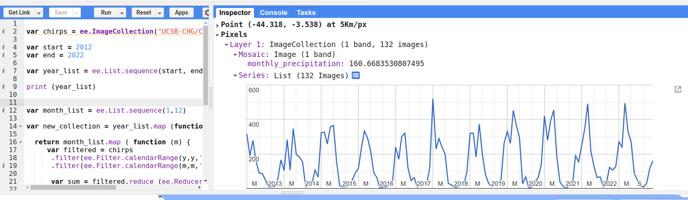

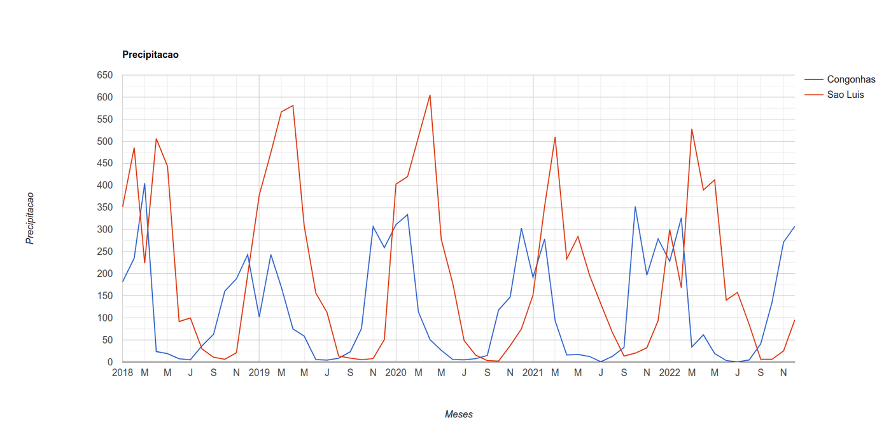

No Console, clique no ícone no canto do gráfico para abri-lo em uma nova aba, de onde é possível baixar os dados em CSV ou a figura em PNG/SVG.

---

## 🏷️ Um primeiro passo na classificação de imagens

**Classificar** uma imagem é atribuir a cada pixel uma classe temática — água, vegetação, área urbana, solo exposto. É a técnica por trás de iniciativas como o **MapBiomas**. Na **classificação supervisionada**, o analista fornece **amostras de treinamento** (pixels de classe conhecida); um algoritmo aprende, a partir das assinaturas espectrais dessas amostras, a separar as classes, e então classifica todos os pixels.

O roteiro no GEE tem cinco passos:

1. **Montar a imagem** a ser classificada — aqui, uma mediana sem nuvens de reflectância de superfície.
2. **Desenhar as amostras**: com as ferramentas de desenho, crie uma camada de pontos para cada classe (*+ new layer*). Em cada camada, clique na engrenagem, escolha **Import as: FeatureCollection** e adicione uma propriedade `classe` com um valor inteiro: `agua` = 0, `vegetacao` = 1, `urbano` = 2, `solo` = 3. Marque alguns pontos (15 a 30) sobre alvos inequívocos de cada classe.
3. **Extrair os valores** das bandas nos pontos de treinamento (`.sampleRegions`).
4. **Treinar** um classificador (aqui, *Random Forest*).
5. **Classificar** a imagem e visualizar.

```javascript
// Supõe que agua, vegetacao, urbano e solo foram desenhadas como
// FeatureCollections com a propriedade "classe" (0, 1, 2, 3).

// 1. Imagem: mediana da estação seca de 2023, reflectância de superfície
var aplicarEscala = function (image) {
  return image.select('SR_B.').multiply(0.0000275).add(-0.2);
};

var imagem = ee.ImageCollection('LANDSAT/LC08/C02/T1_L2')
    .filter(ee.Filter.eq('WRS_PATH', 220))
    .filter(ee.Filter.eq('WRS_ROW', 62))
    .filterDate('2023-07-01', '2023-12-31')
    .filter(ee.Filter.lt('CLOUD_COVER', 30))
    .map(aplicarEscala)
    .median();

var bandas = ['SR_B2', 'SR_B3', 'SR_B4', 'SR_B5', 'SR_B6', 'SR_B7'];

// 2. Amostras de treinamento
var amostras = agua.merge(vegetacao).merge(urbano).merge(solo);

// 3. Valores das bandas nos pontos
var treinamento = imagem.select(bandas).sampleRegions({
  collection: amostras,
  properties: ['classe'],
  scale: 30
});

// 4. Treinamento
var classificador = ee.Classifier.smileRandomForest(50).train({
  features: treinamento,
  classProperty: 'classe',
  inputProperties: bandas
});

// 5. Classificação
var classificada = imagem.select(bandas).classify(classificador);

Map.centerObject(amostras, 10);
Map.addLayer(imagem, {bands: ['SR_B4', 'SR_B3', 'SR_B2'], min: 0, max: 0.2}, 'Cor verdadeira');
Map.addLayer(classificada,
    {min: 0, max: 3, palette: ['1f78b4', '33a02c', 'e31a1c', 'fdbf6f']}, 'Classificação');
```

!!! warning "Isto é só o começo"
    Uma classificação confiável exige amostras representativas e bem distribuídas, a separação entre amostras de **treinamento** e de **validação** e a avaliação da exatidão (matriz de confusão, índice Kappa, exatidão global) — lembre-se das amostras aleatórias do [Capítulo 7](07_processamento_vetorial.md#geracao-de-dados-amostrais). Para aprofundar, veja o *workflow* de classificação do [OpenMRV](https://openmrv.org/) e o livro [Cloud-Based Remote Sensing with Google Earth Engine](https://www.eefabook.org/).

---

## 📝 Síntese

| Tipo de operação | Valor de saída calculado a partir de... | Métodos no GEE |
|---|---|---|
| Local | a mesma célula em uma ou mais imagens | `.add`, `.multiply`, `.expression`, `.normalizedDifference`, `.gt`, `.updateMask` |
| Focal | a vizinhança da célula | `.reduceNeighborhood`, `.convolve`, `ee.Kernel.*` |
| Zonal | as células de uma zona | `.reduceRegion`, `.reduceRegions`, `ui.Chart.image.seriesByRegion` |
| Global | todas as células | `.reduceRegion` sobre toda a imagem |
| Sobre coleções | as imagens da coleção, pixel a pixel | `.mean`, `.median`, `.max`, `.reduce(ee.Reducer.*)` |

## ✏️ Exercícios

1. Calcule o NDVI médio de 2023 para a sua cidade, usando a coleção de reflectância de superfície e o fator de escala. Qual o valor médio para o município?
2. Calcule o NDWI da cena `LC08_220062_20190504` e estime a área (em km²) de água na cena (dica: multiplique a máscara por `ee.Image.pixelArea()` e some com `.reduceRegion`).
3. Aplique ao NDVI filtros de média com janelas 3×3, 5×5 e 7×7. Descreva o efeito do tamanho da janela.
4. Use `.reduceRegions` para calcular a altitude média (SRTM) de cada UF do Nordeste e ordene o resultado.
5. Adapte o exemplo da série temporal para comparar a precipitação mensal de 2015 a 2024 em duas capitais do Nordeste.
6. Faça uma classificação com quatro classes na região da sua cidade. Onde o classificador mais erra? Por quê?
