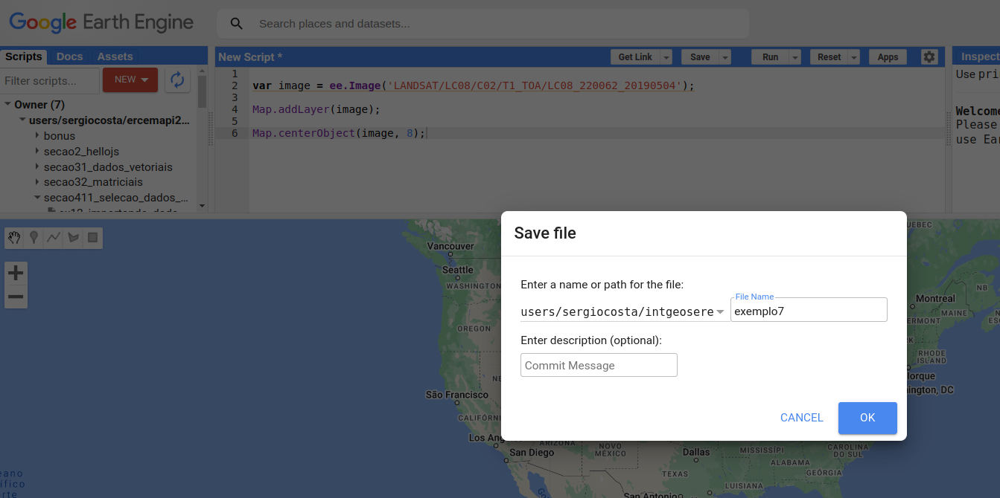
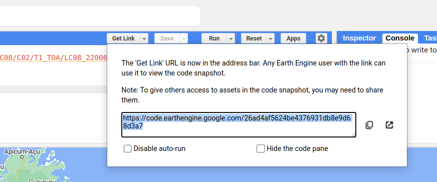
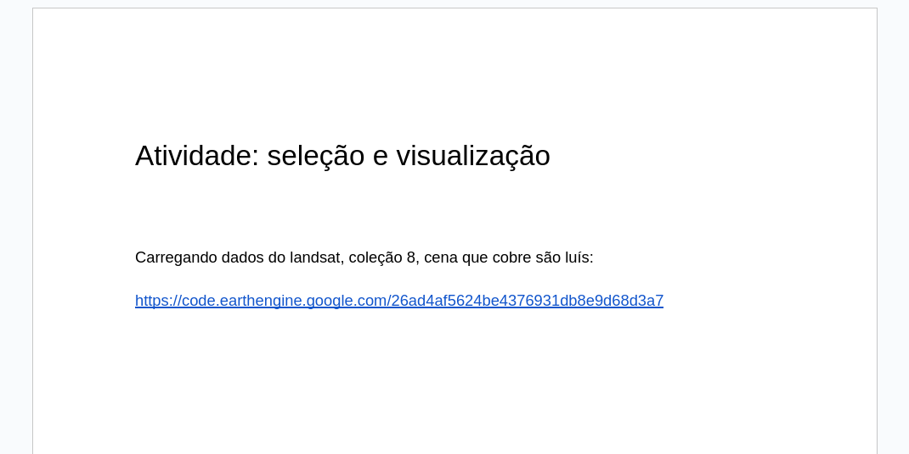

# Atividades e Lista de Exercícios

Este capítulo reúne as atividades avaliativas da Parte 1 e uma lista de exercícios de revisão. Os exercícios ao final de cada capítulo também servem como preparação.

---

## Atividade 1: seleção e visualização

O objetivo desta atividade é garantir o domínio do ambiente do Google Earth Engine, necessário para as aulas de processamento. Ela também é uma forma de organizar um **repositório pessoal de exemplos**, fácil de consultar e adaptar às suas necessidades no futuro.

**Instruções**

1. Siga os Capítulos [5](05_selecao_vetorial.md) e [6](06_selecao_matricial.md). Para cada exemplo, crie um novo *script* no seu repositório e salve-o com um nome que o identifique:

    

2. Execute cada *script* e verifique se funcionou corretamente (lembre-se de trocar os identificadores de *assets* pelos seus).
3. Gere o *link* de cada *script* clicando em **Get Link**:

    

4. Crie um documento com o título de cada exemplo e o respectivo *link*, como no modelo a seguir:

    

5. Salve o documento em PDF e entregue-o no ambiente virtual da disciplina.

!!! tip "Vídeos de apoio"
    A [playlist do minicurso](https://www.youtube.com/playlist?list=PLvNBlvS0nGg8j5ywcJbgFF0YDO7y5G2Jn) mostra a execução dos exemplos passo a passo.

---

## Lista de exercícios

### Conceitos (Capítulos 1, 2 e 4)

1. O que diferencia a geoinformação de outros tipos de informação? Dê um exemplo em que a localização está implícita.
2. Explique a diferença entre geoide, elipsoide e datum. Por que o Brasil adotou o SIRGAS 2000?
3. Que propriedade uma projeção conforme preserva? E uma equivalente? Por que nenhuma projeção preserva ambas?
4. Descreva a interação da energia eletromagnética com um alvo e defina reflectância.
5. Uma imagem tem pixels de 10 m, 12 bits, 13 bandas e revisita de 5 dias. Identifique cada resolução.
6. Por que a água aparece escura em uma composição 5-4-3 do Landsat 8, e a vegetação, vermelha?
7. Classifique os dados a seguir como objeto ou campo e indique a estrutura (vetorial ou matricial) mais adequada: precipitação diária; lotes urbanos; declividade; rede hidrográfica; temperatura da superfície.

### Google Earth Engine (Capítulos 3 a 8)

8. Qual a diferença entre `var x = 10 * 2` e `var x = ee.Number(10).multiply(2)`? Onde cada cálculo é executado?
9. Descreva o padrão *filter–map–reduce* e dê um exemplo de cada etapa com dados geográficos.
10. Escreva um *script* que selecione os municípios do seu estado com área entre 1.000 e 3.000 km² e os exiba com preenchimento semitransparente (50%).
11. Escreva um *script* que selecione a imagem Landsat 9 com menor cobertura de nuvens sobre a sua cidade no ano de 2023 e a exiba em falsa cor 5-4-3.
12. Gere *buffers* de 5 km em torno de três pontos de interesse da sua cidade e calcule a área total coberta pela união dos *buffers*.
13. Calcule a média do NDVI de cada mês de 2023 para a sua cidade e exiba um gráfico (dica: `ui.Chart.image.series`).
14. Explique a diferença entre `.reduceRegion` e `.reduceNeighborhood`, relacionando cada um a um tipo de operação da álgebra de mapas.
15. Por que é necessário aplicar o fator de escala aos dados `T1_L2` antes de calcular um índice espectral? O que aconteceria com o NDVI se o *offset* fosse esquecido?

---

## Projeto da Parte 1

Cada estudante (ou dupla) deve escolher uma **área de estudo** — um município, uma bacia hidrográfica, uma unidade de conservação — e uma **pergunta** que possa ser respondida com os dados do GEE. Exemplos:

- Como variou a área de água do reservatório X entre a estação chuvosa e a seca de 2023?
- Qual a diferença de NDVI médio entre as áreas dentro e fora de uma unidade de conservação?
- Qual a relação entre a precipitação mensal e o NDVI em um município do semiárido?
- Quanto de uma terra indígena está a menos de 20 km de rodovias ou polos madeireiros?

**O projeto deve conter**

1. Um ou mais *scripts* comentados, organizados no repositório pessoal, que combinem:
    - **seleção** de dados vetoriais e matriciais (filtros espaciais, temporais e de metadados);
    - pelo menos uma operação de **processamento vetorial** (Capítulo 7);
    - pelo menos uma operação de **processamento matricial** (Capítulo 8), incluindo uma operação zonal.
2. Uma apresentação de 10 minutos, na aula 8, com: a pergunta, os dados usados (e suas resoluções), o método, os resultados (mapas e gráficos) e as limitações.

**Critérios de avaliação**

| Critério | Peso |
|---|:---:|
| Clareza da pergunta e adequação dos dados escolhidos | 20% |
| Correção técnica dos *scripts* (seleção e processamento) | 40% |
| Qualidade da visualização (parâmetros, paletas, legendas) | 15% |
| Interpretação dos resultados e discussão das limitações | 25% |
