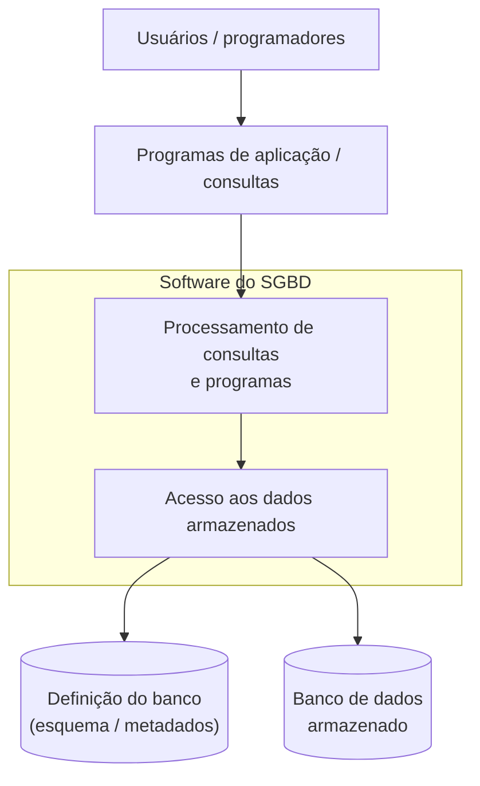
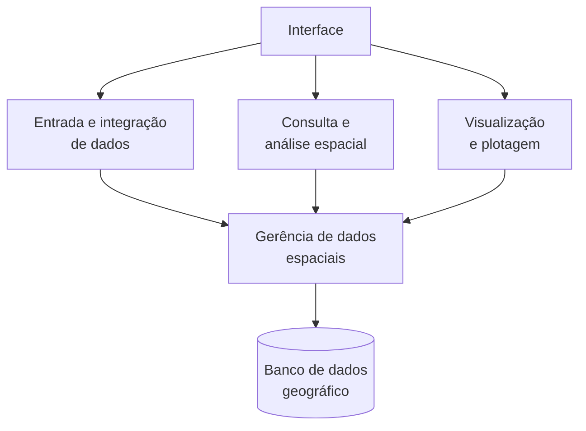
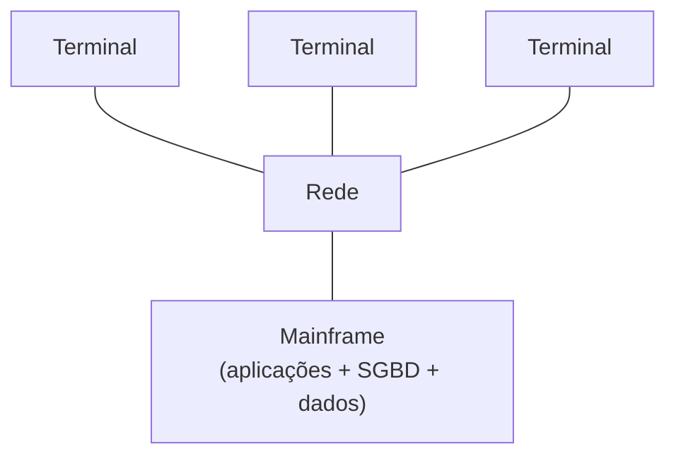
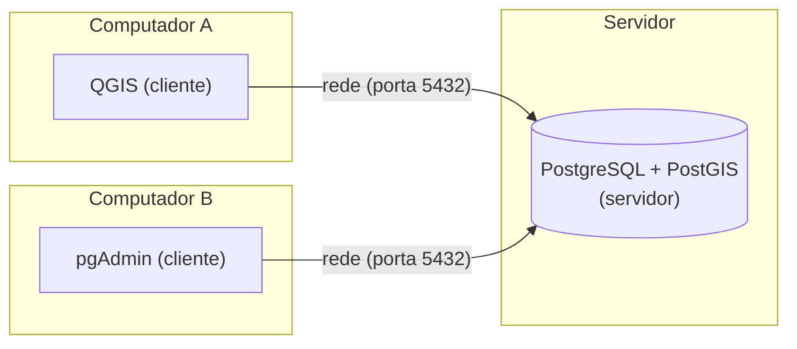
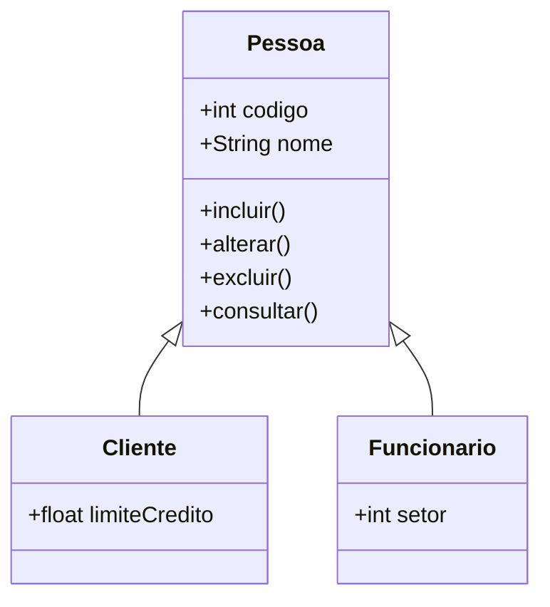

# Introdução a Bancos de Dados

Vivemos um período de grande disponibilidade de informações sobre os mais distintos tópicos, mas a nossa finitude exige que sejamos seletivos quanto ao que devemos aprofundar. Então, por que estudar bancos de dados geográficos?

Uma resposta curta é que o banco de dados geográfico é um **componente elementar dos sistemas de informação geográfica**. Alguém poderia argumentar que ele não é obrigatório: no QGIS ou no ArcGIS é possível manipular dados diretamente a partir de arquivos, como o *Shapefile* ou o KML. Essa pessoa estaria parcialmente certa — mas talvez não conheça as limitações dessa abordagem, ou não saiba que, ao migrar do *Shapefile* para o *GeoPackage*, já estaria usando um banco de dados. Também não conheceria as vantagens do GeoPackage em relação ao *Shapefile*, nem as suas limitações em relação ao PostGIS.

Conhecendo os conceitos de bancos de dados e de sistemas gerenciadores, um usuário de SIG pode decidir **como e onde manter seus dados**. A solução para produzir um mapa que ilustra um artigo é muito diferente da usada em um grande projeto com múltiplos usuários. Além disso, conhecer a linguagem de consulta dá poder para extrair informações de forma rápida e eficiente — em alguns casos, sem precisar de um SIG, porque os bancos geográficos já oferecem diversas operações de análise espacial.

---

## 🗃️ Dados, bancos de dados e SGBDs

Para entender o que é um banco de dados, uma analogia ajuda (FRANÇA; CELESTINO JÚNIOR, 2015). Imagine a secretaria de uma escola antes dos computadores:

| Mundo físico | Mundo digital |
|---|---|
| Cada **informação** anotada em uma ficha (nome, telefone, endereço) | **Campo** (ou coluna, atributo) |
| Cada **ficha**, com as informações de um aluno | **Registro** (ou linha, tupla) |
| Um **arquivo de aço** com as fichas de uma turma | **Tabela** |
| O **conjunto de arquivos de aço** da secretaria | **Banco de dados** |

Elmasri e Navathe (2005) definem um **banco de dados** como *"uma coleção de dados relacionados"*, em que **dados** são *"fatos conhecidos que podem ser registrados e possuem significado implícito"* — por exemplo, os nomes, números de telefone e endereços das pessoas que você conhece. *Poder ser registrado* significa poder ser representado por estruturas computacionais, como números, datas e textos. E os dados precisam estar **relacionados**: é essa relação que permite extrair informações por meio de consultas que combinam dados — como as de turmas, docentes e discentes em um sistema acadêmico. Hoje, praticamente todos os sistemas utilizam, direta ou indiretamente, bancos de dados.

### Sistemas gerenciadores de bancos de dados

Até a década de 1970, era comum que cada sistema de informação fosse responsável por gerenciar sua própria base de dados, com rotinas próprias de armazenamento e recuperação. Mas fazer isso de modo seguro e eficiente é difícil, e desenvolver essas rotinas consumia um tempo que poderia ser dedicado ao problema específico de cada empresa. Como armazenar e recuperar dados era uma necessidade comum, surgiram sistemas específicos para essas tarefas: os **sistemas gerenciadores de banco de dados (SGBD)**.

!!! info "E nos SIGs?"
    Veremos no [Capítulo 14](14_tipos_espaciais.md) que, nos sistemas de informação geográfica, essa realidade — cada sistema com seu próprio formato de armazenamento — durou até o início dos anos 2000, e ainda persiste em alguns casos.

Um SGBD é *"uma coleção de programas que permite aos usuários criar e manter um banco de dados"*; ele *"facilita o processo de definição, construção, manipulação e compartilhamento de bancos de dados entre diversos usuários e aplicações"* (ELMASRI; NAVATHE, 2005). Estudamos bancos de dados para usar melhor os recursos que os SGBDs oferecem:

- **Restringir acesso não autorizado:** usados em ambientes multiusuário, os SGBDs funcionam como servidores e permitem criar diferentes níveis de usuário e de acesso.
- **Tornar as consultas mais eficientes:** por serem especializados, acumulam algoritmos eficientes para armazenar e consultar dados.
- **Backup e recuperação:** oferecem utilitários para criar e restaurar cópias de segurança.
- **Controlar a redundância:** permitem relacionar os dados de modo a evitar repetições.
- **Representar relacionamentos complexos** entre os dados.
- **Impor restrições de integridade:** definido um esquema, garantem que os dados respeitem as regras estabelecidas.

A figura a seguir ilustra um sistema de banco de dados. Observe a distinção entre o **banco de dados armazenado** e a sua **definição** — o **esquema** ou **metadados**, que descreve as tabelas, as relações e as restrições de integridade.



### Bancos de dados geográficos

Alguns SGBDs dão suporte à manipulação de dados espaciais e são chamados de **bancos de dados espaciais** (ou geográficos). Segundo Güting (1994), um banco de dados espacial é um sistema que:

1. oferece **tipos de dados espaciais** no seu modelo de dados e na sua linguagem de consulta;
2. suporta esses tipos na implementação, fornecendo pelo menos **indexação espacial** e algoritmos eficientes para **junções espaciais**.

!!! warning "O que **não** é um banco de dados geográfico"
    Para quem já trabalha com geoprocessamento, vale destacar: **uma pasta organizada com arquivos *shapefile* não é um banco de dados geográfico**. Não há SGBD controlando acesso, integridade, consultas ou índices.

O banco de dados geográfico é o componente base da arquitetura de um SIG (CÂMARA, 2005), sobre o qual se apoiam as funções de entrada e integração de dados, consulta e análise espacial, e visualização:



É por isso que o geoprocessamento — *"a disciplina do conhecimento que utiliza técnicas matemáticas e computacionais para o tratamento da informação geográfica"* (CÂMARA et al., 2001) — depende dos bancos de dados na etapa de **armazenamento**, entre a **coleta** (cartografia, sensoriamento remoto, GPS) e o **tratamento e análise** (modelagem, geoestatística, análise espacial).

---

## 🏛️ Arquiteturas de bancos de dados

Os SGBDs, como outros sistemas, foram implementados inicialmente em uma **arquitetura centralizada**: todo o processamento ocorria em grandes computadores, os *mainframes*, e os usuários acessavam o sistema por meio de **terminais "burros"** — apenas monitores e teclados conectados ao computador central.



Com a redução dos preços, os terminais foram substituídos por computadores capazes de realizar parte do processamento. Surgiu assim a **arquitetura cliente/servidor**, usada pelos SGBDs atuais — como o PostgreSQL, que usaremos neste livro. Essa arquitetura não é exclusiva dos bancos de dados: é a da *web*, do correio eletrônico, das impressoras em rede, da sincronização de arquivos. Quando digitamos um endereço em um navegador (o **cliente**), é enviada uma requisição a um computador (o **servidor**) localizado naquele endereço. O mesmo ocorre com os SGBDs: aplicações clientes, como o **pgAdmin** e o **QGIS**, acessam os dados armazenados no servidor PostgreSQL.



Nessa arquitetura, **não é obrigatório** que cliente e servidor estejam em computadores distintos. Nos tutoriais deste livro, ambos serão instalados no mesmo computador. Em ambientes institucionais e corporativos, porém, é comum um servidor centralizar os dados para diversos usuários.

Com a *web*, surgiu ainda a **arquitetura de três (ou *n*) camadas**, com uma camada intermediária — o servidor de aplicação ou servidor *web* — entre o cliente (o navegador) e o servidor de banco de dados. Nas aplicações atuais, tanto a camada intermediária quanto a de dados podem estar distribuídas em vários servidores.

---

## 🧱 Modelos de bancos de dados

Além da arquitetura, os SGBDs são classificados pela forma como **organizam a informação**:

- **Hierárquico** e **de rede** — os primeiros SGBDs organizavam os dados em árvores ou em redes (vértices e arestas).
- **Relacional** — o modelo dominante até hoje (SGBD-R). Surgiu com base na álgebra relacional proposta pelo pesquisador da IBM **Edgar F. (Ted) Codd**, em 1970, com os conceitos de **relações** (tabelas), **tuplas** (linhas) e **atributos** (colunas). Um banco é uma coleção de tabelas relacionadas.
- **Orientado a objetos** — com a popularização das linguagens orientadas a objetos, esperava-se que os bancos suportassem os conceitos desse paradigma: objetos com propriedades e operações (métodos), classes organizadas em hierarquias, herança, composição e agregação.
- **Objeto-relacional** — os bancos orientados a objetos não se tornaram populares, mas influenciaram os **objeto-relacionais** (SGBD-OR), ou relacionais estendidos. Eles mantêm a compatibilidade com o modelo relacional — o que facilita a migração — e permitem criar **tipos de dados complexos**, além de textos, números e datas. É exatamente isso que permite representar geometrias. O **PostgreSQL** é um SGBD objeto-relacional.
- **NoSQL** (*Not Only SQL*) — alternativas recentes ao modelo relacional, que organizam os dados em documentos, grafos, pares chave-valor, triplas, entre outros. Alguns têm suporte a dados espaciais.

Um exemplo de herança, como seria modelado em um banco orientado a objetos: as classes `Cliente` e `Funcionario` são subclasses de `Pessoa` e herdam seus atributos e operações.



Um exemplo de banco NoSQL com suporte espacial é o [MongoDB](https://www.mongodb.com/), que armazena documentos no formato **GeoJSON**:

```json
{
  "type": "Feature",
  "geometry": {
    "type": "Point",
    "coordinates": [-44.3090446, -2.5583674]
  },
  "properties": {
    "name": "Universidade Federal do Maranhão"
  }
}
```

---

## 📝 Síntese

Neste livro, estudaremos bancos de dados geográficos usando o **PostgreSQL**, um SGBD **objeto-relacional** que funciona em **arquitetura cliente/servidor**, com a extensão espacial **PostGIS**. Antes de instalá-los ([Capítulo 12](12_instalacao.md)), veremos como projetar um banco de dados geográfico ([Capítulo 11](11_projeto_bdg.md)).

## ✏️ Exercícios

1. Conceitue e exemplifique: dado, banco de dados e sistema gerenciador de banco de dados.
2. Cite quatro vantagens de usar um SGBD em vez de arquivos isolados.
3. Por que uma pasta com arquivos *shapefile* não é um banco de dados geográfico?
4. Explique a arquitetura cliente/servidor usando o QGIS e o PostgreSQL como exemplo. Cliente e servidor precisam estar em computadores diferentes?
5. Qual característica dos SGBDs objeto-relacionais os torna adequados para dados geográficos?
