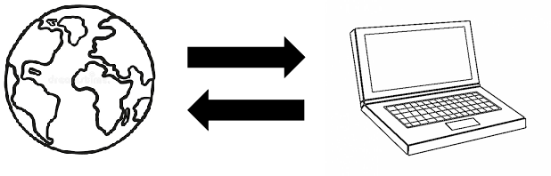
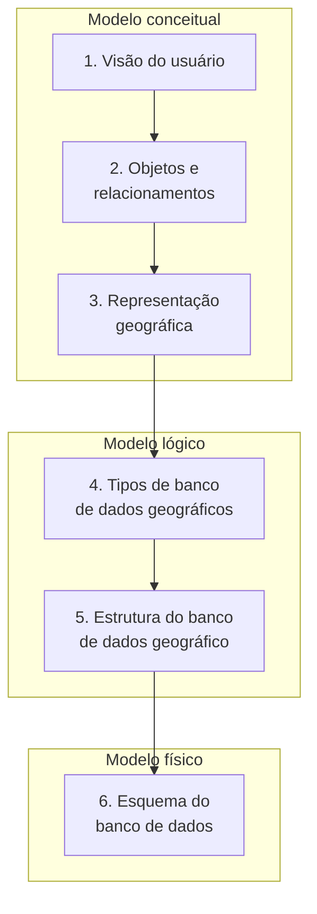
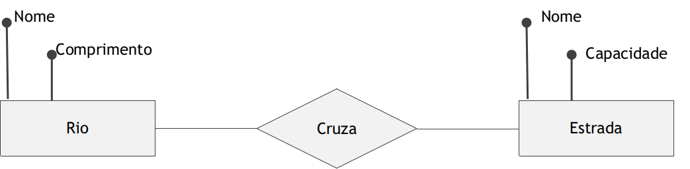
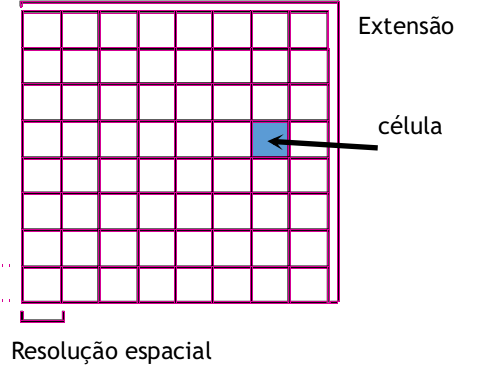
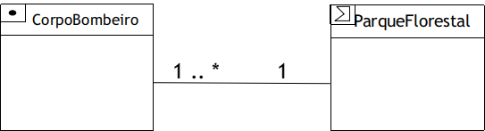

# Projeto de Banco de Dados Geográficos

Aqui é importante diferenciar o uso **pessoal** do uso **institucional** de sistemas de informação geográfica. No uso pessoal e em casos simples, muitas vezes não é necessário um banco de dados geográfico: trabalha-se com poucos dados, em alguns arquivos *shapefile*. Em ambientes corporativos e institucionais, porém, o volume de dados pode ultrapassar vários *gigabytes* — excedendo em muito o limite de um *shapefile* (2 GB por arquivo) —, e os mesmos dados são acessados por vários usuários, para diferentes usos. Nesses casos, **projetar** um banco de dados geográfico se torna fundamental.

---

## 🌍 Do mundo real ao computador

Projetar um banco de dados é representar o "mundo real" por meio de estruturas computacionais — tanto para dados convencionais quanto para dados geográficos.

Um **modelo de dados** é uma descrição dos tipos de informação armazenados em um SGBD (HEUSER, 2009): uma descrição formal da estrutura de um banco de dados, também chamada de **metadados**, **esquema** ou **definição de dados**.

### Um exemplo sem mapas

Criar o modelo de dados de um grande sistema é uma tarefa complexa, que exige profissionais especializados. Vamos começar com um exemplo familiar: as informações de um sistema acadêmico — discentes, docentes, disciplinas, turmas, notas, aprovações.

Comecemos por algo ainda mais simples: o controle de notas de **um** professor em **uma** turma. Quem conhece um pacote de escritório criaria facilmente uma planilha como esta:

| Matrícula | Nome | Nota 1 | Nota 2 | Média | Reposição | Média final | Aprovado |
|---|---|:---:|:---:|:---:|:---:|:---:|:---:|
| 2018111 | João Marcos Oliveira | 5,0 | 4,0 | 4,5 | 5,0 | 5,0 | Não |
| 2018643 | Maria Antônia Silva | 8,0 | 7,0 | 7,5 | — | 7,5 | Sim |

Ao fazer isso, essa pessoa **implicitamente criou um modelo de dados**: definiu quais dados são relevantes para o objetivo — neste caso, apenas identificar os aprovados.

Agora imagine um centro de ensino com necessidades bem maiores: gerar o histórico de cada discente, encontrar facilmente os contatos de discentes e docentes, acompanhar mudanças na matriz curricular, gerar relatórios por turma e por docente. Uma única tabela não bastaria. Para os contatos, por exemplo, seria melhor uma segunda tabela:

| Matrícula | Nome | E-mail | Endereço | Telefone |
|---|---|---|---|---|
| 2018111 | João Marcos Oliveira | joao@exemplo.com | Rua Planejada, 123 | (98) 99999-7799 |
| 2018643 | Maria Antônia Silva | maria@exemplo.com | Rua da Esperança, 345 | (98) 98888-7996 |

Separar os contatos **evita a redundância** (repetição) dos dados e facilita as modificações: se um discente mudar de telefone, a atualização ocorre em um único lugar. De modo prático, **modelar** é decidir quais tabelas existem, como se relacionam e qual o tipo de dado de cada coluna — texto para o nome, número inteiro para a matrícula, número real para as notas.

Um mesmo problema pode ser modelado de diversas formas, algumas melhores que outras para determinados casos — o que torna a modelagem uma das tarefas mais complexas da computação. Para o geoprocessamento, porém, o usuário geralmente precisa responder a algumas perguntas:

- Qual a **representação geográfica**? É um geo-objeto ou um geo-campo?
- Quais **atributos** descrevem esses dados?
- Qual a **representação computacional** (tipo de dado) de cada atributo?
- Quantas **classes** de objetos serão representadas? Existem relações ou restrições entre elas?

---

## 🪜 Níveis e etapas do projeto

O projeto de um banco de dados geográfico tem muitas semelhanças com o de qualquer outro banco: envolve a criação de modelos **conceituais**, **lógicos** e **físicos** (LONGLEY et al., 2015), aqui organizados em seis passos:

Observe que o nível do **mundo real**, comum nos livros de banco de dados, não aparece. No geoprocessamento, ele seria formado pelos fenômenos geográficos — rios, cidades, montanhas —, aqueles que, como vimos no [Capítulo 1](../parte1/01_geoinformacao.md), possuem tempo e espaço bem definidos. Sem querer ser filosófico: talvez o mundo real seja intangível, impossível de ser representado computacionalmente; em muitos casos, os fenômenos são convenções e abstrações que criamos no domínio de discurso, como "o Everest" e "o Brasil". Por isso, podemos começar o projeto a partir do nível conceitual.

---

## 💭 Modelo conceitual

Longley et al. (2015) argumentam que a **visão do usuário** é o primeiro passo do nível conceitual: os dados são identificados e organizados para entender o domínio ou problema, por meio de entrevistas e da leitura de documentos e relatórios.

O segundo passo é a definição dos **objetos e seus relacionamentos**. Nessa etapa, usam-se diagramas simples, ainda independentes de um tipo de banco de dados — como o **diagrama de entidade e relacionamento (DER)**:

Esses diagramas ajudam a entender o domínio, mas a última etapa do nível conceitual é escolher a **representação geográfica** de cada entidade. Como vimos no [Capítulo 4](../parte1/04_tipos_dados.md#nivel-conceitual-objetos-e-campos), há duas visões:

- **Objetos discretos** (geo-objetos): entidades com limites bem definidos sobre um espaço vazio — como os mapas geopolíticos, cujos limites são definidos por acordos (inter)nacionais.
- **Campos contínuos** (geo-campos): variáveis definidas em cada posição do espaço — como as imagens de satélite, em que o sensor lê um valor de reflectância para cada posição imageada.

---

## 🧩 Modelo lógico

O nível lógico ajusta o modelo conceitual às **estruturas de dados** (LONGLEY et al., 2015):

- Os **geo-campos** são geralmente implementados por estruturas **matriciais** (*rasters*), que dividem o mundo em células e especificam atributos para elas. Características importantes dessa representação são a **extensão** (a área coberta) e a **resolução espacial** (o tamanho da célula).

    

- Os **geo-objetos** são geralmente representados por estruturas **vetoriais**: coleções de feições geométricas (ponto, linha, área) com um ou mais atributos associados. A componente espacial usa primitivas geométricas, associadas a dados convencionais como textos e números. Por exemplo, um mapa dos países da América do Sul, em que cada polígono está ligado a uma linha de uma tabela:

    | País | PIB (US$ bilhões) | População (milhões) |
    |---|:---:|:---:|
    | Brasil | 350 | 159 |
    | Argentina | 295 | 34 |
    | Chile | 45 | 14 |

    *Valores ilustrativos, extraídos do exemplo de Câmara et al. (2001).*

### Pictogramas

Definidas as estruturas, podemos incluí-las nos diagramas de entidade-relacionamento ou de classes por meio de **pictogramas**: pequenos ícones que indicam a forma geométrica (ponto, linha, polígono, campo) e as relações espaciais (SHEKHAR; CHAWLA, 2003). No diagrama a seguir, cada corpo de bombeiros é modelado como um **ponto** e está localizado em um parque florestal modelado como um **polígono**:

Os pictogramas tornam explícitos o formato de representação e a relação espacial.

### O modelo OMT-G

Borges, Davis e Laender (2001) propuseram um modelo mais completo, o **OMT-G**, uma extensão para dados geográficos da OMT (*Object Modeling Technique*) de Rumbaugh et al. (1991). Nele, modelam-se dados espaciais e não espaciais por meio de dois tipos de classe:

- **Classes convencionais:** representadas como classes comuns (nome, atributos, operações);
- **Classes georreferenciadas:** têm, além disso, um espaço para um **pictograma** que indica a representação geográfica.

As classes georreferenciadas se especializam em **geo-campos** e **geo-objetos**, seguindo os conceitos vistos no nível conceitual:

| Especialização | Classes no OMT-G | Exemplo |
|---|---|---|
| **Geo-campo** | Rede triangular irregular (TIN) | Temperatura, relevo |
| | Isolinhas | Curvas de nível |
| | Subdivisão planar | Mapa pedológico (tipos de solo) |
| | Tesselação | Imagem Landsat |
| | Amostras | Pontos cotados |
| **Geo-objeto com geometria** | Ponto, linha, polígono | Árvore, meio-fio, edificação |
| **Geo-objeto com geometria e topologia** | Linha unidirecional, linha bidirecional, nó de rede | Trecho de esgoto, tubulação de água, cruzamento |

O OMT-G descreve ainda três categorias de **relacionamentos**:

- **Associações simples** — relações entre objetos de classes diferentes, convencionais ou georreferenciadas (ex.: uma edificação *pertence a* um proprietário);
- **Relacionamentos espaciais** — relações topológicas, métricas ou direcionais entre classes georreferenciadas (ex.: uma edificação *contém* um lote; uma escola está *a menos de 1 km* de um ponto de ônibus);
- **Relacionamentos de rede** — ligações arco-nó ou arco-arco (ex.: segmentos de logradouro ligados a cruzamentos; rodovias formando uma malha rodoviária).

Para ver os diagramas completos e sua notação gráfica, consulte o artigo original (BORGES; DAVIS; LAENDER, 2001) e o capítulo "Modelagem de dados geográficos" de Casanova et al. (2005), disponível em [dpi.inpe.br/livros/bdados](http://www.dpi.inpe.br/livros/bdados/index.html).

### A ET-EDGV

Como comentamos, a modelagem exige experiência e conhecimento do domínio, e um mesmo problema pode ser modelado de muitas maneiras. Essas diferenças podem inviabilizar o compartilhamento de dados entre produtores e usuários de informação cartográfica. Por isso, a **Comissão Nacional de Cartografia (CONCAR)** homologou as **Especificações Técnicas para Estruturação de Dados Geoespaciais Vetoriais (ET-EDGV)**: um modelo conceitual e semântico do mapeamento de referência brasileiro, que padroniza as estruturas de dados (DSG, 2017). A versão 3.0 da ET-EDGV define a estrutura dos dados vetoriais e tem como base o **OMT-G**.

A especificação contém modelos para diversas categorias — Hidrografia, Energia e Comunicações, Relevo, Vegetação, Sistemas de Transporte, Administração Pública, entre outras —, cada uma com classes e relações definidas segundo o OMT-G. Na categoria Hidrografia, por exemplo, há classes como *Curso d'água*, *Trecho de drenagem*, *Barragem*, *Eclusa* e *Bacia hidrográfica*, com relacionamentos espaciais como "trecho de drenagem *está contido em* bacia hidrográfica". A documentação completa está disponível no [Geoportal do Exército Brasileiro](https://geoportal.eb.mil.br/portal/).

---

## 🛠️ Modelo físico

Longley et al. (2015) destacam que o **modelo físico** é a definição do esquema do banco de dados usando a **linguagem de definição de dados** do SGBD — a SQL DDL, que veremos no [Capítulo 13](13_sql.md). É nesse nível que decidimos, por exemplo, que a classe *Município* será uma tabela `municipio`, com as colunas `codigo integer`, `nome varchar(100)` e `geom geometry(MultiPolygon, 4674)`.

!!! tip "Um atalho para a ET-EDGV: o DsgTools"
    A Diretoria de Serviço Geográfico (DSG) do Exército disponibiliza o *plugin* **DsgTools** para o QGIS, que cria bancos de dados (PostGIS ou SpatiaLite) de acordo com a ET-EDGV — ou seja, que já fornece o **modelo físico** pronto.

---

## 📝 Síntese

- **Modelar** é decidir quais tabelas existem, como se relacionam e qual o tipo de cada atributo; no caso geográfico, também qual a **representação geográfica** de cada classe.
- O projeto passa pelos modelos **conceitual** (visão do usuário, objetos, representação), **lógico** (estruturas matriciais e vetoriais) e **físico** (esquema em SQL).
- O **OMT-G** estende a modelagem orientada a objetos com classes georreferenciadas, pictogramas e relacionamentos espaciais e de rede; a **ET-EDGV** padroniza, com base nele, o mapeamento de referência brasileiro.

## ✏️ Exercícios

1. Explique a diferença entre os modelos conceitual, lógico e físico. Em qual deles se decide se um dado será vetorial ou matricial?
2. Modele uma planilha de controle de frequência de uma turma e mostre como separá-la em duas tabelas para evitar redundância.
3. Para um cadastro urbano com as classes *Bairro*, *Quadra*, *Lote*, *Edificação* e *Proprietário*, indique quais são convencionais e quais são georreferenciadas, e o pictograma de cada uma.
4. Dê exemplos de um relacionamento espacial e de um relacionamento de rede em um sistema de saneamento.
5. Qual a importância da ET-EDGV para o compartilhamento de dados geográficos no Brasil?
