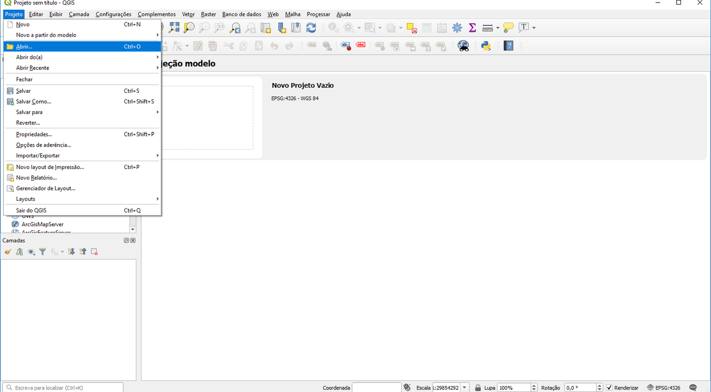
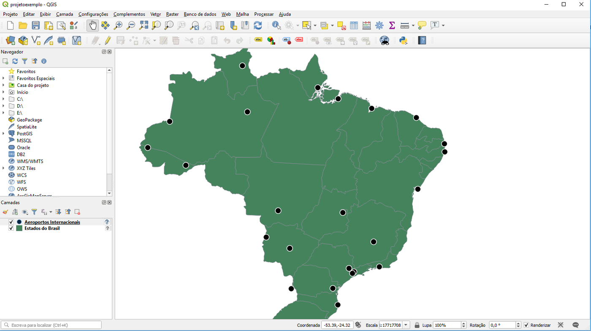

# Instalando PostgreSQL, PostGIS e QGIS

Para conhecer um SGBD, é preciso instalá-lo e explorar seus recursos. Neste capítulo, instalaremos os três programas usados em toda a Parte 2:

| Programa | Papel | Onde obter |
|---|---|---|
| **PostgreSQL** | Servidor de banco de dados objeto-relacional | [postgresql.org/download](https://www.postgresql.org/download/) |
| **PostGIS** | Extensão espacial do PostgreSQL | Instalada junto ao PostgreSQL (ver abaixo) |
| **pgAdmin 4** | Cliente gráfico para administrar o servidor e consultar os dados | Incluído no instalador do PostgreSQL para Windows e macOS |
| **QGIS** | Sistema de informação geográfica (cliente) | [qgis.org/download](https://qgis.org/download/) |

---

## 🐘 O PostgreSQL

O PostgreSQL é um sistema gerenciador de banco de dados **objeto-relacional**, que funciona em arquitetura **cliente/servidor**. Ele surgiu do projeto POSTGRES, iniciado em 1986 na Universidade da Califórnia em Berkeley, e passou por várias evoluções até receber o nome atual, em 1996, quando se tornou um projeto de código aberto coordenado pelo *PostgreSQL Global Development Group* ([histórico oficial](https://www.postgresql.org/docs/current/history.html)). É hoje considerado o SGBD de código aberto mais avançado. Ele é formado por uma coleção de programas: o servidor e diversos utilitários, como o `psql` (cliente de linha de comando).

O **PostGIS** é a extensão que acrescenta ao PostgreSQL os tipos de dados, as funções e os índices espaciais que estudaremos nos Capítulos 14 e 15.

!!! info "Versões"
    Use uma versão do PostgreSQL com suporte ativo (a partir da 14) e o PostGIS 3.x. Os exemplos deste livro foram testados com PostgreSQL 16 e PostGIS 3.4, mas funcionam em versões mais novas. Versões antigas de materiais anteriores (PostgreSQL 9.5, pgAdmin 3) estão **descontinuadas** e não devem mais ser usadas.

Escolha, a seguir, o roteiro do seu sistema operacional.

=== "Windows"

    1. Baixe o instalador da EDB em [enterprisedb.com/downloads/postgres-postgresql-downloads](https://www.enterprisedb.com/downloads/postgres-postgresql-downloads), escolhendo a versão mais recente para Windows x86-64.
    2. Execute o instalador. Nas telas iniciais, mantenha os diretórios sugeridos para o programa e para os dados, e mantenha selecionados os componentes **PostgreSQL Server**, **pgAdmin 4**, **Stack Builder** e **Command Line Tools**.
    3. Defina a **senha do superusuário** `postgres`. Em ambientes institucionais, use uma senha forte; para uso pessoal, uma senha simples, que você não esqueça.
    4. Mantenha a **porta 5432**, a porta padrão do PostgreSQL. Em um mesmo computador podem existir vários servidores; a porta é o número que indica com qual servidor o cliente quer se comunicar.
    5. Mantenha a localidade padrão e conclua a instalação.
    6. Na tela final, deixe marcada a opção de iniciar o **Stack Builder**. Nele, selecione o servidor recém-instalado e, na categoria **Spatial Extensions**, marque o **PostGIS** correspondente à sua versão do PostgreSQL. Avance até concluir, aceitando as opções padrão.

    Ao final, estarão instalados o PostgreSQL, o pgAdmin 4 e o PostGIS — incluindo o *PostGIS Shapefile Import/Export Manager* (`shp2pgsql-gui`), útil para importar *shapefiles*.

=== "Linux (Ubuntu/Debian)"

    Os pacotes das distribuições já incluem o PostGIS:

    ```bash
    sudo apt update
    sudo apt install postgresql postgis
    ```

    O servidor é iniciado automaticamente. Para definir uma senha para o superusuário `postgres`:

    ```bash
    sudo -u postgres psql -c "ALTER USER postgres PASSWORD 'sua_senha';"
    ```

    O pgAdmin 4 pode ser instalado a partir do [repositório oficial](https://www.pgadmin.org/download/pgadmin-4-apt/); como alternativa, o próprio QGIS e o cliente `psql` bastam para os exercícios.

=== "macOS"

    A forma mais simples é o [Postgres.app](https://postgresapp.com/), que já inclui o PostGIS: baixe, arraste para a pasta Aplicativos, abra e clique em **Initialize**. O pgAdmin 4 pode ser baixado em [pgadmin.org](https://www.pgadmin.org/download/pgadmin-4-macos/).

=== "Docker (qualquer sistema)"

    Com o [Docker](https://www.docker.com/) instalado, um único comando sobe um servidor PostgreSQL com PostGIS:

    ```bash
    docker run --name postgis \
      -e POSTGRES_PASSWORD=postgres \
      -p 5432:5432 \
      -v pgdata:/var/lib/postgresql/data \
      -d postgis/postgis:17-3.5
    ```

    O volume `pgdata` preserva os dados quando o contêiner é removido. Acesse com qualquer cliente em `localhost:5432`, usuário `postgres`, senha `postgres`. Veja o [tutorial de Docker da Coleção LambdaGeo](https://lambdageo.github.io/tutoriais/) para mais detalhes.

---

## ✅ Testando a instalação

Vamos criar um banco de dados para os exemplos do livro e ativar nele o PostGIS.

**1. Conecte-se ao servidor.** Abra o **pgAdmin 4**. No painel *Object Explorer*, expanda *Servers*: o servidor local aparece com o nome da versão instalada (no Docker ou no Linux, registre-o com *Register → Server...*, informando `localhost`, porta `5432`, usuário `postgres` e a senha). Digite a senha definida na instalação.

**2. Crie um banco de dados.** Clique com o botão direito em *Databases* → *Create* → *Database...*, dê o nome `curso` e salve. Ou, no `psql`:

```sql
CREATE DATABASE curso;
```

**3. Ative o PostGIS.** A extensão precisa ser criada **em cada banco** em que será usada. Selecione o banco `curso`, abra o **Query Tool** (menu *Tools*) e execute:

```sql
CREATE EXTENSION postgis;
```

**4. Verifique.** Ainda no Query Tool:

```sql
SELECT postgis_full_version();
```

O resultado deve mostrar a versão do PostGIS e das bibliotecas que ele usa — GEOS (operações geométricas), PROJ (transformações entre sistemas de referência) e GDAL (formatos de arquivo). Se aparecer a mensagem `function postgis_full_version() does not exist`, a extensão não foi criada no banco correto.

!!! tip "O `psql`, cliente de linha de comando"
    Todos os comandos SQL deste livro também podem ser executados no `psql`. Para conectar ao banco `curso`:

    ```bash
    psql -h localhost -U postgres -d curso
    ```

    Comandos úteis dentro do `psql`: `\dt` lista as tabelas, `\d nome_tabela` descreve uma tabela e `\q` sai.

---

## 🌎 O QGIS

O **QGIS** é um SIG livre e de código aberto, mantido pela fundação OSGeo, disponível para Windows, Linux e macOS. Ele será o nosso **cliente** geográfico: com ele, visualizaremos e editaremos os dados guardados no PostgreSQL/PostGIS.

!!! info "Qual versão instalar?"
    O QGIS tem duas linhas de versões: a **LTR** (*Long Term Release*), mais estável, atualizada por um ano, e a **versão mais recente**, com novidades a cada quatro meses. Para uso em aula, prefira a **LTR**. As telas deste livro foram capturadas em versões 3.x; em versões mais novas, a disposição de alguns menus pode mudar, mas as funções são as mesmas.

=== "Windows e macOS"

    1. Acesse [qgis.org/download](https://qgis.org/download/) e baixe o instalador da versão **LTR** para o seu sistema.
    2. Execute o instalador, aceite a licença e mantenha a pasta de instalação padrão.
    3. Não é necessário instalar os conjuntos de dados de exemplo.

=== "Linux (Ubuntu/Debian)"

    Os repositórios oficiais do QGIS oferecem versões mais atuais que as das distribuições. Siga as instruções em [qgis.org/resources/installation-guide](https://qgis.org/resources/installation-guide/) ou, para uma instalação rápida, use o pacote da distribuição:

    ```bash
    sudo apt install qgis
    ```

### Testando o QGIS

Baixe os dados de exemplo em [bit.ly/3b6qN8s](https://bit.ly/3b6qN8s) e descompacte-os em uma pasta. Abra o QGIS e, no menu **Projeto → Abrir...**, selecione o arquivo `projetoexemplo`.



Você deverá ver o limite político do Brasil com os aeroportos internacionais:



Pronto: o ambiente está instalado. No [próximo capítulo](13_sql.md), usaremos o banco `curso` para aprender SQL; no [Capítulo 16](16_integracao_qgis.md), conectaremos o QGIS a ele.

---

## ✏️ Exercícios

1. Qual a função da porta 5432? O que aconteceria se dois servidores PostgreSQL tentassem usar a mesma porta no mesmo computador?
2. Por que o comando `CREATE EXTENSION postgis;` precisa ser executado em cada banco de dados?
3. No pgAdmin, crie um segundo banco de dados chamado `brdata` e ative nele o PostGIS. Ele será usado no trabalho prático.
4. Execute `SELECT postgis_full_version();` e identifique as versões do PostGIS, do GEOS e do PROJ instaladas.
