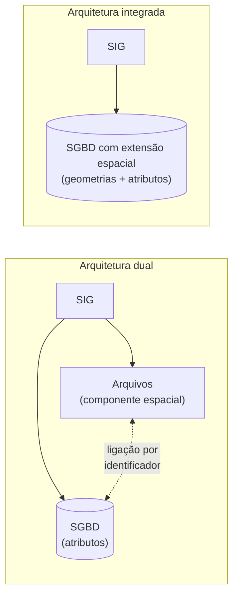
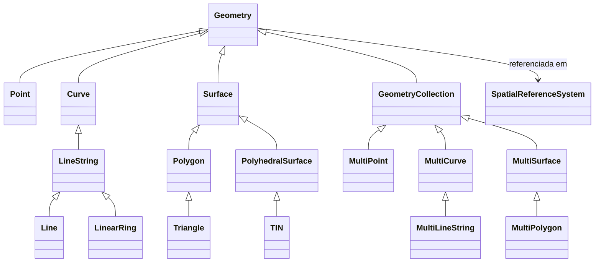
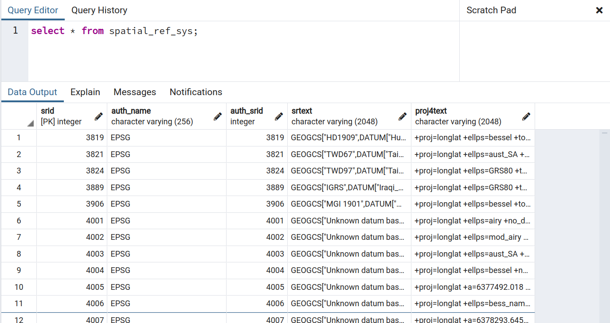
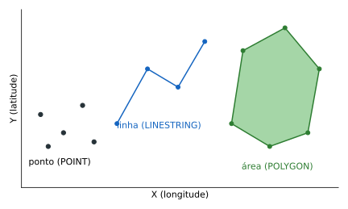
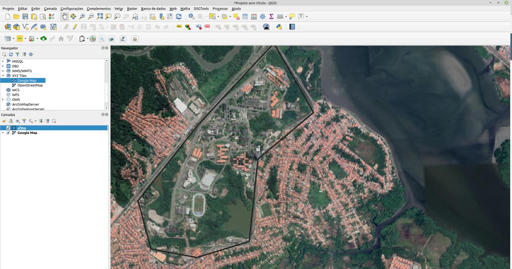
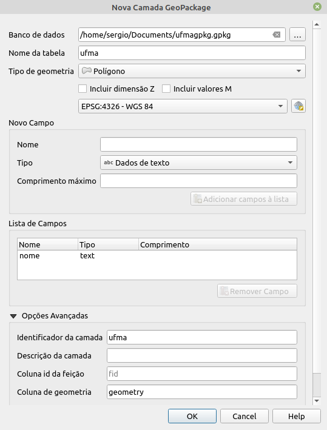
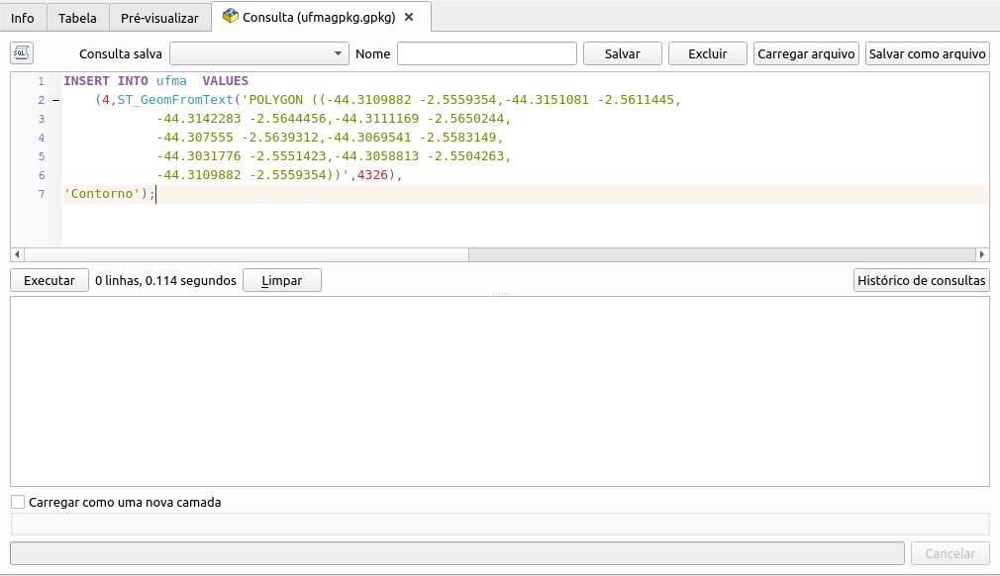

# Tipos de Dados Espaciais

Os gerenciadores de bancos de dados geográficos permitem acessar os dados por meio de uma linguagem de consulta e manipulação, como vimos no [Capítulo 13](13_sql.md). Os usuários finais, porém, normalmente acessam os dados geográficos por aplicações *desktop* ou serviços *web*, usando o banco de forma transparente. Neste capítulo, veremos como os SIGs de *desktop* — QGIS, TerraView, SPRING, ArcGIS, gvSIG — se integram aos SGBDs e quais **tipos de dados espaciais** os bancos oferecem.

---

## 🏛️ Arquitetura dual e arquitetura integrada

Há basicamente duas formas de integrar SIGs e SGBDs (FERREIRA et al., 2005):



A **arquitetura dual** surgiu porque os primeiros SGBDs só tinham tipos básicos — números, textos, datas. Os SIGs precisavam então guardar a componente espacial dos objetos separadamente, em arquivos próprios, e os atributos no SGBD. Ferreira et al. (2005) apontam as dificuldades dessa arquitetura:

- no controle e na manipulação das componentes espaciais;
- em manter a integridade entre a componente espacial e a componente alfanumérica;
- no processamento conjunto da parte convencional e da parte espacial;
- na interoperabilidade, já que cada sistema tem seu próprio formato.

Como solução, os SIGs passaram a usar uma **arquitetura integrada**, baseada em **extensões espaciais** desenvolvidas sobre SGBDs objeto-relacionais. Essas extensões incluem tipos de dados, métodos de acesso e operadores específicos. Exemplos: **Oracle Spatial**, **PostGIS** (PostgreSQL) e **SpatiaLite** e **GeoPackage** (baseados no SQLite). Elas se destacam por (FERREIRA et al., 2005):

- fornecer **tipos de dados espaciais**;
- estender a SQL com **operações** sobre esses tipos;
- oferecer **métodos de acesso e armazenamento** (índices) otimizados para consultas espaciais.

Para garantir a interoperabilidade entre as extensões, o **Open Geospatial Consortium (OGC)** propôs a especificação ***Simple Features for SQL*** (SFSQL), que define as geometrias vetoriais, as operações topológicas e métricas e um esquema de tabelas de metadados — como a que armazena os sistemas de referência espacial (HERRING, 2010).

---

## 📐 O modelo de geometrias do OGC

Vimos no [Capítulo 11](11_projeto_bdg.md) que os geo-objetos são mapeados para estruturas vetoriais e os geo-campos para matrizes. Nesta parte do livro, o enfoque são os dados **vetoriais**. O modelo usado pelos bancos para representá-los é o modelo de geometrias simples do OGC, organizado em uma hierarquia de tipos:



Observe que toda geometria está associada a um **sistema de referência espacial**. Para isso, os bancos usam uma tabela com os códigos **EPSG** que vimos no [Capítulo 1](../parte1/01_geoinformacao.md#sistemas-de-referencia-de-coordenadas-e-codigos-epsg). No PostGIS, essa tabela, chamada `spatial_ref_sys`, é criada pelo comando que executamos no Capítulo 12:

```sql
CREATE EXTENSION postgis;
```

Ela pode ser consultada como qualquer outra tabela:

```sql
SELECT srid, auth_name, auth_srid, srtext
FROM spatial_ref_sys
WHERE srid IN (4326, 4674, 31983);
```



No PostGIS, o identificador do sistema de referência de uma geometria é o **SRID** (*Spatial Reference Identifier*), que, para os sistemas EPSG, coincide com o código EPSG.

---

## 📍 As primitivas geométricas

Os formatos espaciais e os SIGs atuais suportam, principalmente, três tipos primitivos: **ponto**, **linha** e **polígono** (área). O ponto é o mais básico, a partir do qual os demais são construídos. Até as curvas são aproximadas por linhas com muitos vértices.



Ao usar um banco geográfico, usamos todos os conceitos vistos para dados convencionais, com a possibilidade de incluir os novos tipos. Por exemplo, uma tabela para os limites da Universidade Federal do Maranhão e de seus edifícios:

```sql
CREATE TABLE ufma (
  fid  integer NOT NULL PRIMARY KEY,
  geom geometry(POLYGON, 4326),
  nome varchar(30)
);
```

O primeiro atributo é o identificador, a chave primária. O segundo é do tipo **`geometry`**, especificamente um **`POLYGON`**, com **SRID 4326** — ou seja, datum WGS 84 e coordenadas geográficas (longitude e latitude, em graus). O banco passa a **recusar** geometrias de outro tipo nessa coluna:

```sql
INSERT INTO ufma VALUES (99, 'POINT(-44.30 -2.55)', 'Um ponto');
-- ERROR: Geometry type (Point) does not match column type (Polygon)
```

---

## 🔤 Os formatos WKT e WKB

Para inserir e trocar geometrias, o OGC especificou dois formatos: o **WKT** (*Well-Known Text*), textual, e o **WKB** (*Well-Known Binary*), binário. Ambos incluem o tipo do objeto e as coordenadas que o formam. No WKT, é o nome do tipo seguido dos pares de coordenadas:

| Tipo | WKT |
|---|---|
| Ponto | `POINT(0 0)` |
| Linha | `LINESTRING(0 0, 1 1, 1 2)` |
| Polígono (com um buraco) | `POLYGON((0 0, 4 0, 4 4, 0 4, 0 0), (1 1, 2 1, 2 2, 1 2, 1 1))` |
| Multiponto | `MULTIPOINT((0 0), (1 2))` |
| Multilinha | `MULTILINESTRING((0 0, 1 1, 1 2), (2 3, 3 2, 5 4))` |
| Multipolígono | `MULTIPOLYGON(((0 0, 4 0, 4 4, 0 4, 0 0), (1 1, 2 1, 2 2, 1 2, 1 1)), ((-1 -1, -1 -2, -2 -2, -2 -1, -1 -1)))` |
| Coleção | `GEOMETRYCOLLECTION(POINT(2 3), LINESTRING(2 3, 3 4))` |

!!! info "Polígonos com buracos"
    No polígono da tabela, o primeiro anel é o **limite externo** e o segundo, um **buraco** (anel interno). A área dele é 4 × 4 − 1 × 1 = 15 — confira com `SELECT ST_Area('POLYGON((0 0,4 0,4 4,0 4,0 0),(1 1,2 1,2 2,1 2,1 1))'::geometry);`. Todo anel deve ser fechado: o último ponto repete o primeiro.

Os formatos WKT e WKB originais suportam apenas geometrias 2D e não incluem o SRID. O PostGIS implementa uma extensão desses formatos, o **EWKT** e o **EWKB** (*Extended*): todo WKT/WKB válido é um EWKT/EWKB válido. O EWKT acrescenta coordenadas 3D e 4D e a especificação do SRID:

| EWKT | Significado |
|---|---|
| `POINT(0 0 0)` | Ponto XYZ (com altitude) |
| `SRID=32632;POINT(0 0)` | Ponto XY com SRID |
| `POINTM(0 0 0)` | Ponto XYM (com uma medida, como tempo ou quilometragem) |
| `POINT(0 0 0 0)` | Ponto XYZM |
| `TRIANGLE((0 0, 0 9, 9 0, 0 0))` | Triângulo |
| `TIN(((0 0 0, 0 0 1, 0 1 0, 0 0 0)), ((0 0 0, 0 1 0, 1 1 0, 0 0 0)))` | Rede triangular irregular |

No PostGIS, podemos inserir geometrias diretamente em EWKT, especificando o SRID no próprio literal:

```sql
INSERT INTO ufma VALUES
(1, 'SRID=4326;POLYGON((-44.3109882 -2.5559354, -44.3151081 -2.5611445,
      -44.3142283 -2.5644456, -44.3111169 -2.5650244,
      -44.307555 -2.5639312, -44.3069541 -2.5583149,
      -44.3031776 -2.5551423, -44.3058813 -2.5504263,
      -44.3109882 -2.5559354))',
 'Contorno');
```

Após a inserção, o dado pode ser visualizado em um SIG como o QGIS — aqui, sobre uma camada de imagens de satélite:



!!! tip "Consultando uma geometria"
    Um `SELECT geom FROM ufma;` retorna a geometria em WKB, em hexadecimal — ilegível para humanos. Use as funções de saída do [Capítulo 15](15_operacoes_espaciais.md#construindo-e-exportando-geometrias), como `ST_AsText(geom)`.

---

## 🌐 `geometry` e `geography`

O tipo `geometry` trata as coordenadas como se estivessem em um **plano cartesiano**. Isso é perfeito para SRCs projetados (em metros), mas traz uma armadilha para coordenadas geográficas: medidas como área e distância são calculadas **em graus**. O PostGIS oferece também o tipo **`geography`**, que faz os cálculos sobre o **elipsoide** e retorna metros. Compare a área do contorno da UFMA calculada de três formas:

```sql
SELECT ST_Area(geom)                         AS em_graus2,
       ST_Area(geom::geography)              AS m2_geography,
       ST_Area(ST_Transform(geom, 31983))    AS m2_utm_23s
FROM ufma
WHERE fid = 1;
```

| em_graus2 | m2_geography | m2_utm_23s |
|---:|---:|---:|
| 0.0000818 | 1.006.034 | 1.005.376 |

O primeiro valor não tem significado prático. Os outros dois mostram que o *campus* tem cerca de **100 hectares** (1 km²): um calculado sobre o elipsoide, outro após projetar os dados para SIRGAS 2000 / UTM 23S (EPSG:31983) com `ST_Transform`. A pequena diferença entre eles vem da distorção da projeção.

!!! warning "Regra prática"
    Para medir áreas e distâncias de dados em coordenadas geográficas (SRID 4326 ou 4674), converta para `geography` ou transforme para um SRC projetado adequado à região. Nunca interprete medidas em graus.

---

## 📦 GeoPackage: um banco de dados em um arquivo

Como alternativa aos SGBDs servidores — PostgreSQL, Oracle —, existem formatos mais leves, que **não exigem a instalação de um servidor**. Eles se baseiam no [SQLite](https://www.sqlite.org/), um banco de dados completo guardado em um único arquivo. Os mais conhecidos são o [SpatiaLite](https://www.gaia-gis.it/fossil/libspatialite/home), mais antigo, e o **GeoPackage** (`.gpkg`), padrão proposto e mantido pelo OGC. O GeoPackage é suportado pelas versões recentes dos SIGs e é, desde a versão 3 do QGIS, o formato padrão para novas camadas.

!!! question "*Shapefile* ou GeoPackage?"
    Um único arquivo `.gpkg` pode conter **várias camadas** vetoriais e matriciais, estilos e metadados, sem os limites do *shapefile* (2 GB por arquivo, nomes de campo com até 10 caracteres, um único tipo de geometria por arquivo). E, por ser um banco de dados, aceita consultas SQL. Para trocar dados com outras pessoas, prefira o GeoPackage.

No QGIS, uma base GeoPackage é criada pelo menu **Camada → Criar Camada → Nova Camada GeoPackage...**:



Nesse caso, não é preciso executar explicitamente o `CREATE TABLE`: a tela já define o nome da tabela, o tipo de geometria, o SRC e os campos. Na lista de campos, só foi adicionado `nome`, porque a chave primária (`fid`) e a coluna de geometria são criadas por padrão. Agora podemos inserir a mesma área do exemplo anterior com um `INSERT`, pelo **Gerenciador de Banco de Dados** do QGIS (menu **Banco de Dados → Gerenciador BD...**, janela *SQL*):



```sql
INSERT INTO ufma VALUES
(4, ST_GeomFromText('POLYGON((-44.3109882 -2.5559354, -44.3151081 -2.5611445,
      -44.3142283 -2.5644456, -44.3111169 -2.5650244,
      -44.307555 -2.5639312, -44.3069541 -2.5583149,
      -44.3031776 -2.5551423, -44.3058813 -2.5504263,
      -44.3109882 -2.5559354))', 4326),
 'Contorno');
```

Observe que aqui foi necessário usar o **WKT** padrão com a função `ST_GeomFromText`, que recebe o código EPSG como segundo argumento. Como o EWKT é uma extensão do PostGIS, e não um formato padrão, só pode ser usado em bases PostGIS. (O `ST_GeomFromText` funciona igualmente no PostGIS.)

---

## 📝 Síntese

- A **arquitetura integrada** guarda geometrias e atributos no mesmo SGBD, por meio de **extensões espaciais** que seguem o *Simple Features* do OGC.
- Toda geometria tem um tipo (ponto, linha, polígono, multi..., coleção) e um **SRID**; o PostGIS guarda os SRCs na tabela `spatial_ref_sys`.
- Geometrias são escritas em **WKT/WKB**; o PostGIS aceita também **EWKT/EWKB**, com SRID e 3D/4D.
- O tipo `geometry` calcula no plano; o `geography`, no elipsoide.
- O **GeoPackage** é um banco de dados geográfico em um único arquivo, baseado no SQLite.

## ✏️ Exercícios

1. Explique as duas formas de integrar bancos de dados geográficos e SIGs e as dificuldades da arquitetura dual.
2. Escreva em WKT: (a) um multiponto com três pontos; (b) um polígono quadrado de lado 10 com um buraco quadrado de lado 2 no centro. Qual a área de (b)?
3. Crie no banco `curso` a tabela `pontos_interesse(id serial PRIMARY KEY, nome varchar(80), geom geometry(POINT, 4326))` e insira três pontos da sua cidade usando EWKT.
4. Qual a diferença entre `POINT(0 0 0)` e `POINTM(0 0 0)`?
5. Por que `ST_Area` aplicada a uma geometria com SRID 4326 retorna um número muito pequeno? Como obter a área em metros quadrados?
6. Cite três vantagens do GeoPackage em relação ao *shapefile*.
