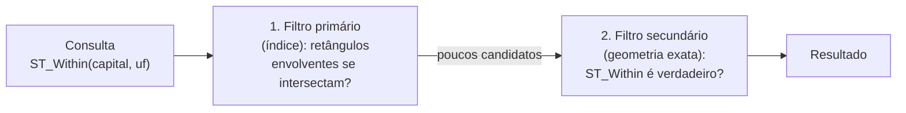

# Operações e Indexação Espacial

As consultas espaciais se baseiam em relacionamentos de vários tipos — **topológicos**, **métricos** e **direcionais**. Neste capítulo veremos como o PostGIS implementa essas operações sobre geo-objetos e como os **índices espaciais** tornam as consultas rápidas.

---

## 🗂️ Preparando os dados

Para os exemplos, usaremos no banco `curso` três tabelas:

**1. Unidades federativas.** Importe o arquivo [BR_UF.zip](../dados/BR_UF.zip) (SIRGAS 2000, EPSG:4674). A forma mais simples é pelo QGIS, como veremos no [Capítulo 16](16_integracao_qgis.md). Pela linha de comando, o utilitário `shp2pgsql`, instalado com o PostGIS, converte um *shapefile* em comandos SQL:

```bash
# descompacte o BR_UF.zip e, na mesma pasta:
shp2pgsql -s 4674 -I -W UTF-8 BR_UF.shp public.uf | psql -h localhost -U postgres -d curso
```

O parâmetro `-s` informa o SRID, `-I` cria o índice espacial e `-W` indica a codificação dos atributos. A tabela `uf` terá as colunas `gid` (chave primária), `cd_uf`, `nm_uf`, `sigla_uf`, `nm_regiao`, `area_km2`, `cd_regiao` e `geom`. No Windows, a mesma importação pode ser feita pela interface gráfica *PostGIS Shapefile Import/Export Manager*.

**2. Capitais** (algumas, com coordenadas aproximadas):

```sql
CREATE TABLE capital (
  id   serial PRIMARY KEY,
  nome varchar(40),
  geom geometry(Point, 4674)
);

INSERT INTO capital (nome, geom) VALUES
  ('São Luís',  'SRID=4674;POINT(-44.3028 -2.5307)'),
  ('Teresina',  'SRID=4674;POINT(-42.8019 -5.0892)'),
  ('Belém',     'SRID=4674;POINT(-48.5044 -1.4558)'),
  ('Fortaleza', 'SRID=4674;POINT(-38.5267 -3.7319)'),
  ('Palmas',    'SRID=4674;POINT(-48.3336 -10.1844)'),
  ('Brasília',  'SRID=4674;POINT(-47.8825 -15.7942)');
```

**3. Uma ferrovia** — um traçado **ilustrativo**, simplificado, entre Parauapebas (PA) e São Luís (MA):

```sql
CREATE TABLE ferrovia (
  id   serial PRIMARY KEY,
  nome varchar(60),
  geom geometry(LineString, 4674)
);

INSERT INTO ferrovia (nome, geom) VALUES
  ('Trecho ilustrativo Parauapebas–São Luís',
   'SRID=4674;LINESTRING(-49.90 -6.07, -48.45 -5.35, -47.49 -5.53,
                         -46.20 -4.40, -45.10 -3.60, -44.35 -2.57)');
```

!!! note "Dados didáticos"
    As geometrias das UFs foram simplificadas para reduzir o tamanho do arquivo, e a ferrovia é um traçado aproximado. Os números obtidos nos exemplos servem para aprender as operações, não como informação oficial.

---

## 🧭 Categorias de operações

Rigaux, Scholl e Voisard (2002) classificam as operações sobre geo-objetos em sete categorias:

| Categoria | Entrada → saída | Exemplos no PostGIS |
|---|---|---|
| Unária booleana | geometria → verdadeiro/falso | `ST_IsValid`, `ST_IsEmpty`, `ST_IsClosed` |
| Unária escalar | geometria → número | `ST_Area`, `ST_Length`, `ST_Perimeter`, `ST_NPoints` |
| Unária espacial | geometria → geometria | `ST_Buffer`, `ST_Centroid`, `ST_Envelope`, `ST_Transform` |
| Binária booleana (relacionamento espacial) | duas geometrias → verdadeiro/falso | `ST_Intersects`, `ST_Contains`, `ST_Touches`, `ST_DWithin` |
| Binária escalar | duas geometrias → número | `ST_Distance` |
| Binária espacial | duas geometrias → geometria | `ST_Intersection`, `ST_Union`, `ST_Difference` |
| N-ária espacial | várias geometrias → geometria | `ST_Union` (agregação), `ST_Collect` |

Os **relacionamentos espaciais** (binários booleanos) podem ainda ser:

- **topológicos** — não se alteram com translação, rotação ou mudança de escala (ex.: *contém*, *toca*, *cruza*);
- **direcionais** — expressam uma noção de direção (ex.: *acima*, *ao norte de*);
- **métricos** — expressam a noção de distância (ex.: *a menos de 100 km de*).

A especificação *Simple Features for SQL* define as operações que os bancos devem oferecer, e o PostGIS implementa **centenas** delas, com o prefixo `ST_` (de *spatial type*). A documentação completa está em [postgis.net/docs](https://postgis.net/docs/reference.html).

---

## 🔄 Construindo e exportando geometrias

As operações mais básicas constroem geometrias a partir de formatos abertos — WKT, KML, GeoJSON, GML — ou as exportam para esses formatos. Dado o contorno da UFMA inserido no [Capítulo 14](14_tipos_espaciais.md), podemos exportá-lo em KML:

```sql
SELECT ST_AsKML(geom) FROM ufma WHERE fid = 1;
```

```xml
<Polygon><outerBoundaryIs><LinearRing><coordinates>-44.3109882,-2.5559354
-44.3151081,-2.5611445 -44.3142283,-2.5644456 -44.3111169,-2.5650244
-44.307555,-2.5639312 -44.3069541,-2.5583149 -44.3031776,-2.5551423
-44.3058813,-2.5504263 -44.3109882,-2.5559354</coordinates></LinearRing>
</outerBoundaryIs></Polygon>
```

| Função de saída | Retorna |
|---|---|
| `ST_AsText(geom)` | WKT, sem o SRID |
| `ST_AsEWKT(geom)` | EWKT, com o SRID |
| `ST_AsBinary(geom)` | WKB, sem o SRID |
| `ST_AsGeoJSON(geom)` | GeoJSON |
| `ST_AsKML(geom)` | KML |
| `ST_AsSVG(geom)` | caminho SVG (*path*) |

A função `ST_GeomFromText` que usamos no Capítulo 14 é um **construtor** que recebe WKT. Há construtores para outros formatos:

```sql
INSERT INTO ufma VALUES
(5, ST_GeomFromKML('<Polygon><outerBoundaryIs><LinearRing><coordinates>
      -44.3109882,-2.5559354 -44.3151081,-2.5611445 -44.3142283,-2.5644456
      -44.3111169,-2.5650244 -44.307555,-2.5639312 -44.3069541,-2.5583149
      -44.3031776,-2.5551423 -44.3058813,-2.5504263 -44.3109882,-2.5559354
    </coordinates></LinearRing></outerBoundaryIs></Polygon>'),
 'Contorno (KML)');
```

| Construtor | Entrada |
|---|---|
| `ST_GeomFromText(wkt, srid)` | WKT |
| `ST_GeomFromEWKT(ewkt)` | EWKT |
| `ST_GeomFromGeoJSON(json)` | GeoJSON |
| `ST_GeomFromKML(kml)` | KML (SRID 4326) |
| `ST_GeomFromGML(gml)` | GML |
| `ST_MakePoint(x, y)` | coordenadas numéricas (útil para planilhas com colunas de longitude e latitude) |

---

## 🔗 Relacionamentos topológicos

Em muitas aplicações é preciso identificar as relações topológicas entre os objetos: quais municípios são cruzados por um rio, quantos lotes estão dentro de uma quadra, em que estado fica cada capital.

| Função | Verdadeira quando... |
|---|---|
| `ST_Intersects(A, B)` | A e B têm **pelo menos um ponto em comum** |
| `ST_Disjoint(A, B)` | A e B **não** têm nenhum ponto em comum (o contrário de `ST_Intersects`) |
| `ST_Contains(A, B)` | nenhum ponto de B está no exterior de A, e pelo menos um ponto do interior de B está no interior de A |
| `ST_Within(A, B)` | A está dentro de B (o mesmo que `ST_Contains(B, A)`) |
| `ST_Touches(A, B)` | A e B têm pelo menos um ponto em comum, mas seus **interiores não se intersectam** (só as bordas se tocam) |
| `ST_Crosses(A, B)` | A e B têm alguns pontos interiores em comum, mas não todos — por exemplo, uma linha que atravessa um polígono |
| `ST_Overlaps(A, B)` | A e B, de mesma dimensão, se sobrepõem parcialmente |
| `ST_Equals(A, B)` | A e B representam a mesma geometria (a ordem dos vértices é ignorada) |

Em que UF fica cada capital? Uma **junção espacial**: a condição do `JOIN` é um relacionamento topológico, e não a igualdade de chaves.

```sql
SELECT c.nome, u.sigla_uf
FROM capital c
JOIN uf u ON ST_Within(c.geom, u.geom)
ORDER BY c.nome;
```

| nome | sigla_uf |
|---|---|
| Belém | PA |
| Brasília | DF |
| Fortaleza | CE |
| Palmas | TO |
| São Luís | MA |
| Teresina | PI |

Quais UFs a ferrovia atravessa?

```sql
SELECT u.sigla_uf
FROM uf u
JOIN ferrovia f ON ST_Crosses(f.geom, u.geom);
-- MA, PA, TO
```

Quantos lotes estão **dentro** da quadra Q1? (Tabelas `lotes` e `quadras` hipotéticas.)

```sql
SELECT COUNT(*)
FROM lotes lt, quadras qd
WHERE ST_Contains(qd.geom, lt.geom)
  AND qd.nome = 'Q1';
```

!!! warning "`ST_Contains` × `ST_Intersects`"
    Um lote que ultrapassa o limite da quadra **não** é contado por `ST_Contains`, mas é contado por `ST_Intersects`. Escolha o predicado de acordo com a pergunta.

Quais UFs fazem divisa com o Maranhão? A pergunta pede `ST_Touches`. Mas, ao executá-la sobre os nossos dados, o resultado é vazio!

```sql
SELECT v.sigla_uf
FROM uf ma
JOIN uf v ON ST_Touches(ma.geom, v.geom)
WHERE ma.sigla_uf = 'MA';
-- (0 linhas)
```

Isso acontece porque `ST_Touches` exige que os interiores **não** se intersectem, e as geometrias simplificadas de estados vizinhos se sobrepõem ligeiramente nas divisas. Em dados reais, pequenas imprecisões também são comuns. Uma alternativa robusta é usar `ST_Intersects`, excluindo a própria UF:

```sql
SELECT v.sigla_uf
FROM uf ma
JOIN uf v ON ST_Intersects(ma.geom, v.geom)
WHERE ma.sigla_uf = 'MA'
  AND v.sigla_uf <> 'MA';
-- PA, PI, TO
```

!!! info "O modelo de 9 interseções"
    Todos esses predicados são casos particulares do **modelo de 9 interseções** de Egenhofer, na versão estendida com dimensões (**DE-9IM**, *Dimensionally Extended 9-Intersection Model*), que compara o interior, a borda e o exterior de duas geometrias. A função `ST_Relate(A, B)` retorna a matriz completa. Veja a [documentação do PostGIS](https://postgis.net/workshops/postgis-intro/de9im.html).

---

## 📏 Operações métricas

| Função | Retorna |
|---|---|
| `ST_Area(geom)` | área de um polígono ou multipolígono |
| `ST_Length(geom)` | comprimento de uma linha |
| `ST_Perimeter(geom)` | comprimento da borda de um polígono |
| `ST_Distance(A, B)` | menor distância entre duas geometrias |
| `ST_DWithin(A, B, d)` | verdadeiro se A e B estão a uma distância de até `d` |

Lembre-se do que vimos no Capítulo 14: com o tipo `geometry`, as medidas saem **na unidade do SRC** — graus, se as coordenadas forem geográficas. Para obter metros, use `geography` ou transforme para um SRC projetado:

```sql
SELECT b.nome,
       round(ST_Distance(a.geom, b.geom)::numeric, 3) AS graus,
       round((ST_Distance(a.geom::geography, b.geom::geography) / 1000)::numeric, 1) AS km
FROM capital a, capital b
WHERE a.nome = 'São Luís' AND b.nome <> 'São Luís'
ORDER BY km;
```

| nome | graus | km |
|---|---:|---:|
| Teresina | 2.966 | 328.4 |
| Belém | 4.337 | 482.3 |
| Fortaleza | 5.900 | 655.6 |
| Palmas | 8.650 | 956.6 |
| Brasília | 13.738 | 1518.6 |

Quais capitais estão a menos de 500 km de São Luís? `ST_DWithin` é a forma eficiente (usa o índice espacial) de fazer essa pergunta:

```sql
SELECT b.nome
FROM capital a
JOIN capital b ON ST_DWithin(a.geom::geography, b.geom::geography, 500000)  -- metros
WHERE a.nome = 'São Luís' AND b.nome <> a.nome;
-- Teresina, Belém
```

Área calculada e área oficial do IBGE, e perímetro, para as maiores UFs do Nordeste:

```sql
SELECT sigla_uf,
       round((ST_Area(geom::geography) / 1e6)::numeric)       AS area_calc_km2,
       round(area_km2)                                         AS area_ibge_km2,
       round((ST_Perimeter(geom::geography) / 1000)::numeric) AS perimetro_km
FROM uf
WHERE nm_regiao = 'Nordeste'
ORDER BY area_calc_km2 DESC
LIMIT 3;
```

| sigla_uf | area_calc_km2 | area_ibge_km2 | perimetro_km |
|---|---:|---:|---:|
| BA | 564795 | 564760 | 5550 |
| MA | 329646 | 329651 | 5338 |
| PI | 251756 | 251755 | 3276 |

As funções espaciais se combinam com as agregações do Capítulo 13. A área de cada região:

```sql
SELECT nm_regiao,
       round((sum(ST_Area(geom::geography)) / 1e6)::numeric) AS area_km2,
       count(*) AS ufs
FROM uf
GROUP BY nm_regiao
ORDER BY area_km2 DESC;
```

---

## ✂️ Operações que geram geometrias

| Função | Resultado |
|---|---|
| `ST_Buffer(geom, d)` | polígono com todos os pontos a até `d` da geometria |
| `ST_Intersection(A, B)` | parte comum a A e B |
| `ST_Union(A, B)` ou `ST_Union(coluna)` (agregação) | união das geometrias |
| `ST_Difference(A, B)` | parte de A que não está em B |
| `ST_Centroid(geom)` | centroide |
| `ST_Envelope(geom)` | retângulo envolvente (*bounding box*) |
| `ST_Transform(geom, srid)` | a mesma geometria em outro sistema de referência |

Qual a extensão da ferrovia em cada UF? Recortamos a linha por cada estado com `ST_Intersection` e medimos com `ST_Length`:

```sql
SELECT u.sigla_uf,
       round((ST_Length(ST_Intersection(f.geom, u.geom)::geography) / 1000)::numeric, 1) AS km
FROM ferrovia f
JOIN uf u ON ST_Intersects(f.geom, u.geom)
ORDER BY u.sigla_uf;
```

| sigla_uf | km |
|---|---:|
| MA | 449.9 |
| PA | 161.2 |
| TO | 125.3 |

Observe o padrão: `ST_Intersects` no `JOIN` seleciona os pares relevantes; `ST_Intersection` no `SELECT` calcula a geometria resultante.

Se você medir a ferrovia inteira (`SELECT ST_Length(geom::geography) / 1000 FROM ferrovia;`), obterá cerca de 769 km, e não os 736 km da soma da tabela. A diferença está no último trecho, que passa pela Baía de São Marcos: como os polígonos das UFs não incluem a água, esses quilômetros não pertencem a nenhum estado.

Outros exemplos:

```sql
-- Área (km²) de um buffer de 50 km em torno de São Luís
SELECT round((ST_Area(ST_Buffer(geom::geography, 50000)) / 1e6)::numeric)
FROM capital WHERE nome = 'São Luís';
-- 7809 (≈ π × 50²)

-- A geometria da região Nordeste, unindo as nove UFs
SELECT ST_Union(geom) FROM uf WHERE nm_regiao = 'Nordeste';
-- um MultiPolygon: o continente, as ilhas e pequenas frestas entre UFs vizinhas,
-- efeito da simplificação das geometrias (confira com ST_NumGeometries)

-- Centroide do Maranhão
SELECT ST_AsText(ST_Centroid(geom)) FROM uf WHERE sigla_uf = 'MA';
-- POINT(-45.2877... -5.0727...)

-- São Luís em SIRGAS 2000 / UTM 23S (coordenadas em metros)
SELECT ST_AsText(ST_Transform(geom, 31983)) FROM capital WHERE nome = 'São Luís';
-- POINT(577507.66 9720258.96)
```

!!! tip "`ST_Transform` e SRIDs diferentes"
    O PostGIS não compara geometrias com SRIDs diferentes: `ST_Within` entre uma geometria em 4326 e outra em 4674 gera um erro. Use `ST_Transform` para colocar ambas no mesmo sistema. Por exemplo, para as sedes municipais que estão no município de código 186, com tabelas em sistemas diferentes:

    ```sql
    SELECT DISTINCT s.nome
    FROM sedes s, municipios m
    WHERE m.id = 186
      AND ST_Within(ST_Transform(s.geom, 4674), m.geom);
    ```

---

## ⚡ Indexação espacial

Os SGBDs são conhecidos por responder rapidamente a consultas complexas — mas, para isso, os dados precisam estar **indexados** de modo eficiente. As estruturas de índice dos bancos convencionais (como a árvore B, ou *B-tree*) servem para dados ordenáveis, como números e textos, mas não para dados espaciais: não existe uma ordem "natural" entre polígonos.

Os índices espaciais se baseiam no **retângulo envolvente** (*bounding box*) de cada geometria. Uma consulta espacial é resolvida em duas etapas:



O filtro primário é muito rápido e descarta a maioria das geometrias; o cálculo exato, mais custoso, só é feito para os candidatos que sobram. O PostGIS implementa seus índices espaciais sobre a estrutura **GiST** (*Generalized Search Tree*) do PostgreSQL, que funciona como uma **R-tree**. A sintaxe é:

```sql
CREATE INDEX nome_do_indice ON nome_tabela USING GIST (coluna_geometrica);
```

Por exemplo:

```sql
CREATE INDEX capital_geom_gix ON capital USING GIST (geom);
CREATE INDEX ferrovia_geom_gix ON ferrovia USING GIST (geom);
```

(A tabela `uf` já ganhou um índice, porque usamos a opção `-I` do `shp2pgsql`. Ao importar pelo QGIS, a opção *Criar índice espacial* faz o mesmo.)

Os índices são usados automaticamente nas consultas com predicados espaciais como `ST_Intersects`, `ST_Contains`, `ST_Within` e `ST_DWithin`. Com `EXPLAIN`, vemos o plano de execução escolhido pelo PostgreSQL:

```sql
EXPLAIN
SELECT c.nome, u.sigla_uf
FROM capital c
JOIN uf u ON ST_Within(c.geom, u.geom);
```

```text
Nested Loop
  ->  Seq Scan on capital c
  ->  Index Scan using uf_geom_idx on uf u
        Index Cond: (geom ~ c.geom)
        Filter: st_within(c.geom, geom)
```

A linha `Index Cond` é o filtro primário (o operador `~` testa se um retângulo envolvente contém o outro), feito com o índice; a linha `Filter` é o filtro secundário, com a geometria exata.

!!! tip "Quando o índice faz diferença"
    Com 27 UFs, a diferença é imperceptível. Com os 5.570 municípios brasileiros e milhões de pontos (focos de queimada, registros de ocorrência), uma consulta sem índice pode levar minutos; com índice, segundos. **Crie sempre um índice espacial** nas colunas de geometria das tabelas grandes.

---

## 📝 Síntese

- As operações espaciais podem ser **unárias**, **binárias** ou **n-árias**, e retornar valores **booleanos**, **escalares** ou **geometrias**.
- **Junções espaciais** usam predicados topológicos (`ST_Intersects`, `ST_Contains`, `ST_Within`...) como condição.
- Medidas em metros exigem `geography` ou um SRC projetado.
- Índices **GiST** aceleram as consultas pelo filtro dos retângulos envolventes.

## ✏️ Exercícios

1. Considere as tabelas `bairro(codigo integer PRIMARY KEY, bairronm varchar(20), geom geometry(POLYGON, 0))` e `lotes(codigo integer PRIMARY KEY, lotenm varchar(20), geom geometry(POLYGON, 0))`. Escreva a consulta que retorna todos os lotes localizados dentro do bairro Turu.
2. Liste as UFs da tabela `uf` cuja área ultrapassa 500.000 km², calculada com `geography`.
3. Quais capitais da tabela `capital` estão a mais de 1.000 km de Brasília?
4. Qual a diferença entre `ST_Intersects` e `ST_Intersection`? Dê um exemplo de uso de cada uma na mesma consulta.
5. Crie um *buffer* de 100 km em torno da ferrovia e descubra quais capitais estão dentro dele.
6. Explique, com suas palavras, o filtro primário e o filtro secundário de uma consulta espacial indexada.
