# Integração com o QGIS

Como vimos no [Capítulo 10](10_introducao_bd.md#arquiteturas-de-bancos-de-dados), um SGBD usa a arquitetura cliente/servidor. Na integração com um SIG, o **SIG é o cliente** e o **PostgreSQL/PostGIS é o servidor**. Neste capítulo, conectaremos o QGIS ao banco, importaremos camadas, faremos consultas espaciais a partir do SIG e veremos que o mesmo banco pode ser usado por outros SIGs.

---

## 🔌 Conectando a um banco de dados

Dado um banco de dados já criado (por exemplo, o `curso` do [Capítulo 12](12_instalacao.md)), o primeiro passo é criar uma **conexão** entre o QGIS (cliente) e o SGBD (servidor). Há vários caminhos para isso no QGIS; o mais simples é pelo painel **Navegador**: clique com o botão direito no item **PostgreSQL** (em versões antigas, **PostGIS**) e escolha **Nova Conexão...**

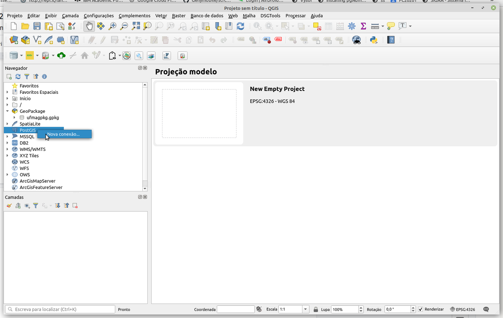

Na janela que se abre, informe:

- **Nome:** um nome que facilite encontrar a conexão no futuro (ex.: `curso-local`);
- **Host:** o endereço do servidor — `localhost` se o SGBD estiver no mesmo computador;
- **Porta:** `5432`;
- **Banco de dados:** o nome de um banco **já existente** (ex.: `curso`);
- **Autenticação:** na aba *Básico*, o usuário (`postgres`) e a senha. Marque *Armazenar* se não quiser digitá-los a cada vez.

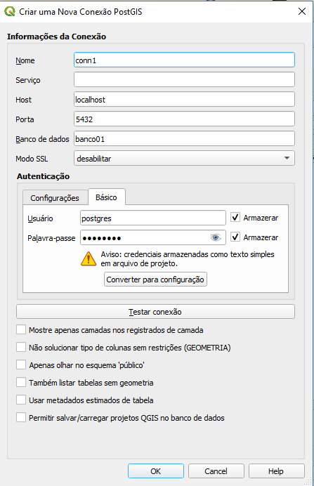

Clique em **Testar Conexão**. Se tudo estiver certo, a mensagem de sucesso aparece e a conexão passa a ser listada no Navegador, com os esquemas e as tabelas do banco. As tabelas espaciais (como `uf` e `capital`, do Capítulo 15) podem ser arrastadas para o mapa como qualquer camada.

!!! warning "Problemas comuns de conexão"
    - *Connection refused*: o servidor não está em execução, ou a porta está errada.
    - *password authentication failed*: usuário ou senha incorretos.
    - *database "..." does not exist*: o banco precisa ser criado antes (no pgAdmin ou com `CREATE DATABASE`).
    - A tabela aparece, mas sem geometria: verifique se o PostGIS foi ativado **nesse** banco (`CREATE EXTENSION postgis;`).

---

## 📥 Importando e visualizando dados vetoriais

Com a conexão criada, podemos inserir dados a partir de formatos de intercâmbio — em vez de digitar `INSERT`s, como fizemos no Capítulo 14.

**1. Crie um esquema.** Um **esquema** (*schema*) é uma "pasta" dentro do banco, que agrupa tabelas. É uma boa prática inserir os dados em um esquema diferente do `public`, que o PostgreSQL e o PostGIS usam para metadados (como a `spatial_ref_sys`). Clique com o botão direito na conexão e escolha **Novo Esquema...**; crie o esquema `brasil`:

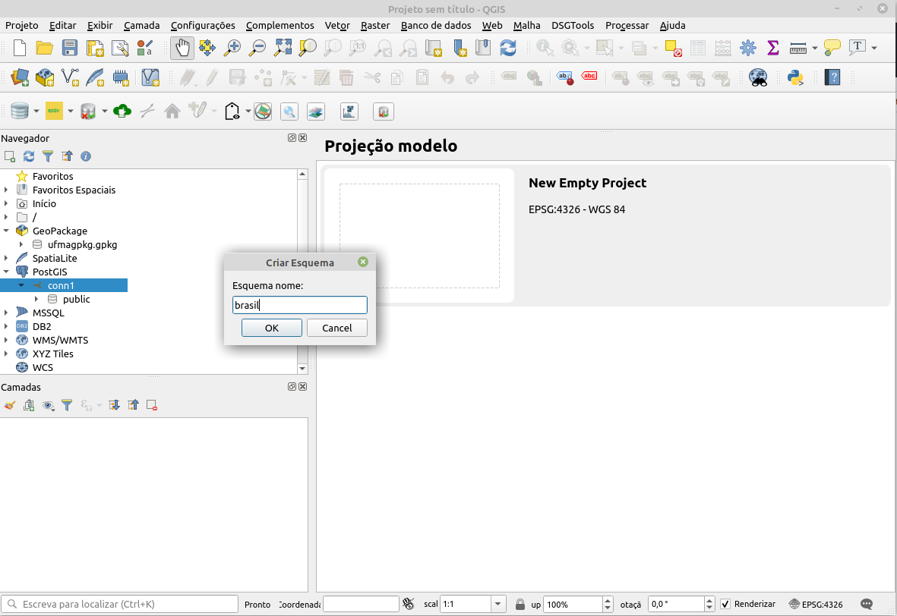

O mesmo pode ser feito em SQL:

```sql
CREATE SCHEMA brasil;
```

**2. Abra o Gerenciador de Banco de Dados.** No menu **Banco de Dados → Gerenciador BD...**, expanda o provedor PostGIS, a conexão criada e selecione o esquema `brasil`:

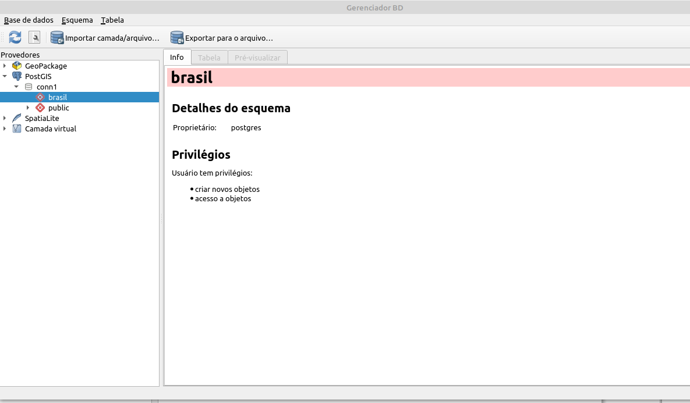

**3. Importe a camada.** Clique no botão **Importar camada/arquivo**. Na janela, escolha a camada de entrada (um arquivo *shapefile* ou uma camada já aberta no projeto — aqui, os municípios do Brasil) e preencha as opções:

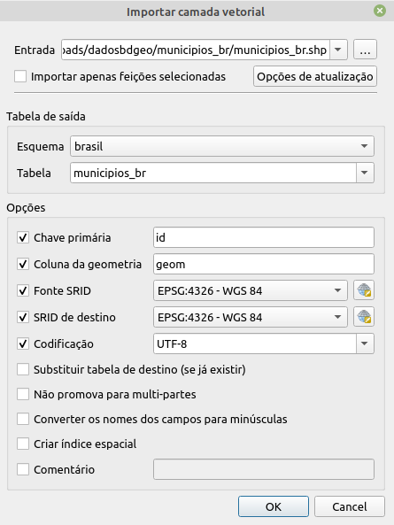

- **Esquema** e **Tabela**: o destino (`brasil.municipios_br`);
- **Chave primária** e **Coluna de geometria**: os nomes das colunas (ex.: `id` e `geom`);
- **SRID de origem** e **SRID de destino**: o SRC dos dados e o SRC em que serão gravados — se forem diferentes, o QGIS faz a transformação;
- **Codificação**: normalmente `UTF-8`;
- **Criar índice espacial**: marque sempre.

**4. Visualize.** Após a importação, a nova tabela aparece no Gerenciador, com informações sobre o tipo de geometria, o SRID, o número de registros e os campos. Um duplo clique (ou arrastar para o mapa) adiciona a camada ao projeto.

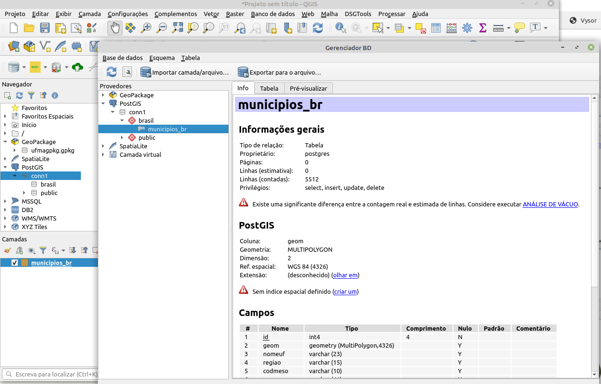

!!! tip "Outra forma: a ferramenta de processamento"
    Na **Caixa de Ferramentas de Processamento**, o algoritmo *Banco de dados → Exportar para PostgreSQL* faz a mesma importação e pode ser executado em lote para vários arquivos.

---

## 🧮 Consultas SQL a partir do QGIS

O Gerenciador de Banco de Dados tem uma **janela SQL** (botão *Janela SQL*, ou `F2`), em que podemos executar qualquer consulta — inclusive as consultas espaciais do [Capítulo 15](15_operacoes_espaciais.md) — e **carregar o resultado como uma nova camada**. Por exemplo, as UFs atravessadas pela ferrovia, com a extensão da ferrovia em cada uma:

```sql
SELECT u.gid, u.sigla_uf,
       ST_Length(ST_Intersection(f.geom, u.geom)::geography) / 1000 AS km,
       u.geom
FROM uf u
JOIN ferrovia f ON ST_Intersects(f.geom, u.geom);
```

Execute a consulta e marque **Carregar como nova camada**, indicando a coluna com valores únicos (`gid`) e a coluna de geometria (`geom`). O resultado aparece no mapa como uma camada comum, que pode ser estilizada, rotulada ou exportada.

!!! info "Camadas virtuais e o filtro de camadas"
    Duas outras formas de usar SQL no QGIS: o **Construtor de consultas** (*botão direito na camada → Filtrar...*), que aplica uma condição `WHERE` à camada, e as **camadas virtuais** (*Camada → Adicionar Camada → Adicionar/Editar Camada Virtual*), que permitem consultas SQL espaciais até sobre arquivos *shapefile* e GeoPackage.

---

## 🔄 Integrando com outros SIGs

Uma vantagem de usar um banco de dados geográfico como o PostGIS é poder acessar **os mesmos dados** a partir de **diferentes SIGs**, já que eles não estão em um formato específico de um programa. O **TerraView**, desenvolvido pelo INPE, é um exemplo:

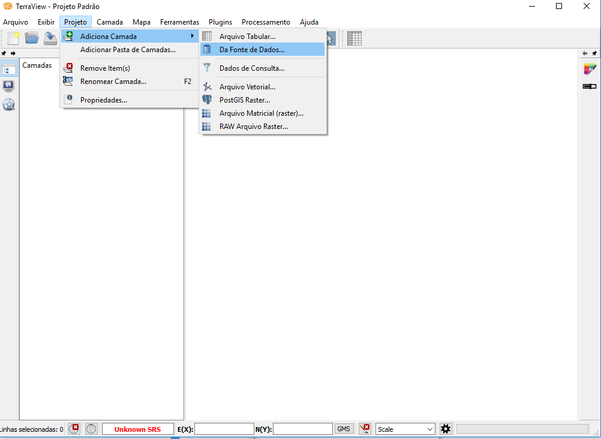

Na tela principal, adiciona-se uma camada pelo menu **Projeto → Adicionar Camada → Da Fonte de Dados...**. Na janela *Seletor de Fonte de Dados*, seleciona-se **PostGIS**, e a janela de conexão pede as mesmas informações que o QGIS: servidor, porta, usuário, senha e banco de dados.

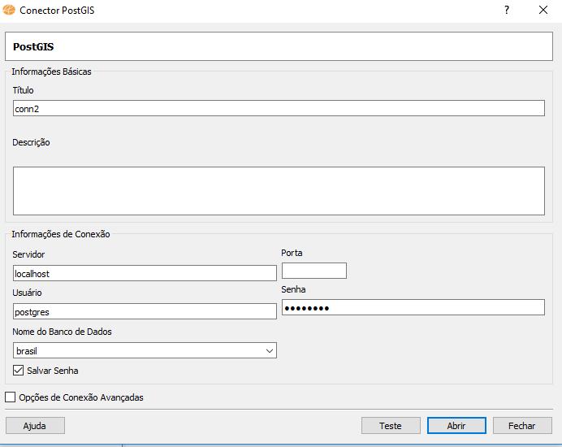

Configurada a conexão, o mesmo dado importado pelo QGIS é exibido no TerraView:

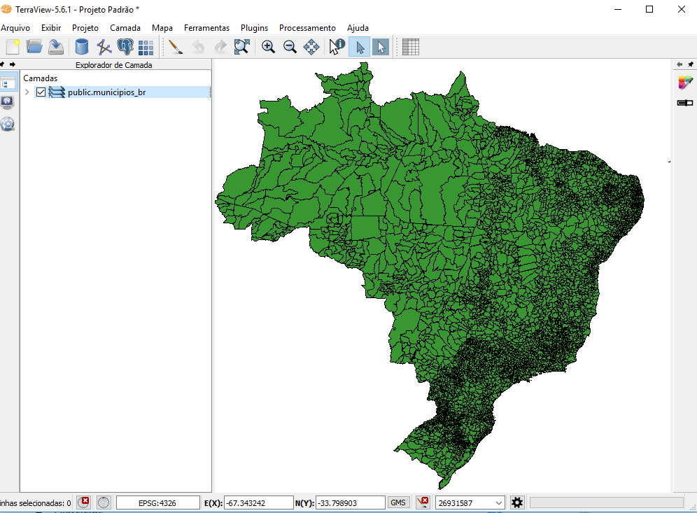

O mesmo vale para o ArcGIS, o gvSIG, o GeoServer (que publica os dados como serviços *web* WMS/WFS) e para bibliotecas de programação, como o GeoPandas (Python) e o `sf` (R). O banco de dados passa a ser o **ponto central** dos dados geográficos de uma instituição.

---

## 💡 Dica: relatório de valores únicos de um *raster*

Embora esta parte trate de dados vetoriais, o QGIS também processa dados matriciais — por exemplo, imagens exportadas do Google Earth Engine na Parte 1. Uma tarefa comum é contar quantos pixels há de cada classe em uma imagem classificada. No menu **Processamento**, abra a **Caixa de Ferramentas** e pesquise por *raster layer unique*:

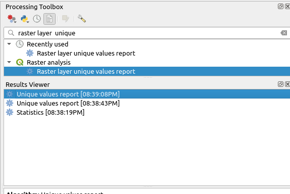

Na caixa de diálogo, selecione o *raster* e clique em **Executar**:

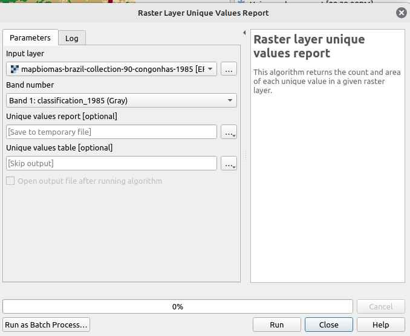

O resultado é um documento HTML; clique no *link* para abri-lo:

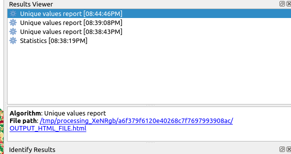

O relatório lista cada valor, a quantidade de pixels e a área correspondente:

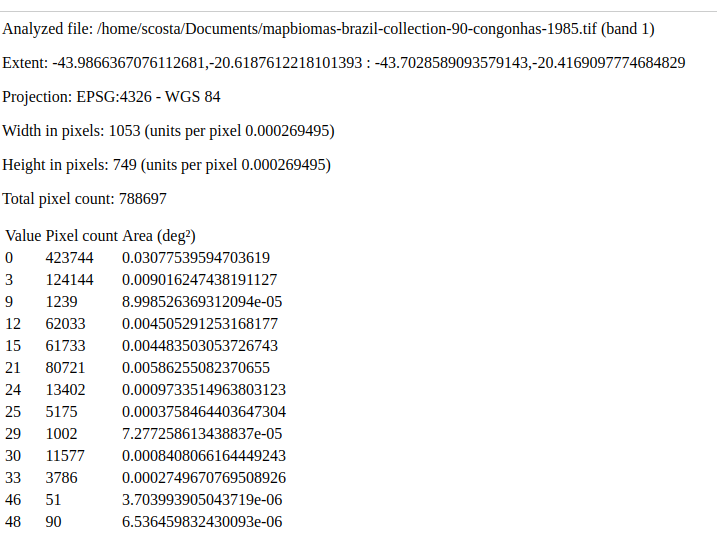

Saiba mais sobre a Caixa de Ferramentas de Processamento no [manual do QGIS](https://docs.qgis.org/latest/pt_BR/docs/user_manual/processing/toolbox.html).

---

## 📝 Síntese

- No QGIS, uma **conexão** PostgreSQL/PostGIS informa servidor, porta, banco e credenciais.
- Organize os dados em **esquemas** e importe camadas pelo **Gerenciador BD**, sempre criando o **índice espacial**.
- A **janela SQL** executa consultas espaciais e carrega o resultado como camada.
- Um banco geográfico permite que **vários SIGs** e usuários acessem os mesmos dados.

## ✏️ Exercícios

1. Explique as duas formas de integrar bancos de dados geográficos e sistemas de informação geográfica e por que a arquitetura integrada favorece o uso de vários SIGs.
2. Crie uma conexão do QGIS com o banco `curso`, importe o arquivo [BR_UF.zip](../dados/BR_UF.zip) para um esquema `brasil` e crie um mapa categórico por região.
3. Pela janela SQL, carregue como camada apenas as UFs que fazem divisa com o seu estado.
4. Conecte o QGIS ao banco de um colega (peça ao professor para liberar o acesso pela rede). O que precisa mudar na conexão?
